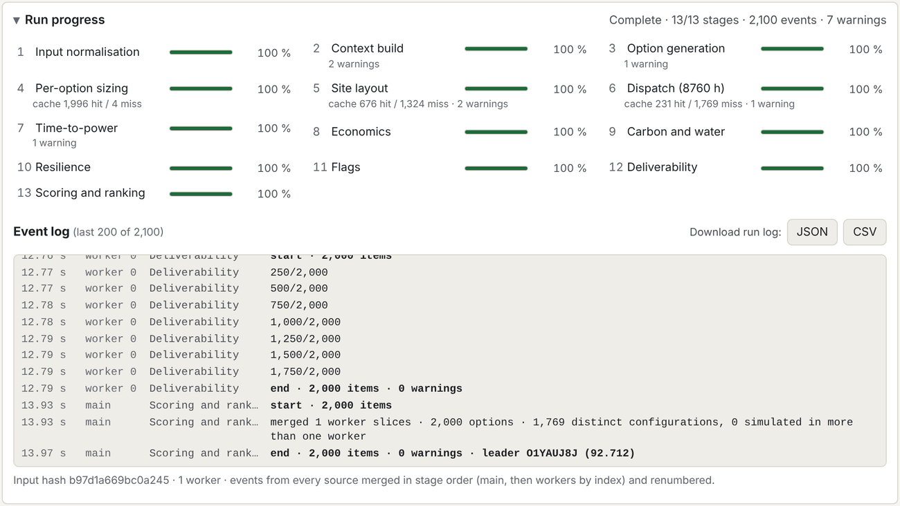
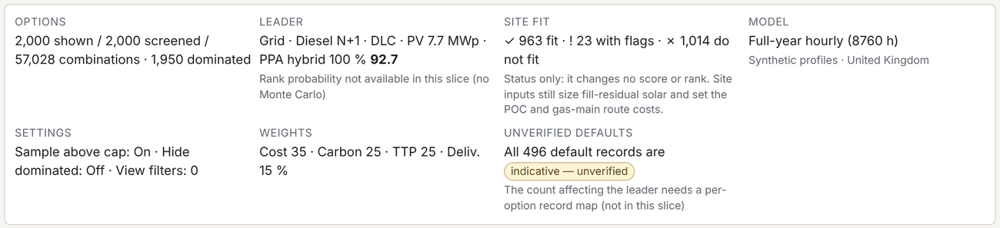

# Part I. Getting started {#part1 .part}

This part explains what the tool is for, how to get it running on a Windows computer, how to do a first run, and what is on the screen.

# 1. What the tool does {#ch1}

## The question it answers

A data centre campus needs a lot of electricity, reliably, from the day each building opens. At concept stage the design team has to choose an energy strategy long before anything is certain: wait for a grid connection or bridge with on-site generation; which backup power; whether to add solar, batteries or a power purchase agreement; which cooling approach. Each choice affects cost, carbon, how soon the site can take load, and how hard the scheme will be to deliver.

The tool answers: **for this site, which energy strategies are worth taking forward, and what do you give up with each?**

## How it answers it

For each run the tool:

1. **Builds the options.** It combines the values of up to 20 design choices (grid strategy, bridging supply, firm on-site generation, backup technology, redundancy, fuel storage, cooling, heat rejection, solar, wind, batteries, PPAs and others) into every logically possible combination, adds eleven reference strategies called archetypes, and, if there are more than 2,000, picks a spread-out sample of 2,000.
2. **Sizes each option with the same rules.** Backup generators from the critical load, fuel tanks from the autonomy hours, solar from the free roof and ground, batteries from the design load, and so on. No option is tuned by hand.
3. **Simulates every hour of every year.** For each option it works out, hour by hour over 8,760 hours a year, where each megawatt-hour comes from: solar, wind, the PPA, the battery, on-site plant or the grid, and how much demand cannot be met.
4. **Costs it.** It builds a year-by-year cost ledger over the evaluation period (20 years by default) and works out the net present cost and the levelised cost of energy.
5. **Works out carbon and water.** Location-based and market-based carbon, the share of carbon-free energy matched hour by hour, and water use.
6. **Checks requirements.** Does the backup meet the resilience requirement? (and, on the Beta Site tab, does the plant fit on the site?)
7. **Raises flags.** Grid capacity binding, permitting thresholds, fuel availability, targets missed and so on.
8. **Scores and ranks.** Each option gets four scores (cost, carbon, time-to-power and deliverability), each from 0 to 100 relative to the other options, and a weighted overall score. Options are ranked by that score.

A full run of 2,000 options takes about 15 to 20 seconds on a typical laptop.

## The principles behind it

These come from the design brief and the walkthrough, and they explain much of the tool's behaviour.

- **Use whatever you know.** Some inputs are always known (location, site area); some sometimes (the grid offer, the IT load); some rarely. Every input has a default, and you can run with nothing but a location and a site area. *Agreed:* every value you did not enter is flagged on each option that uses it, with its source.
- **Flag, don't enforce.** Constraints are reported, never used to hide or reject options. An option whose demand exceeds the grid connection keeps its place in the ranking; the shortfall is shown as unmet load and flagged. You decide what is acceptable.
- **Same rules for every option.** Every option is sized by the same rules before any check is made, so the comparison is fair.
- **Every number can be traced.** Each option carries plain-English sizing sentences, a year-by-year ledger and a list of flags; every run writes a log of every stage.
- **Private and offline.** The program runs entirely on your computer. It makes no network connection and needs no account.

## What it is not

The tool does not replace design. In particular it does not:

- do electrical studies (load flow, fault levels, harmonics, protection) or model anything faster than one hour (for example AI training load swings of seconds);
- design the cooling plant: cooling is represented by a simple model of power use against outdoor temperature;
- make permitting determinations: permitting flags are screening proxies based on EU thresholds;
- replace a financial model: there is no tax, debt, inflation or revenue modelling beyond simple export income;
- produce a site layout for planning: the Site tab (Beta) is a concept-stage proxy.

## Who it is for

The agreed audience is **data centre consultancies in general**: senior engineers running option studies, often live in workshops with clients, with results exported for clients and investors.

# 2. Getting the program and opening it {#ch2}

## The Windows program

::: {.callout .built}
**Built.** The Windows program is built automatically on GitHub. It is not code-signed yet, and there is no installer: you unzip a folder and run the program from it.
:::

To get it:

1. Sign in to GitHub and open the repository's **Actions** page, then **Desktop builds**.
2. Open the latest run with a green tick (or press **Run workflow** to make a fresh one).
3. Under **Artifacts**, download **desktop-win32-x64** (about 151 MB).
4. GitHub wraps the download in a second zip file: unzip both.
5. Open the folder and run **Concept Energy Optioneering.exe**. Keep the folder together: the program needs the files next to it.

The first time, Windows shows "Windows protected your PC" (this is Windows SmartScreen, which warns about programs that are not signed with a paid certificate). Choose **More info**, then **Run anyway**. Signing can be added later without changing the program.

What the program does and does not do:

- It runs the model in a locked-down window: the page has no access to your files except through the save dialog, and it cannot run other programs.
- It **makes no network connection at all**. This was checked by tracing every process of the program during start-up and a full run. Links to websites open in your normal browser.
- It does not update itself. To update, download a newer build.
- It remembers its window size and position. Opening it a second time brings the open copy to the front.

## The single-file version

::: {.callout .built}
**Built.** The same app is also built as one HTML file, `energy-tool-single-file.html`. Open it in Chrome, Edge or Firefox; it works offline with no setup.
:::

The single file is handy for a quick look or for testing. It runs the model in background threads (Web Workers) where the browser allows; if it cannot, it runs on the main thread in short slices and says so in the status line. That is slower but gives the same results.

## Phone

The walkthrough dropped the phone version. An earlier private link for phones still exists but is no longer maintained.

## What your computer needs

- Windows 10 or 11, 64-bit.
- The brief's reference machine is a four-core laptop from 2020 or later with 16 GB of memory. The model splits the options between background threads: one per processor core minus one, at least one and at most eight.
- About 370 MB of disk space for the unzipped program (the download is about 151 MB). *Agreed:* the offline map will add to this (its size is still to be checked; see chapter 52).

## Privacy

Nothing you enter leaves your computer. There is no account, no telemetry and no update check. Files are only written when you save them (today the run log; agreed, the PDF report).

# 3. Your first run {#ch3}

This chapter takes you from opening the program to reading a result. It follows the current version and notes where the agreed design differs.

## Step 1. Open the program

The program opens with the **T1 example** loaded and starts a run straight away. While it runs, the **Run progress** panel shows the 13 stages filling up. After 15 to 20 seconds the results appear.

## Step 2. Enter your site

Press **Inputs** at the top to open the inputs panel. At minimum, enter:

- **Location.** Today: latitude and longitude. *Agreed:* click on a map to drop a pin (chapter 14).
- **Site area** in hectares.
- **IT load at full build** in MW, and its phasing if you know it. *Agreed:* if you do not know it, the tool estimates it from the site area (chapter 16).
- **Grid**: import capacity available now, at full connection, and the full-connection date. *Agreed:* each can be "Not known", in which case a country default is used and flagged (chapter 17).

Every field you leave alone keeps its default. In the current version every default shows a yellow **unverified** tag; required fields filled in with the T1 example values show a grey **required · example value** tag.

## Step 3. Let it run

You do not press a Run button. **A new run starts by itself about a third of a second after you finish editing a field.** If you change something during a run, the old run is stopped and a new one starts, so stale results never appear.

Some changes do not need a new run. Changing the **weights**, the cost or carbon metric used for scoring, or "rank requirement-compliant options first" only re-scores the options already run. That takes a fraction of a second.

## Step 4. Read the header

The header strip at the top of the results summarises the run: how many options were shown, screened and possible; the leader and its score; the site-fit counts; the model; key settings; the weights; and the count of unverified defaults.

## Step 5. Look at the best options

*Current version:* the **Options** tab lists all screened options in rank order, with their scores and main figures.

*Agreed:* the first results screen shows the **top five options** as cards, each with its scores, cost, carbon, resilience, capex, main flags, the assumed defaults it relies on, and up to three pros and three cons judged against the other options (chapter 22).

## Step 6. Open the leader

Select the leader's name to open its detail: scores, economics, carbon and energy, time-to-power, resilience, deliverability, the plain-English sizing sentences, its flags and its full list of choices (chapter 23). Read the flags first: they tell you what to worry about.

## Step 7. See the trade-offs

The **Trade-offs** tab plots every option on two axes: by default cost against carbon. Options in the bottom-left corner are cheap and clean. The line joining the best of them is the trade-off frontier (chapter 24).

## Step 8. Look inside

- The **Dispatch** tab shows how one option is supplied, month by month and hour by hour, with an energy balance for each year (chapter 26).
- The **Sensitivity** tab re-runs one option with each key input set low and high, to show which assumptions matter most (chapter 27).

## Step 9. Change the priorities

Move the **weights** (cost, carbon, time-to-power, deliverability) or pick a preset such as "Lowest carbon". The ranking updates at once. *Agreed:* the impact of each weight change is described live.

## Step 10. Save the result

*Current version:* save the run log (JSON or CSV) from the Run progress panel.

*Agreed:* export one PDF report with the inputs first and the results after (chapter 29).

# 4. A tour of the screen {#ch4}

## The top bar

- **Concept energy optioneering**: the program's title.
- **Inputs** / **Close inputs**: opens and closes the inputs panel.
- **Load T1 example**: replaces your inputs with the T1 example.
- **Reset to defaults**: replaces your inputs with the defaults (required fields keep the example values, marked as such).
- **Save study** and **Open study…**: save your inputs to a study file and open one again (built 24 October 2026; chapter 29).

::: {.callout .built}
**Built 24 October 2026** (work package 15, OPEN-QUESTIONS 27). A study is saved as one JSON file and reopened from it: chapter 29 says what it holds and what happens when the tool has changed since it was saved.
:::

## The inputs panel

The panel has numbered sections, each covered by a chapter of Part III:

| Section | Chapter |
|---|---|
| 1 · Project and location | 14 |
| 2 · Site | 15 |
| 3 · Load and building | 16 |
| 4 · Utilities and grid | 17 |
| 5 · Requirements and priorities | 18 |
| 6 · Choices (C1–C20) | 20 |
| Run and dispatch settings | 19 |

*Agreed:* economics gets its own section (evaluation periods, WACC, carbon and gas prices, escalation, grid connection costs, contracted grid capacity, revenue options), and a new section covers load shape, flexibility and batteries (chapters 16 to 19).

## The results area

From top to bottom:

1. **Header strip**: the run at a glance.
2. **Status line**: "Screening options…" with the current stage while running; then "Last run 14 s on 3 workers", for example. Warnings appear here too (for example "Web Workers unavailable: running on the main thread instead").
3. **Run progress**: the 13 stages and the event log (chapter 21).
4. **Run summary**: how the options were generated, the compatibility rules, the values not generated, the dispatch settings, and run-level flags (chapter 21).
5. **Results tabs**: Options, Trade-offs, Site, Dispatch, Sensitivity.

*Agreed:* the results open on the top-five cards; Compare (up to three options side by side) is added; the Site tab is hidden unless turned on as a Beta feature in the general settings; the tornado measures LCOE by default.

## Keyboard and accessibility

The program is built to the WCAG 2.2 AA accessibility standard (the brief's choice): every chart has a table alternative, tabs and charts work with the keyboard (arrow keys, Home and End), status colours always come with an icon and words, and "Skip to results", "Skip to trade-offs chart" and "Skip to site plan" links appear at the top for keyboard users. A full screen-reader walk-through has not been done yet.
