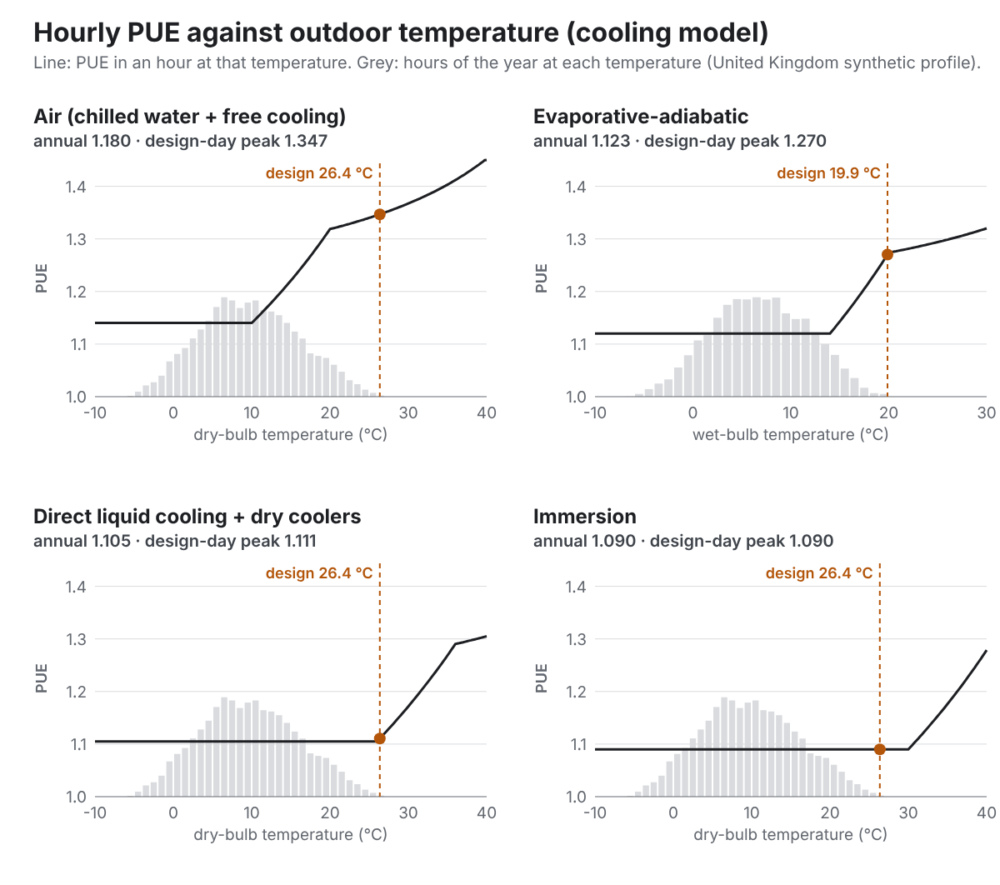
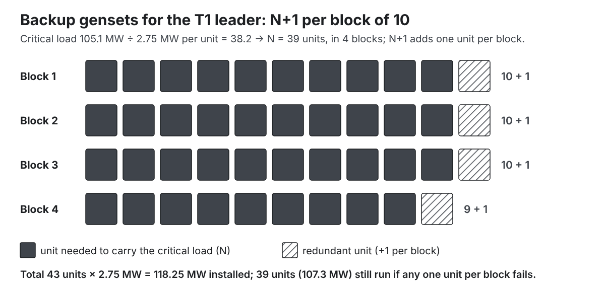
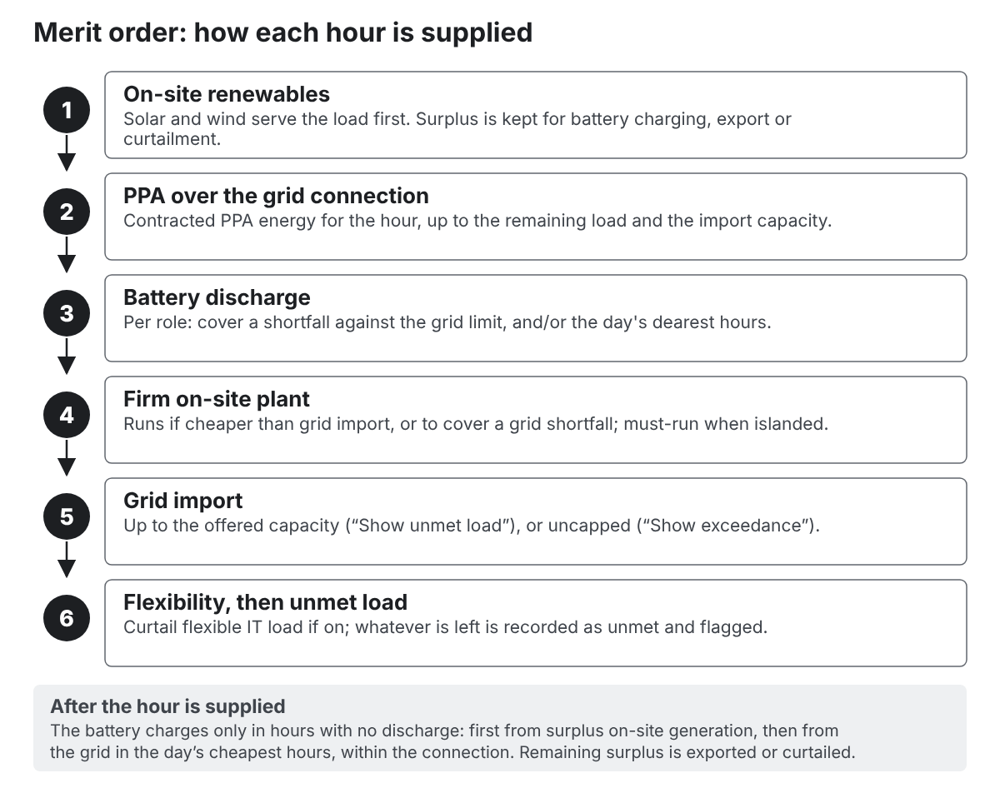
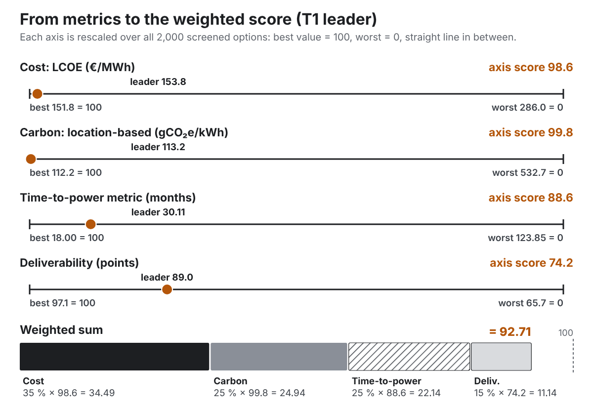

# Part II. Concepts you need {#part2 .part}

This part explains the engineering and financial ideas the tool is built on, in plain words. Each chapter ends with how the tool represents the idea; Part IV then gives the exact rules.

# 5. Data centre power: IT load, facility load and PUE {#ch5}

## IT load

The **IT load** is the power drawn by the servers, storage and network equipment. It is the reason the campus exists, and everything else is sized from it.

Two numbers matter:

- **Installed IT** (sometimes called contracted or critical IT capacity): the maximum IT power the halls are built for. The tool's input "IT load at full build" is this number, for the whole campus.
- **Utilised IT**: the IT power actually drawn on average. Servers rarely all run flat out. The tool assumes **80 % utilisation** by default for energy (how many MWh are used), but **sizes all plant for 100 %**, because the plant must cope with the halls running full.

## Phasing and ramp

Campuses are built in phases. The phasing table lists each phase's IT MW and the date it is energised. After energisation, a phase does not fill up at once: the tool assumes each phase starts at **25 %** of its IT (the owner's judgement, 22 October 2026; it was 50 % when the worked examples in Part IV were run) and rises in a straight line to 100 % over **12 months** (the "ramp"). With no phasing table, the tool assumes one phase of the full IT load on the grid full-connection date.

In the T1 example, four 25 MW phases open in July 2028, 2029, 2030 and 2031. Installed IT therefore steps up every July and ramps in between, reaching 100 MW in July 2032.

## Facility load and PUE

The **facility load** is everything the site draws from its supplies: IT, plus cooling (fans, pumps, chillers), plus electrical losses (UPS, transformers, distribution), plus ancillary loads (lighting, offices, security).

**Power Usage Effectiveness (PUE)** is the ratio of facility energy to IT energy:

::: formula
| PUE = total facility energy ÷ IT energy
:::

A PUE of 1.0 would mean no overhead at all. Published averages give a sense of scale: the Uptime Institute's 2025 global survey average was 1.54 (all ages of facility); the EU's first aggregate report under the Energy Efficiency Directive gave a weighted average of 1.36 for 776 European data centres (2023–24 data); Germany's Energy Efficiency Act (EnEfG) requires data centres opening from July 2026 to reach 1.2 or less within two years of starting operation (a draft amendment of April 2026 proposed relaxing this to 1.3). New hyperscale designs with liquid cooling aim lower still.

Two PUE numbers matter for an energy strategy:

- **Annual PUE**: the average over a year. It sets how much energy is bought, and so the cost and carbon.
- **Peak (design) PUE**: the PUE on the hottest hour, when cooling works hardest. It sets the **design load**, and so the size of the grid connection and plant.

## The loads the tool works with

The tool uses four related loads. In the T1 example (direct liquid cooling, United Kingdom profile):

| Load | Rule | T1 value |
|---|---|---|
| Design facility load | IT × (peak PUE + ancillary 2 %) | 100 × (1.111 + 0.02) = 113 MW |
| Critical load | backed % × IT × (1 + design mechanical) | 100 % × 100 × 1.051 = 105 MW |
| Average facility load | utilised IT × hourly PUE + ancillary | about 90 MW |
| Annual energy | average × 8,760 h | about 792 GWh a year |

- The **design facility load** sizes the supply: grid shortfall, bridging plant and batteries.
- The **critical load** sizes the backup: the IT plus the "essential mechanical" load (the cooling plant's fans and compressors at design conditions) that must keep running in a grid outage. Electrical losses and ancillary loads are not included.
- The **average load** and annual energy set costs and carbon.

The ancillary load is **2 % of installed IT** by default and is added on top of the PUE (it is not part of the "peak PUE" figure the tool reports).

## Load shape

Within each day, IT demand varies a little. The current version gives each workload type a gentle daily wave around the utilisation, peaking in the afternoon: ±1 % for AI training, ±4 % for mixed cloud and AI inference, ±8 % for enterprise, plus a small random wobble. The wave is scaled so that its average is exactly the utilisation.

::: {.callout .built}
**Built 23 October 2026.** The load shape is a choice: **flat** (the utilisation every hour), **daily fluctuation** (the wave above, the default; its swing can be entered), **AI training** (90 % average, with a checkpoint dip to 55 % for 1 hour every 6 hours) and **AI inference** (70 % average, a night trough at 60 % of the afternoon peak at 15:00, weekends at 90 %). The AI values are the mock-up's illustrative ones, labelled indicative — unverified, to research. Because the model works in whole hours, swings shorter than an hour (training steps and checkpoints lasting seconds) cannot be shown; the inputs say so when an AI profile is chosen. The shape changes energy, not sizing (sizing uses 100 % of IT).
:::

## Demand flexibility

Some data centres can reduce their load for short periods: deferring batch work, shifting load to another site, or running on their own batteries. This is **demand flexibility**. It can help where the grid connection is tight or prices spike.

Flexibility is a design choice (C16, off by default). When on, it can shed up to **10 % of IT** for up to **100 hours a year**.

::: {.callout .built}
**Built 23 October 2026 (OPEN-QUESTIONS 33, 34, 61).** Flexibility acts in two ways within the same limits: in **trigger hours** (grid price, grid carbon, or weather and grid stress at or above the trigger level; events of at most 4 hours with 12 hours' recovery between them) and as the **last step against a shortfall**. Every curtailed MWh costs €500 (the cost of curtailment, in the ledger). With **battery response** on, the economic battery runs the site through trigger hours before any curtailment. IT shed against a shortfall still counts as unmet for power adequacy, because the customer loses it. Notice time is recorded but not modelled (prices and carbon are known a day ahead). The run summary shows how often the trigger occurs in the profile. The synthetic price profiles peak near €215/MWh, so the default €250/MWh trigger never occurs until real price data arrives with the country set-up.
:::

# 6. Cooling and its effect on power and water {#ch6}

## Why cooling matters to the energy strategy

Cooling is the largest load after IT. Its power depends strongly on the outdoor temperature, and its peak sets the design load. The cooling approach also changes the building size (how much IT fits on each square metre), the capital cost and the water use.

## Free cooling and mechanical cooling

When outdoor air (or water cooled by it) is cold enough, heat can be rejected with fans and pumps alone: **free cooling**. When it is too warm, compressors (chillers) must work: **mechanical cooling**. Between the two there is a band where both work together.

A compressor's efficiency is its **coefficient of performance (COP)**: units of heat removed per unit of electricity. A COP of 5 means 1 MW of electricity removes 5 MW of heat. COP falls as the outdoor temperature rises.

## Dry-bulb and wet-bulb temperature

**Dry-bulb temperature** is the ordinary air temperature. **Wet-bulb temperature** is the lowest temperature water can reach by evaporating into the air; it is lower than dry-bulb, and much lower in dry weather. Evaporative (adiabatic) systems cool by evaporating water, so their performance follows the wet-bulb temperature; the other approaches follow the dry-bulb temperature.

## The four approaches in the tool

| Approach | Driven by | Full free cooling below | IT density |
|---|---|---|---|
| Air (chilled water + free cooling) | dry-bulb | 10 °C | 1.5 kW/m² |
| Evaporative-adiabatic | wet-bulb | 14 °C | 1.8 kW/m² |
| Direct liquid cooling (DLC) + dry coolers | dry-bulb | 26 °C | 4.0 kW/m² |
| Immersion | dry-bulb | 30 °C | 3.0 kW/m² |

Liquid cooling runs at much higher coolant temperatures, so it can reject heat with dry coolers on all but the hottest days, and packs more IT into each square metre of data hall ("whitespace"). It costs more to build: the tool adds €150/kW of IT for DLC and €250/kW for immersion compared with air, and subtracts €40/kW for evaporative.

## The cooling model in one picture

The tool works out the cooling power for every hour from that hour's temperature. Below the free-cooling threshold only fans run; across a band (10 K wide, 6 K for evaporative) the compressor share rises in a straight line; above the band the compressors carry the full load, with a COP that falls as the temperature rises. Electrical losses (6–7 % of IT) are added on top. The result is a PUE for each hour:

For the T1 site (United Kingdom profile, hottest hour 26.4 °C dry-bulb, 19.9 °C wet-bulb), this gives:

| Approach | Annual PUE | Design-day PUE |
|---|---|---|
| Air | 1.180 | 1.347 |
| Evaporative | 1.123 | 1.270 |
| DLC | 1.105 | 1.111 |
| Immersion | 1.090 | 1.090 |

These are design values for a new build, at the low end of published fleet averages (chapter 5). Notice how much the peak matters: an air-cooled 100 MW campus has a design load of 100 × (1.347 + 0.02) = **136.7 MW**, which is more than the T1 grid offer of 120 MW. That one fact explains much of the T1 ranking (chapter 47).

## Design temperature

The current version takes the **hottest hour of its synthetic year** as the design temperature. Engineers normally use a published design condition (for example the ASHRAE 0.4 % dry-bulb: the temperature exceeded for 0.4 % of the hours of a typical year).

::: {.callout .agreed}
**Agreed, not built yet.** The tool finds the nearest ASHRAE weather station, uses its design temperatures for the PUE, and flags that the design temperatures come from that station, not the site. Hourly weather comes from NOAA station records (cleaned by the app) or from an EPW weather file the engineer downloads and uploads. The ASHRAE data licence still has to be checked (chapter 53).
:::

## Water

**Water Usage Effectiveness (WUE)** is litres of water per kWh of IT energy. The tool uses a base WUE for each approach (0.05 L/kWh for air, 0.3 for evaporative, 0.02 for DLC and immersion), plus, for evaporative cooling, 1.8 L/kWh during the hours when the adiabatic stage runs. It flags an option if daily water use exceeds the water available (when that input is known).

## What the engineer chooses

::: {.callout .agreed}
**Agreed, not built yet.** The cooling type is always chosen by the engineer. The tool offers a typical PUE and maximum demand for each type, which the engineer can edit. Today the cooling approach is either fixed by the "Cooling approach" input or left as an open choice (C8), in which case all four are generated and compared.
:::

# 7. Resilience: backup power and redundancy {#ch7}

## Why backup

Grids fail occasionally. A data centre must ride through an outage without dropping its IT load. The usual chain is:

1. **UPS** (uninterruptible power supply): batteries that carry the critical load instantly for a few minutes.
2. **Standby generators** (gensets): start within seconds and take over from the UPS.
3. **Fuel**: enough stored on site to run the gensets for a stated time, the **autonomy** (often 24 to 72 hours).

## Redundancy

Redundancy means having more units than strictly needed, so a failure (or maintenance) does not cause an outage. Common terms:

- **N**: exactly enough units to carry the load.
- **N+1**: one spare unit. On large sites this is usually applied per group ("block") of units.
- **2N**: two complete systems, each able to carry the whole load.
- **Distributed redundant ("catcher")**: blocks share a small number of spare units that can catch any block's failure.

The tool groups backup units into **blocks of 10** (an indicative default) and applies the topology per block:

| Topology | Units the tool installs |
|---|---|
| N | N |
| N+1 | N + one per block |
| 2N | 2 × N |
| Catcher | N + one per four blocks |

where N is the number of units needed to carry the critical load.

## Fuel storage

Diesel and HVO (hydrotreated vegetable oil, a renewable diesel) are stored in bunded tanks. The tool sizes bulk storage as:

::: formula
| fuel volume = critical load × autonomy hours × fuel use per kWh
| T1: 105.1 MW × 48 h × 0.26 L/kWh = 1,311 m³ (about 1,101 tonnes)
:::

Autonomy is set in hours (12, 24, 48 or 72). The former choice "belly tanks only" was removed on 22 October 2026 (OPEN-QUESTIONS 52). Gas gensets store no fuel: they depend on the gas network staying up during a grid outage, which the tool flags.

Large fuel stores can trigger major-hazard rules (in the EU, the Seveso III directive's lower tier starts at 2,500 tonnes of petroleum products); the tool flags this.

## Other ways to provide backup

- **BESS-augmented UPS** (an emerging approach): gensets cover N only, and a large battery covers the redundancy for a set time (2 hours by default).
- **Retained bridging plant**: on-site generation installed to bridge until the grid arrives is kept and used as the backup.
- **Firm on-site generation** (CHP, fuel cells, SMR) also counts towards the firm capacity in an outage.

## Islanding

An **islanded** site runs without a grid connection. The tool's islanding requirement, when set to Yes, checks that on-site firm generation (prime and retained bridging plant) can carry the critical load.

## How the tool checks resilience

Resilience is a **requirement check, not a score**. Each option gets one of three statuses:

- **Meets**: backed load, topology and autonomy all meet the requirement.
- **Meets with flags**: meets, but depends on the gas network or uses BESS-augmented UPS.
- **Does not meet**: at least one item fails, and the failing item is named.

An option that does not meet the requirement is still scored and ranked (flag, don't enforce). You can choose to rank requirement-compliant options first (chapter 19).

The default requirement is **100 % of IT plus essential mechanical backed, N+1, 48 hours of autonomy** (indicative, judgement). The 5-minute UPS requirement is the resilience reserve battery (below).

::: {.callout .built}
**Built 23 October 2026 (work package 4).**

- Backup gensets are tested **6 hours a year per generator** (replacing 12), at a **test load of 75 %**, a separate editable input. US practice (NFPA 110) requires monthly runs of at least 30 minutes, about 6 hours a year.
- Gensets can run as **primary power** for a set number of hours a year (default 0): their N units run in the most expensive grid-price hours, and their fuel, carbon and run hours are costed.
- Batteries are split into a **resilience reserve** (always kept and never dispatched; default 5 minutes of UPS at full IT load; its battery energy is costed per building at €500/kWh, indicative) and an **economic battery** (choice C12: fixed sizes, the shortfall size, or sized to the trigger hours). Longer battery autonomy is the reserve minutes input.
:::

::: {.callout .agreed}
**Agreed, not built yet.** Autonomy can come from on-site fuel and generation, from batteries, or a combination; the engineer chooses.
:::

# 8. The energy technologies in the tool {#ch8}

This chapter describes each supply technology in plain words. The tool's cost and performance defaults for each are in chapter 35 and Appendix A; chapter 50 compares the important ones with published values.

## Maturity

Each technology carries a maturity class that feeds the deliverability score (chapter 43):

- **Commercial**: widely deployed at data centre scale.
- **Emerging**: deployed, but not yet routine at this scale (fuel cells, BESS-augmented UPS).
- **Nascent**: not yet commercially available for data centres (small modular reactors, hydrogen).

## Programme

Plant is ordered from **day one** of the project (the analysis start), in parallel with construction of the first phase (built 23 October 2026; OPEN-QUESTIONS 44, 45 and 56). Its earliest month of supply is its procurement time plus its construction time, counted from the analysis start. Only plant that needs **significant environmental permitting** first waits a **permitting allowance** of 6 months:

- **IED** (Industrial Emissions Directive): every combustion plant of an option whose total combustion thermal input (prime, bridging and backup units together) is 50 MWth or more. On a data centre campus the backup gensets alone usually pass this, so gas engines, CHP, turbines, diesel prime and rented generation are normally held.
- **Seveso**: liquid-fuel plant when the diesel/HVO store is 2,500 t or more; hydrogen plant when the hydrogen store is 5 t or more.

Onshore wind, ground-mounted solar and small modular reactors need a consent of their own, so they keep their **planning and consent months** instead. Some technologies also have an earliest calendar year (for SMR, 2035). Gas plant also waits for the gas supply date. The sizing sentences of each option give the month and how it was reached.

| Technology | Months to first supply (ordered at once) | With the permitting allowance | Maturity |
|---|---|---|---|
| Rented temporary generation | 4 | 10 | Commercial |
| Fuel cells (SOFC) | 9 | not combustion: never held | Emerging |
| Rooftop solar | 10 | — | Commercial |
| HVO-diesel prime gensets | 12 | 18 | Commercial |
| Battery storage (BESS) | 15 | — | Commercial |
| Gas reciprocating engines | 15 | 21 | Commercial |
| Gas turbines | 18 | 24 | Commercial |
| Gas CHP / trigeneration | 21 | 27 | Commercial |
| Ground-mounted solar | 21 (9 planning + 6 + 6) | — | Commercial |
| Hydrogen gensets / fuel cells | 27 | 33 | Nascent |
| Onshore wind | 54 (24 planning + 18 + 12) | — | Commercial |
| Small modular reactor | 120 (36 planning + 36 + 48), and not before 2035 | — | Nascent |

**Permitting outlook** (built 23 October 2026, OPEN-QUESTIONS 46). Every held plant, the standby gensets included, gets an outlook with its reason, to advise the client whether it can be consented and installed in time. The outlook is a judgement by technology, labelled indicative — unverified, and the same in every country until country differences are researched:

| Plant | Outlook | Reason (short) |
|---|---|---|
| Gas engines, gas turbines, CHP | uncertain | IED permit with NOx limits and an air-quality assessment; site-specific |
| Rented temporary generation | uncertain | counts towards the installation; long-running temporary plant is scrutinised |
| HVO-diesel prime gensets | unlikely | diesel running as prime power rarely consented under air-quality rules |
| Hydrogen | uncertain | Seveso regime and separation distances; few precedents |
| Standby gensets | likely | routinely permitted at data centres |

The outlook also compares the month the plant is ready with the month it is first needed: bridging plant at the first month of shortfall, a baseload prime and the standby gensets at the first month of load, a top-up plant at the first month of permanent shortfall. In T1 the standby gensets are ready at month 24 (6 + 12 + 6) but the first building is energised at month 18, so they are 6 months late in every option.

## The grid

The public grid is the default supply for most options. See chapter 9.

## Power purchase agreements (PPAs)

A **PPA** is a long-term contract to buy electricity from a specific generator (for example a wind farm) at an agreed price, the **strike price**. A data centre uses PPAs to fix part of its energy cost and to claim renewable supply. The energy is delivered over the public grid.

The tool offers five PPA shapes:

| PPA type | Hourly shape of the contracted volume | Strike (default) |
|---|---|---|
| Annual-matched solar | the solar profile | €55/MWh |
| Annual-matched wind | the wind profile | €65/MWh |
| Hybrid | half solar, half wind | €62/MWh |
| Baseload-shaped | flat | €80/MWh |
| 24/7-matched | the site's own demand | €95/MWh |

plus a shaping cost of €5/MWh on all types. **Coverage** is the share of the site's annual consumption contracted: 50, 80 or 100 %.

The tool counts PPA energy only where it is **physically delivered**: up to the remaining load in each hour, and up to the grid import capacity. Contracted volume that cannot be delivered (for example at a sunny, windy midday when the contract produces far more than the site uses) is settled financially; the tool reports that settlement separately as the "PPA hedge (not counted)" and leaves it out of the costs and scores. This rule was decided by the owner on 18 October 2026 (chapter 39).

## On-site solar

Photovoltaic panels on the data-hall roofs or on the ground. You give two areas in the Site section, and the solar choice C10 is None, Roof only or Roof + ground (built 22 October 2026, OPEN-QUESTIONS 52–54):

- **Roof area for PV.** Leave it empty and the tool uses its rule: 50 % of the roof not used by plant, at 5.5 m² per kWp. Enter an area and the tool uses that instead. An area larger than the free roof is flagged, not reduced.
- **Ground area for PV.** 0 by default, so there is no ground solar. Enter an area and the tool adds "Roof + ground" options, with ground solar at 1.2 ha per MWp.

Car-park canopies go in either area; there is no separate carport choice any more. Ground solar no longer fills the land left over after the layout, so its size never depends on the Site tab (Beta).

Solar output follows the hourly solar profile (about 950 kWh per kWp a year in the United Kingdom profile).

## Onshore wind

Wind turbines (5 MW each by default, 180 m tip height) need a lot of space: about 34 ha each for spacing (5 by 3 rotor diameters), plus buffers for topple distance (1.5 × tip height) and noise (500 m to houses). On sites of 20 ha or less, the tool does not generate wind options unless you include them.

## Battery energy storage (BESS)

Lithium-ion batteries in containers. Sized as a share of the design load (25 or 50 %) for a number of hours (1, 2 or 4), with 88 % round-trip efficiency (12 % of the energy put in is lost). Their **role** decides how they are used:

- **Peak-shave against the grid limit** (default): discharge when demand exceeds what the grid and firm plant can supply, and also in the day's most expensive hours while keeping half the energy in reserve.
- **Shifting**: buy in the cheapest hours, use in the dearest.
- **Bridging support**: discharge only to cover a shortfall.
- **Grid services**: in the current version treated like shifting (no grid-services income is modelled).

## Firm on-site generation

"Firm" means it can run whenever needed, unlike solar and wind.

- **Gas reciprocating engines** ("recips"): large gas engines, 4.5 MW units by default, 44 % efficient. Quick to start; good for bridging.
- **Gas turbines**: open-cycle or aeroderivative, 30 MW units, 38 % efficient.
- **Gas CHP / trigeneration**: gas engines whose waste heat drives absorption chillers, displacing some electric cooling. The tool credits the cooling they displace.
- **Fuel cells (SOFC)**: solid oxide fuel cells running on natural gas, 55 % efficient, with stacks replaced every 7 years. Emerging.
- **HVO-diesel prime gensets**: diesel-type gensets run as a main supply on HVO. Flagged.
- **Rented temporary generation**: hired gas gensets, paid for by the month; quick to deploy.
- **Small modular reactor (SMR)**: nascent; placed off site by default; not available before 2035 in the defaults.
- **Hydrogen gensets / fuel cells**: nascent; need a hydrogen supply (off by default) and large separation distances.

When chosen as the site's main ("prime") supply, any of these is sized to the site's average facility load in the steady-state year. Each firm plant has a **minimum stable load**: below it, a unit cannot run steadily (30 % of rating for recips, for example).

## Standby generators

Diesel, HVO or gas gensets of 2.75 MW (2 MW for gas) installed only for backup. In the current version they do not take part in normal supply; they run only for testing (and that test fuel, cost and carbon is counted).

## Bridging

**Bridging** means supplying the site from on-site generation until the grid connection is big enough. After the grid arrives, the bridging plant can be removed (sold at 50 % of its remaining value), kept as backup, kept as a prime supply, or kept for grid services.

# 9. The grid connection {#ch9}

## Offered capacity

A grid operator offers a connection with an **import capacity** (how many MW the site may draw) and dates. Often a small amount is available early and the full amount years later, after reinforcement. The tool models:

- **grid import now** (MW, from the analysis start);
- optional **steps** (MW from a date);
- **grid import at full connection** (MW) and its **date**.

::: {.callout .built}
**Built (23 October 2026, work package 3; OPEN-QUESTIONS 19, 20, 50).**

- **Contracted grid capacity, per grid strategy.** Under "Contracted grid capacity" you enter one MW value for the options that wait for the grid and one for those that bridge until it (and one for Grid + export). Blank means the full offer of each period. An option never imports more than the lower of its strategy's contracted capacity and the offer of that period, so a bridging option can contract 80 MW of a 120 MW offer. Sizing, time-to-power and the timeline use the same value. Islanded options contract 0 MW and keep the connection as backup only. The rule is set before the run; changing the capacity of one option after the run is not built.
- **Grid connection charge**: one lump sum in € m, the same for every grid-connected option, **default 0**. Islanded options do not pay it. Next to the field the tool shows the expected figure, the standard rate per MW for the voltage band (indicative — unverified) times the contracted MW, with a **Use the expected figure** button. Left at 0, every grid-connected option carries the info flag "Grid connection charge assumed €0", which also gives the expected figure. The cable route from the POC is costed separately (chapter 45).
- Before this package every option, islanded ones included, paid the offered MW × the standard rate per MW (KNOWN-ISSUES item 7).
:::

For reference, a published country value: the 2026 construction-cost contribution of the German transmission operator 50Hertz, €96.91 per kW at extra-high voltage (chapter 50).

::: {.callout .agreed}
**Agreed, not built yet.**

- **If the grid capacity or connection time is not known**, the tool uses a country default, labelled indicative, and flags it on every option (research pending; chapter 52).
:::

## Voltage bands and substations

The connection voltage depends on the capacity. The tool uses three bands:

| Band | Offered capacity | Typical voltage |
|---|---|---|
| MV (medium) | below 20 MW | 11–33 kV |
| HV (high) | 20–150 MW | 110–150 kV |
| EHV (extra high) | above 150 MW | 220–400 kV |

The band sets the connection and substation cost per MW and the substation footprint. A substation can be air-insulated (AIS: cheaper, larger) or gas-insulated (GIS: about 1.4 times the cost, a third of the area). The cable route from the grid point of connection (POC) to the site costs €1.5 m per km.

## Prices

The hourly grid price is the wholesale price for that hour (from the country profile, times an optional multiplier) **plus a non-commodity adder**: the network charges, levies and other costs paid on every MWh taken from the grid. The adder is a single number per country (for example €55/MWh for the United Kingdom and Germany), which you can replace with your own figure (field "Network charges and levies on grid energy", built 24 October 2026). PPA energy, which also travels over the grid, pays the adder too.

## Carbon

Grid electricity carries the carbon intensity of the country's generation in that hour (from the country profile), which falls each year towards a 2050 value set per country (for example to 10 % of today's value in the United Kingdom by 2050).

## When the grid is not enough

If, in some hour, demand exceeds what the grid and every other source can supply, the tool has two ways to show it (setting "Grid capacity handling"):

- **Show unmet load** (default): the grid supplies up to its capacity; the rest is **unmet load**, recorded hour by hour and flagged "Grid capacity binding".
- **Show exceedance**: the grid supplies everything; the import above the capacity is recorded and flagged "Import exceeds grid capacity".

Neither setting hides an option, changes its sizing or removes it from the ranking. They are two ways of reporting the same problem.

## Grid strategies (choice C1)

- **Wait for grid**: no bridging; the site takes what the grid offers when it offers it.
- **Bridge until grid**: on-site plant covers the gap until the full connection.
- **Islanded**: no grid supply in normal operation; the grid offer, if any, is treated as backup only.
- **Grid + export**: like waiting, but surplus on-site generation is sold at 90 % of the hourly price, up to the export capacity.

## Why the grid often decides the answer

Across Europe, large connections now take years. Amazon Web Services said in February 2026 that securing power in Europe can take up to seven years; the International Energy Agency reports that waits in the main European data centre hubs can approach a decade; in Amsterdam new connections above 20 MW were quoted for 2028 or later. Ireland's regulator now requires large new data centres to bring dispatchable on-site generation or storage, and Great Britain's regulator is consulting on stricter queue rules. This is why the tool puts time-to-power alongside cost and carbon.

# 10. Modelling hour by hour {#ch10}

## Why every hour

Solar output, wind output, wholesale prices and grid carbon all change from hour to hour and season to season, and the battery's state of charge carries over from one hour to the next. An annual average hides the hours when the grid is full, the sun is down and the battery is empty. So the tool simulates **all 8,760 hours of each year** for every option.

## Model years

The site changes over the first years: phases open, the grid steps up, plant comes online. The tool therefore simulates each year separately, in order, carrying the battery's charge from one year to the next, until the last change (the last phase fully ramped, the full grid connection, the last plant online), up to **8 distinct years**. The last simulated year then repeats to the end of the evaluation period. In the T1 example, six years are simulated (2027 to 2032) and 2032 repeats to 2046.

## Where the hourly data comes from

Each country has hourly profiles of temperature, wet-bulb temperature, solar output per MWp, wind capacity factor, wholesale price and grid carbon.

::: {.callout .built}
**Built.** The current profiles are **synthetic**: generated by the program from a random-number seed so that they have realistic daily and seasonal patterns, weather spells, and prices and carbon that fall when it is windy and sunny, and then scaled to match indicative annual figures for each country (mean temperature, solar yield, wind capacity factor, mean price, mean carbon). They are not measured data. Chapter 33 explains how they are made.
:::

::: {.callout .agreed}
**Agreed, not built yet.** Prices and generation profiles come from ENTSO-E (the European network of transmission system operators), with published sources (Ember, the World Bank, Eurostat) as options; weather from NOAA station records or an uploaded EPW file. The data is fetched and cleaned when each release is prepared, then bundled with the program, which stays offline (chapter 52).
:::

## The merit order

In each hour the tool supplies the demand from its sources in a fixed order of preference, the **merit order**:

Chapter 37 gives the exact rules and works through two real hours of the T1 leader.

## Representative days

Simulating 8,760 hours for 2,000 options takes 15 to 20 seconds. The brief's speed targets (results in about half a second) need a faster first pass.

::: {.callout .built}
**Built (23 October 2026, work package 8; OPEN-QUESTIONS 23), optional and off by default.** Power adequacy needs every hour, so the full year stays the default. In **Run and dispatch settings → Dispatch model** you can choose **Screening: representative days, then verify the best**. Every option is then dispatched over about 50 days. In each month the days are grouped into three clusters of similar days (by grid price, solar, wind, grid carbon and temperature), and each cluster is represented by its most central day, weighted by the number of days it stands for. The day with the highest mean grid price and the design day (when it falls in that month) are added with a weight of one. The weights add up to the year. The best options by rank (10 by default, "Options verified with the full year") are re-run hour by hour for the full year, their figures replaced, and every option re-scored; if that moves an option not yet verified into the best 10, it is verified too (up to five rounds), so the final top 10 always carry full-year figures. Each option says which model produced its figures; a verified option also shows its screening figures. In the Dispatch tab only verified options are offered.

On T1, the screening LCOE is within 0.8 % of the full year for every option and location-based carbon within 3.4 % (the target is 5 %). The leader is the same; the run takes about 16 s instead of 25 s on the test machine (one thread), because layout and the other stages do not change. (The first version used three days a month and was within 4 % on cost but 13 % on carbon; Haiku check H2 found that, and the clustered days replaced it.)
:::

# 11. Money: capex, opex, discounting, NPV and LCOE {#ch11}

## Capex and opex

- **Capex** (capital expenditure): the one-off cost of building plant: the grid connection, substation, gensets, fuel tanks, solar, batteries, engines and so on.
- **Opex** (operating expenditure): the yearly running cost: electricity bought from the grid, PPA payments, fuel, maintenance, carbon allowances, rental of temporary plant.

**What is in the capex.** The tool compares the **differences** between options: energy plant, backup plant, the grid connection and substation, and the extra (or saved) cost of the cooling approach compared with air cooling. **The data hall building and the IT equipment are left out**, because they are much the same in every option. So the capex figures are not project totals, and every result says so.

## Contingency and the estimate range

Every capex line carries a **10 % contingency** for unknowns. The range shown with each capex figure, **−30 % to +50 %**, follows the AACE International classification for a Class 5 (concept-stage) estimate, whose published range is −20 % to −50 % on the low side and +30 % to +100 % on the high side.

## Real terms

All money is in **real terms**: today's prices, with no general inflation. Escalation rates (for example carbon prices rising 2 % a year faster than inflation) are real too.

## The time value of money and the WACC

A euro spent in ten years is cheaper today than a euro spent now, because the money can earn a return meanwhile. To compare costs that fall in different years, each is multiplied by a **discount factor**:

::: formula
| discount factor for year y = 1 ÷ (1 + r)^y
:::

where r is the discount rate. The tool uses the **WACC** (weighted average cost of capital: the blended rate of return the investors require), **7 % real** by default. At 7 %, €1 in year 10 is worth €0.51 today; in year 20, €0.26.

The tool books capex at the **start** of the year it is spent (discount factor 1/(1+r)^y) and opex at the **end** of each year (1/(1+r)^(y+1)), so year-0 capex is not discounted and year-0 opex is discounted by one year.

## Present value and NPV of net cost

The **present value** of a cost is the cost times its discount factor. The **NPV of net cost** (net present value) is the sum of the present values of every capex and opex item over the evaluation period. Lower is better. (Revenue, such as export income, reduces it; that is why it is "net".)

## Replacements and residual value

Plant with a life shorter than the evaluation period is replaced when it wears out (batteries every 15 years; fuel-cell stacks every 7). Plant with life left at the end has a **residual value**: its cost times the share of its life remaining, booked as a credit in the last year. Plant removed early (bridging plant after the grid arrives) is sold for **50 %** of its remaining value.

## LCOE

The **levelised cost of energy (LCOE)** is the average cost of each MWh the site receives, taking timing into account:

::: formula
| LCOE = NPV of net cost ÷ present value of delivered energy
:::

where the delivered energy each year is discounted like opex. It is the tool's default cost metric. For the T1 leader: €936.7 m ÷ 6.09 million MWh = **€153.8/MWh**.

LCOE is a cost per unit, so an option that delivers less energy (for example because its grid is too small) can have a low LCOE while failing to supply the site. That is why the tool shows unmet load and time-to-power next to it.

## Evaluation period

The ledger runs for **20 years** by default.

::: {.callout .agreed}
**Agreed, not built yet.**

- **Several evaluation periods** (for example 10, 15 and 20 years), with results shown for each.
- **WACC 7 % real**, labelled judgement until researched.
- **Carbon price**: the latest EU ETS market price, with its date shown.
- **Gas price**: the latest published wholesale price with its date, from a free monthly source; the engineer can override it with a current quote.
- **Escalation**: a published forecast for each commodity (electricity, gas, carbon), which the engineer can override.
- **Revenue options** (battery arbitrage and grid services, waste-heat reuse): off by default.
- **Currency**: chosen per site from a fixed list, with exchange rates fixed at each release.
:::

# 12. Carbon: Scope 1, Scope 2 and carbon-free energy {#ch12}

## Scopes

Carbon accounting follows the Greenhouse Gas Protocol's scopes:

- **Scope 1**: emissions from fuel burnt on site: generator tests, gas engines, turbines, CHP, fuel cells, diesel prime plant.
- **Scope 2**: emissions from the electricity bought: grid imports and PPA energy delivered over the grid.
- Scope 3 (supply chain, construction, IT equipment) is not included.

Fuel emission factors follow the IPCC 2006 defaults: natural gas 0.202 tonnes CO₂ per MWh of fuel, diesel 0.267. HVO is given 0.03 as a proxy (biogenic CO₂ not counted), and hydrogen zero at the point of use.

## Location-based and market-based carbon

Scope 2 can be counted in two ways:

- **Location-based**: every MWh from the grid carries the grid's average carbon intensity for that hour, whatever contracts the site holds. PPA energy, which arrives over the grid, also carries grid intensity.
- **Market-based**: contracts count. Energy covered by a renewable PPA is counted as zero-carbon.

The tool reports both, as **grams of CO₂-equivalent per kWh delivered**, averaged over the evaluation period (Scope 1 + Scope 2, divided by the energy delivered). The location-based figure is the default carbon metric.

In the current version, the market-based figure counts the whole annual PPA contract volume against the year's imports: if the contract covers all the imported energy, market-based Scope 2 is zero, even if part of the contract volume was not delivered in the hours it was needed.

## Hourly carbon-free energy (CFE)

**24/7 carbon-free energy** asks a harder question: in each hour, what share of the demand was met by carbon-free supply? The tool counts, hour by hour, on-site renewables used, PPA volume up to the grid energy the site actually used in that hour (decision O2, built 23 October 2026), and SMR or hydrogen output, and divides the total by the demand. For the T1 leader the result is **67 %**: the hybrid PPA covers the whole year's consumption on paper, but in many hours it produces less than the site uses.

::: {.callout .built}
**Built 23 October 2026 (decisions O1 and O2; OPEN-QUESTIONS 22, 49, 62).**

- **No PPA unless ticked.** Options use the national grid's standard price and carbon unless the engineer ticks "Include an offsite PPA" and enters its type and one coverage; then each strategy is generated with that PPA and without it, so the ranking shows whether it pays.
- **O2.** The carbon-free energy score uses **hourly matching**: PPA energy counts only against grid energy actually used for the load in that hour.
- **O1.** A PPA that can never be delivered (an islanded option, or no grid capacity at any time) is **not generated** (rule k): it would have exactly the same cost, carbon and score as its no-PPA twin.
:::

## Carbon cost and decarbonisation

Scope 1 emissions pay the **carbon price**: by default €85/t (the EU ETS level) in every country except the United Kingdom, where it is €50/t (the UK ETS level), rising 2 % a year in real terms. Scope 2 carbon is not charged directly; its cost is assumed to be inside the electricity price.

Grid carbon falls each year in a straight line from today's value to a 2050 value set per country. This assumption matters: for the T1 leader, grid carbon in 2029 counts at 92 % of today's value but in 2046 at only 26 %, so the 20-year average (113 g/kWh) is much lower than the first years' figure (about 180 g/kWh in 2029).

# 13. Comparing options: scores, weights, trade-offs and sensitivity {#ch13}

## Four axes

Every option is measured on four **axes**:

| Axis | Default metric | Better is |
|---|---|---|
| Cost | LCOE (€/MWh); or NPV | lower |
| Carbon | location-based g/kWh; or market-based; or 1 − hourly CFE | lower |
| Time-to-power | months to full design load, plus a penalty for power gaps | lower |
| Deliverability | 100 points less penalties for immature technology, permitting flags and supply risks | higher |

Resilience and site fit are **requirement checks** shown as statuses, not axes: they are pass-or-flag questions, not "more is better" quantities.

## From metrics to scores

Each axis metric is turned into a score from 0 to 100 **relative to the other options in the run**: the best option on that axis scores 100, the worst 0, and the rest in a straight line in between. Then the four axis scores are combined with the **weights**:

::: formula
| weighted score = w_cost × cost score + w_carbon × carbon score
|     + w_ttp × time-to-power score + w_deliv × deliverability score
:::

The default weights are **Cost 35, Carbon 25, Time-to-power 25, Deliverability 15** (a judgement, provisionally accepted in the walkthrough). Presets set other balances:

| Preset | Cost | Carbon | Time-to-power | Deliverability |
|---|---|---|---|---|
| Balanced | 35 | 25 | 25 | 15 |
| Lowest cost | 70 | 10 | 10 | 10 |
| Lowest carbon | 20 | 60 | 10 | 10 |
| Speed to market | 20 | 10 | 60 | 10 |
| Lowest risk | 25 | 15 | 20 | 40 |

Weights do not have to add up to 100: the tool divides each by their sum.

**Reading a score.** Because scores are relative, a weighted score of 92.7 does not mean "92.7 % good". It means the option is close to the best of this run on most axes. Add a much worse option to the run and every other score can go up; remove the best and they go down. Compare scores within a run, never between runs.

## Dominance

Option A **dominates** option B if A is at least as good on all four axes and strictly better on at least one, and A's resilience and site-fit statuses are at least as good as B's. A dominated option is never the best choice, whatever the weights, because another option beats it everywhere.

The tool marks dominated options ("Dominated by #1 …") but **keeps them, scored and ranked**. In the T1 run, 1,950 of the 2,000 options are dominated, including the number-two option, which is dominated by the leader. You can hide dominated options with one click.

## The trade-off frontier

On a chart of any two axes, the **frontier** is the set of options that no other option beats on both. Moving along the frontier, you can only gain on one axis by losing on the other: that is the real trade-off. The tool draws it as a step line (chapter 24).

## Sensitivity

A ranking built on uncertain inputs needs a check: does it change if a key assumption is wrong? The **tornado** re-runs one option with each key driver set to a low and a high value and shows how much the result moves. Drivers with long bars are the ones worth pinning down (chapter 27). The **breakevens** find how far a driver must move before another option takes the lead, and the **Monte Carlo** moves all the uncertain inputs together, many times, to show each option's likely range and how often the leader stays first (chapter 27, built 24 and 25 October 2026).

## Flag, don't enforce

The tool never removes an option for failing a check. It raises a flag and lets you filter. This matters at concept stage, when a constraint may later turn out to be negotiable (a larger grid offer, a planning concession) and you want to see what it costs.
