# Part III. Using the app, screen by screen {#part3 .part}

This part goes through every input and every results view. For each, it says what the field means, its default, how the engine uses it, and what the walkthrough agreed to change.

**How defaults are shown in the current version.** Every field still at its default carries a yellow **unverified** tag (in full: "indicative — unverified"). Hover over the tag to see the basis of the value (source, judgement or run setting), the source it should be checked against, and any note. Required fields show a grey **required · example value** tag: the program has filled them with the T1 example so it can run, but they are not defaults and you should replace them.

::: {.callout .built}
**Built (23 October 2026, work package 2).** Only the **location** and the **site area** are required. The IT load and the three grid values can be left blank ("Not known"): the tool assumes a value, shows it in the field as "Not known (…)", and says how it was made. Every key input you did not enter is flagged on **every option that uses it, with its source**, for example "Assumed IT load at full build: estimated from the site area: 15 ha × 35 % coverage × 2 storeys ÷ gross-up 2.2 × 1.5 kW/m² = 71.6 MW (indicative — unverified)". The flags are listed under **Assumed defaults** in each option's detail, counted on the top-five cards and in Compare, and printed in the PDF; they are kept out of the flag counts. Entering a value removes its flag from every option. One further flag on each option counts the technology, cost and carbon records, all indicative — unverified. The key inputs flagged are: IT load, phasing, the three grid values, analysis start, utilisation, ramp, load shape, cooling type, grid non-commodity adder, electricity escalation, gas availability, date and price (gas-burning options), carbon price (options that burn fuel), WACC, evaluation period, backup autonomy and test hours (options with backup generation), UPS ride-through, PPA type (PPA options) and the flexibility settings (options with flexibility).
:::

# 14. Inputs: project and location {#ch14}

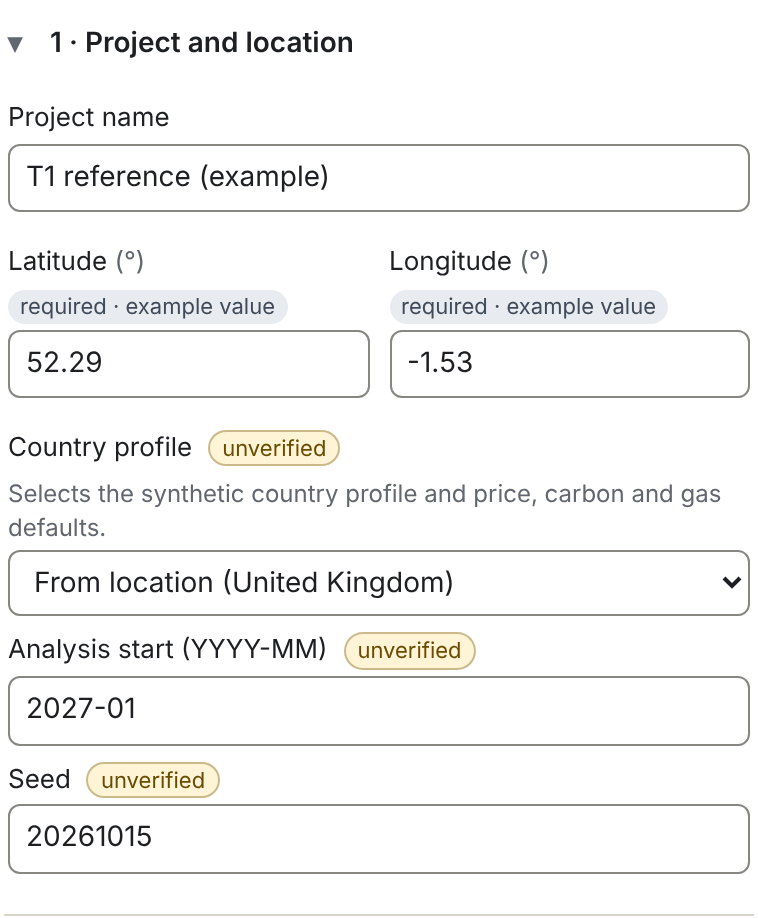

| Field | Default | What it does |
|---|---|---|
| Project name | Untitled project | A label only |
| Map pin, latitude, longitude | required (T1: 52.29, −1.53) | Picks the country whose outline contains the pin when "Country profile" is "From location"; sets the latitude used for the solar profile |
| Country profile | From location | Selects the country's hourly profiles and its price, network-charge, carbon, gas and carbon-price defaults |
| Analysis start | today + 3 months | Month 0 of every timeline; the base year for prices and discounting |
| Seed | 20261015 | Starting number for the synthetic profiles and the sampling of options |

**Country from location.** Since 23 October 2026 the tool picks the built-in country whose outline contains the pin. If the pin is at sea or on the coast just outside every outline, it takes the built-in country whose outline is nearest, up to 25 km away ("nearest coast"). If the pin is inside a country with no built-in profile (for example Serbia or Ukraine) but within 3 km of a built-in country, it takes that country. Otherwise it takes the nearest reference point. The outlines are simplified (Natural Earth 1:50m, rounded to about 1 km), so a pin within 3 km of a border carries a flag on every option naming the neighbour and asking you to check the country (before, it always took the nearest reference point, which could be wrong near a border). Check the label "From location (…)" and override it if needed. The 31 built-in countries are the 27 EU member states plus the United Kingdom, Norway, Switzerland and Iceland.

**Analysis start.** All dates (phases, grid steps, plant availability) are counted in months from this month. It also sets the price base year: all money is in real terms of that year.

**Seed.** The synthetic profiles and the sampling of options use a seeded random-number generator. The same inputs and seed always give exactly the same results. Change the seed to see how much the results depend on the particular synthetic year.

::: {.callout .built}
**Built (23 October 2026, work package 1; OPEN-QUESTIONS 63–65).**

- **Map pin.** Section 1 opens with a map of Europe. Click or tap to place the pin; with the map focused, the arrow keys move it by 0.1° (with Shift by 1°), and + and − zoom. The map is **Natural Earth 1:50m country outlines** (public domain), bundled with the program (about 330 kB), so it works offline. It shows countries only, no roads or place names: type the coordinates for a precise site. OpenStreetMap roads were not bundled: Europe to roads level is several gigabytes and its licence (ODbL) asks for attribution and share-alike.
- **Country from the pin**: the built-in country whose outline contains the pin, named under the map and in the Country profile hint, and editable. This replaces the nearest-reference-point rule, which picked the wrong country near borders (Strasbourg came out as Luxembourg). A pin at sea or in a country without a built-in profile (for example Serbia) uses the nearest built-in country and is flagged on every option.
- **Currency shown**: by country (default), or euro, pound, Swiss franc, Norwegian, Swedish or Danish krone, or Icelandic króna. Every result and the PDF are converted at the fixed ECB reference rate of the release (22 October 2026). The engine and the inputs stay in euro.
- **Climate data**: ASHRAE design-station data is licensed and cannot be bundled, so the design day stays the hottest hour of the country profile, flagged on every option ("design temperatures from the synthetic profile"). Hourly weather from NOAA records or an uploaded EPW file moves to package 0, with the profile research.
:::

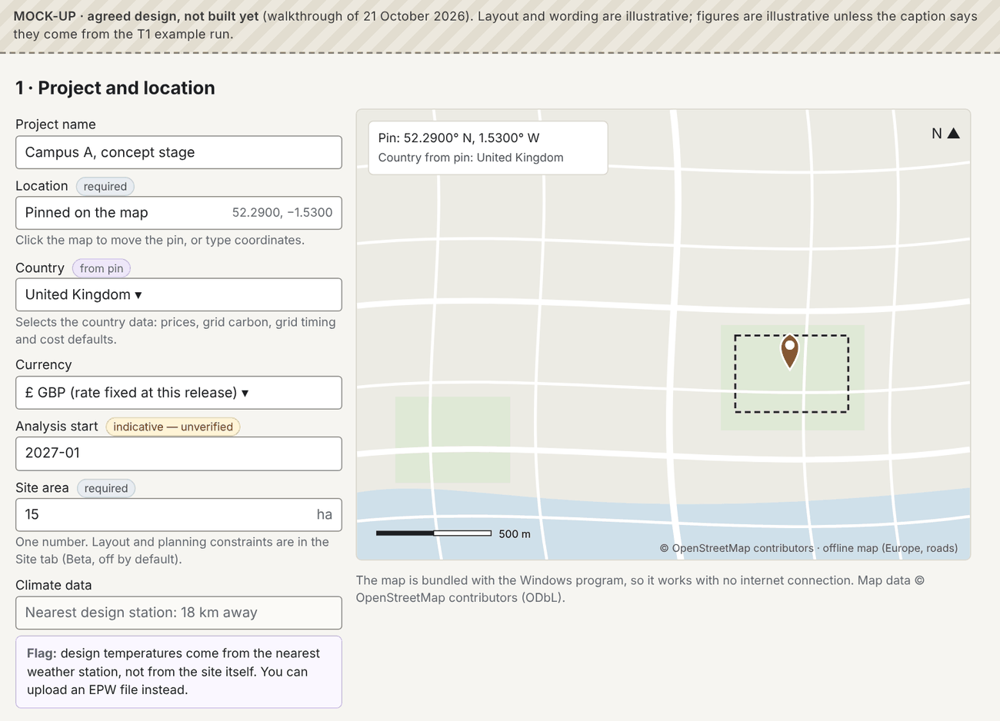

# 15. Inputs: site {#ch15}

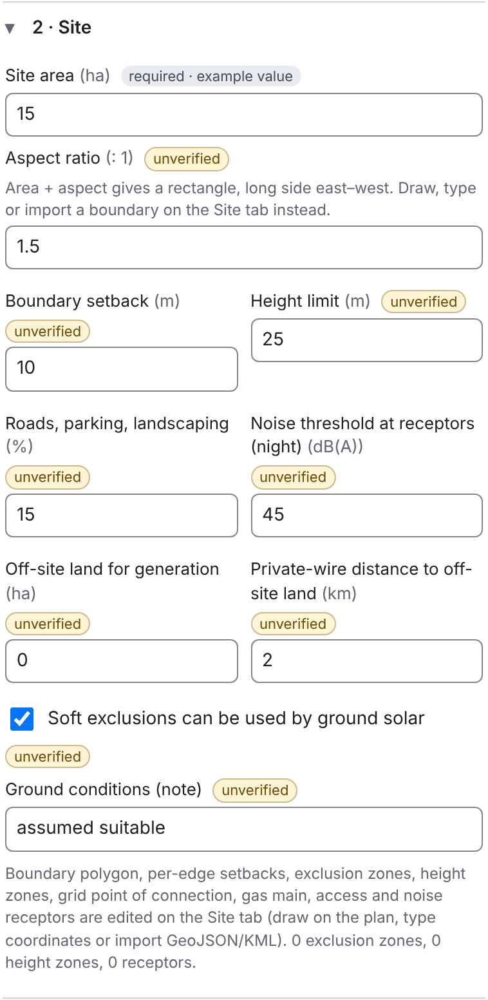

| Field | Default | What it does |
|---|---|---|
| Site area | required (T1: 15 ha) | Gross site area |
| Aspect ratio | 1.5 : 1 | With the area, gives a rectangle, long side east–west |
| Boundary setback | 10 m | Strip around the edge where nothing is built |
| Height limit | 25 m | Flags blocks and stacks above it |
| Roads, parking, landscaping | 15 % | Share of the buildable area held back |
| Noise threshold at receptors (night) | 45 dB(A) | Flags the noise proxy at houses you add |
| Roof area for PV | empty (rule) | Roof covered by PV; empty = 50 % of the free roof after roof plant. Built 22 October 2026 |
| Ground area for PV | 0 ha | Ground covered by PV; above 0 adds the C10 choice "Roof + ground". Built 22 October 2026 |
| Off-site land for generation | 0 ha | Land for off-site wind or solar |
| Private-wire distance to off-site land | 2 km | Length of the cable to it |
| Soft exclusions usable by ground solar | on | Lets ground solar use soft exclusion zones |
| Ground conditions | "assumed suitable" | A note only |

**How the area is used.** The tool works out three areas:

::: formula
| buildable envelope = the site less the boundary setback
| net developable area = envelope × (1 − roads share)
| T1: 15 ha → 13.46 ha envelope → 11.44 ha net developable
:::

The net developable area is the land budget for every block of plant and the data halls. It decides whether the plant fits and (with the 20 ha threshold) whether wind is generated. Ground solar has its own input, the ground area for PV, below.

**Boundary and features.** The boundary polygon, setbacks per edge, exclusion zones (hard, such as easements and ecology; soft, such as flood zones), height zones, the grid point of connection (POC), the gas main, access points and noise receptors are edited on the Site tab (chapter 28).

::: {.callout .agreed}
**Agreed, not built yet.** The site area stays a **single number** in the main flow. The site layout, the planning constraints (setback, height, roads share) and boundary import move out of the main flow, into the Site tab, which becomes a **Beta** feature: hidden by default, turned on in the general settings, labelled Beta, and kept out of the ranking and the PDF export.
:::

::: {.callout .open}
**Open.** With the Site tab hidden, the engine still needs a land budget for the wind default. Ground solar was settled on 22 October 2026 (OPEN-QUESTIONS 53): it has its own area input.
:::

# 16. Inputs: load and building {#ch16}

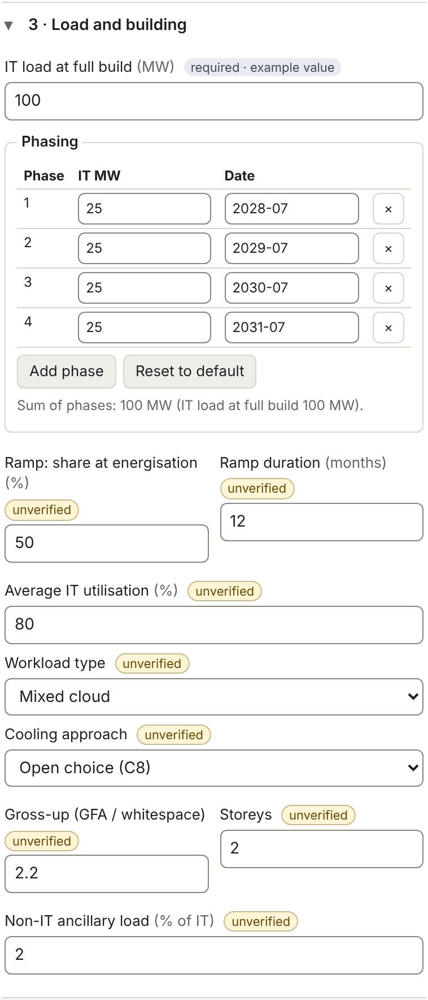

| Field | Default | What it does |
|---|---|---|
| IT load at full build | Not known: estimated from the area (T1: 100 MW entered) | Installed IT of the whole campus |
| Phasing table | one phase at the grid full-connection date | IT MW and energisation date of each phase |
| Ramp: share at energisation | 25 % (was 50 % until 22 October 2026) | Share of a phase's IT drawn when it opens |
| Ramp duration | 12 months | Time to reach 100 % |
| Average IT utilisation | 80 % | Average draw as a share of installed IT (energy only) |
| Workload type | Mixed cloud | Sets the daily load wave (chapter 5) |
| Cooling approach | Open choice (C8) | Fixes the cooling, or leaves all four open |
| Gross-up | 2.2 | Building gross floor area ÷ data hall whitespace |
| Storeys | 2 | Storeys of data hall |
| Non-IT ancillary load | 2 % of IT | Lighting, offices, security |

**The phasing table.** Add a row per phase with its IT MW and date (year and month). "Reset to default" returns to the one-phase default. The sum of the phases is shown against the IT load at full build; if they differ, the phasing table is what the engine uses month by month, while sizing uses the IT load at full build.

**Building massing.** The tool works out the data hall building from the IT load:

::: formula
| whitespace (m²) = IT load (kW) ÷ IT density (kW/m², by cooling)
| gross floor area = whitespace × gross-up
| footprint = gross floor area ÷ storeys
| height = storeys × 6 m + 4 m roof plant zone
| T1, DLC: 100,000 ÷ 4.0 = 25,000 m²; × 2.2 = 55,000 m²; ÷ 2 = 27,500 m²; 16 m high
:::

The footprint takes land on the site plan and gives the roof area for rooftop solar.

::: {.callout .built}
**Built (23 October 2026, work package 2; OPEN-QUESTIONS 26): estimating the IT load from the area.** Leave the IT load blank and the tool estimates it with the building massing rule above, run backwards:

::: formula
| IT load ≈ site area × site coverage × storeys ÷ gross-up × IT density of the cooling type
| 15 ha, cooling open (air density): 150,000 m² × 35 % × 2 ÷ 2.2 × 1.5 kW/m² = 71.6 MW
:::

Site coverage 35 % (the walkthrough's figure), the storeys and the gross-up are judgements. When the cooling is an open choice the air density, the lowest, is used. One rule now serves both the estimate and the sizing, so the same site gives the same building. The walkthrough's benchmark of 5.5 kW per m² of floor (STACK Erskine Park: 450 MW "operational capacity" on 82,020 m², not known whether IT or facility load) would give about 290 MW on 15 ha; it stays a research item (chapter 50). If you enter phases but no IT load, the IT load is their sum. The estimate is flagged as assumed on every option, and you can enter the IT load at any time.
:::

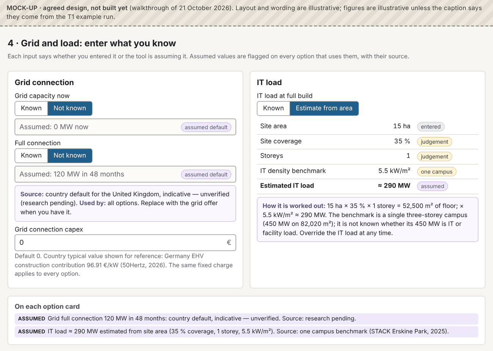

::: {.callout .built}
**Built 23 October 2026: load shape and flexibility.**

- **Load shape**: flat, daily fluctuation (default, with an optional swing), AI training (average, dip level, dip interval, dip length) or AI inference (average, night trough, peak hour, weekend level). The AI inputs appear when an AI profile is chosen, with the sub-hour caveat.
- **Demand flexibility** (generated when choice C16 includes On): maximum curtailable share of IT, maximum hours a year, trigger (price, carbon, or weather and grid stress as temperature), trigger level, duration per event, notice (recorded, not modelled), recovery period, cost of curtailment.
- **Battery response**: on by default; the economic battery runs the site in trigger hours before any curtailment. **Hold fixed** decides how the C12 battery "Sized to the trigger hours" is sized: *trigger threshold* (default: the battery is the flexible share of IT for the longest trigger event), *hours covered* (the trigger level is set so the events reach the target hours a year), or *battery size* (entered; the hours it covers are reported). The battery capex is in the ledger.
:::

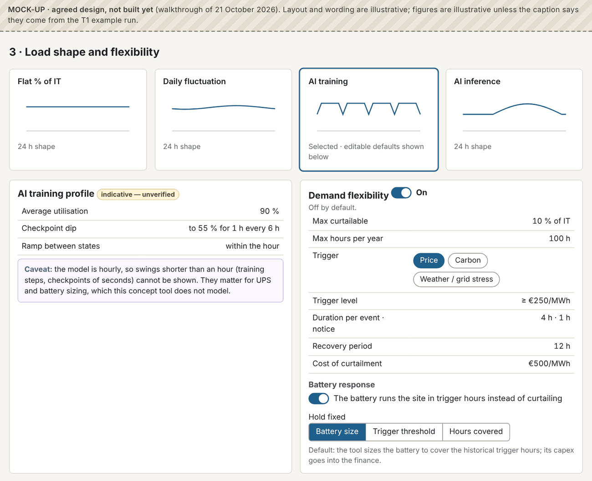

# 17. Inputs: utilities and grid {#ch17}

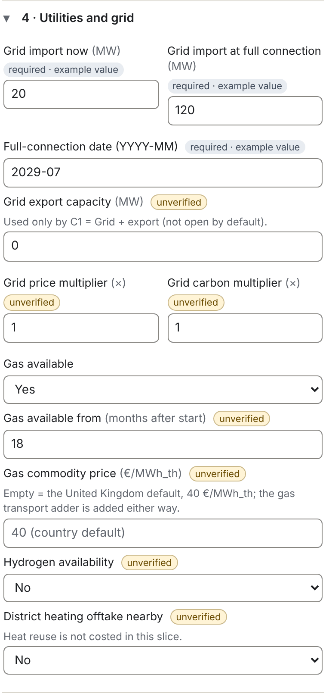

| Field | Default | What it does |
|---|---|---|
| Grid import now | Not known: 0 MW (T1: 20 MW) | Import capacity from the analysis start |
| Grid import at full connection | Not known: IT load × 1.4 (T1: 120 MW) | Import capacity from the full-connection date |
| Full-connection date | Not known: start + 48 months (T1: 2029-07) | When the full capacity is available |
| Grid export capacity | 0 MW | Used only by C1 "Grid + export" |
| Grid price multiplier | × 1 | Scales the country's hourly wholesale prices |
| Grid carbon multiplier | × 1 | Scales the country's hourly grid carbon |
| Gas available | Unknown | Yes, No or Unknown |
| Gas available from | 18 months after start | Gas supply date (unlimited from then) |
| Gas commodity price | country default | €/MWh of gas; the transport adder (€4) is added either way |
| Hydrogen availability | No | Hydrogen plant runs only if Yes |
| District heating offtake nearby | No | Allows heat-reuse values of C15 (not costed) |

Two inputs exist in the engine but are not on screen in the current version: **grid steps** (intermediate capacities between "now" and "full", each from a date) and **water available** (m³ a day, for the water flag).

**What "Unknown" gas means.** Gas plant is generated and runs (from the gas date), but every gas-using option gets a minor flag ("Gas connection unconfirmed") and loses 10 deliverability points. With "No", gas CHP is not generated at all, and any other gas plant is flagged major and never runs. With "Yes", gas plant runs from the gas date with an information flag that the capacity and date are assumed.

**Multipliers.** The price and carbon multipliers scale the whole hourly profile, for example to test a high-price future. The tornado (chapter 27) uses ranges of 0.7 to 1.5 for price and 0.8 to 1.2 for carbon.

::: {.callout .agreed}
**Agreed, not built yet.**

- **Country values for "Not known" grid capacity and connection time.** Built 23 October 2026 with one default for every country: now 0 MW, full connection 1.4 MW per MW of IT (about the design load), 48 months after the start, each labelled indicative and flagged on every grid-connected option. Country values are still to be researched.
- **Gas price**: the latest published wholesale price with its date, from a free monthly source, overridable with a current quote.
:::

# 18. Inputs: requirements, priorities and weights {#ch18}

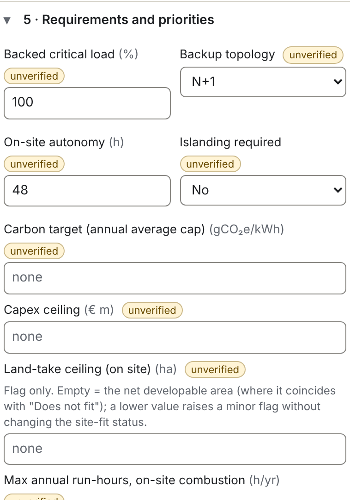

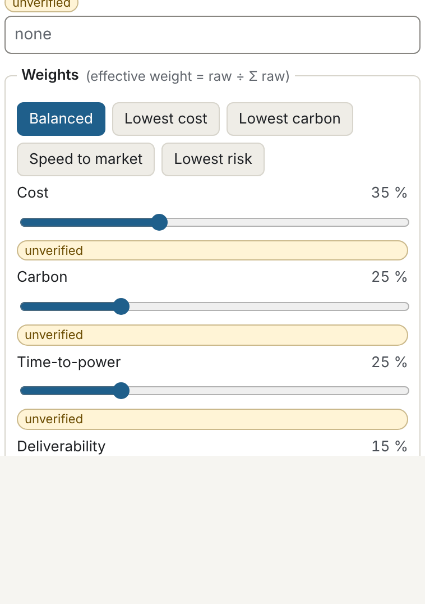

| Field | Default | What it does |
|---|---|---|
| Backed critical load | 100 % | Share of IT plus essential mechanical that backup must carry |
| Backup topology | N+1 | Required redundancy; also fixes choice C6 |
| On-site autonomy | 48 h | Required hours of backup; also fixes choice C7 |
| Islanding required | No | If Yes, on-site firm plant must carry the critical load |
| Carbon target | none | Flags options above it (g/kWh, location-based) |
| Capex ceiling | none | Flags options above it |
| Land-take ceiling | none (the net developable area) | Flags options above it |
| Max annual run-hours, on-site combustion | none | Flags (or limits) firm plant above it |
| Weights | 35 / 25 / 25 / 15 | Cost, carbon, time-to-power, deliverability |

**Requirements are checks, targets are flags.** The resilience requirement decides the backup sizing and the resilience status. The carbon target, capex ceiling, land-take ceiling and run-hour limit only raise flags; none of them removes an option.

**Weights.** Drag the sliders or pick a preset (Balanced, Lowest cost, Lowest carbon, Speed to market, Lowest risk). The effective weight of each axis is its raw value divided by the sum of all four. If all four are zero, the tool uses 25 % each and warns. Changing weights re-scores instantly, without re-running the model.

::: {.callout .built}
**Built 23 October 2026 (work package 4).** New inputs: **resilience reserve battery** (minutes of UPS at full IT, default 5), **genset test running** (6 h a year per unit), **genset test load** (75 %), **backup gensets as primary power** (h a year, default 0), and **client-perceived risk of pooled backup** (minor or major).
:::

::: {.callout .agreed}
**Agreed, not built yet.** Autonomy from on-site fuel and generation, batteries, or a combination (the engineer chooses). Weights stay 35/25/25/15 (provisionally accepted); the impact of each weight change is described live; the repaint target after a weight change is relaxed from 100 ms.
:::

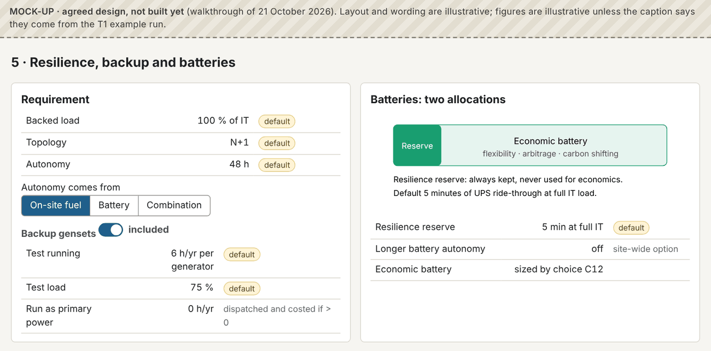

# 19. Inputs: economics and run settings {#ch19}

Since 23 October 2026 the economic inputs have their own section, **5 · Economics** (below); the collapsed **Run and dispatch settings** section keeps the settings that change how the run is done or reported.

| Field | Default | What it does |
|---|---|---|
| Grid capacity handling | Show unmet load | Or "Show exceedance" (chapter 9) |
| Run-hour limit handling | Flag only | Or "Respect limit": firm plant stops at the limit |
| Cost axis metric | LCOE | Or NPV of net cost |
| Carbon axis metric | Location-based | Or market-based, or 1 − hourly CFE |
| Rank requirement-compliant options first | off | Ranks failing options after the rest; scores unchanged |
| Include site-fit penalty in deliverability | off | −10 for "Fits with flags", −25 for "Does not fit" |
| Generation cap | 2,000 options | Maximum options screened |
| Sample above cap | on | Samples down to the cap; off screens all |
| Wind default site threshold | 20 ha | Wind not generated on smaller sites |
| Layout raster cell / large-site cell / threshold | 2 m / 5 m / 50 ha | Resolution of the auto-layout |

**Rank requirement-compliant options first.** Off by default (flag, don't enforce). When on, options whose resilience is "Does not meet" or whose site fit is "Does not fit" are ranked after all the others. Their scores do not change. The setting is shown in the header.

**Sampling.** With sampling on, a run with more combinations than the cap screens all archetypes plus a seeded Latin hypercube sample of the rest (chapter 34). With sampling off, every combination is screened, which can take much longer. The header and the run summary always say which applies.

**Section 5 · Economics** (built 23 October 2026, work package 2):

| Field | Default | What it does |
|---|---|---|
| WACC (real) | 7 % | "The blended return the investors require, used as the discount rate" |
| Scoring evaluation period | 20 years | Length of the ledger that sets the cost axis and the ranking (OPEN-QUESTIONS 21) |
| Further periods shown | 10, 15 years | LCOE and NPV over these periods in each option's detail and the PDF; they do not rank |
| Contingency | 10 % | Added to every capex line |
| Carbon price (Scope 1) | country default | €/t CO₂e (EU ETS or UK ETS) |
| Electricity, gas and carbon escalation | 0 %, 0 %, 2 % a year real | Price change per year over the period |

The currency is the euro; revenue options (export, battery grid services, heat reuse) stay off unless opened in the choices. Capex range (−30 %/+50 %) and salvage value (50 %) have no field.

::: {.callout .agreed}
**Agreed, not built yet: the rest of the economics section.**

- **Carbon price**: the latest EU ETS market price with its date (for example €82.40/t on 5 October 2026).
- **Gas price**: the latest published wholesale price with its date (for example the TTF front month, €75.75/MWh on 5 October 2026), from a free monthly source; overridable.
- **Escalation**: a published forecast per commodity, overridable.
- **Currency** per site, from a fixed list (package 1).
:::

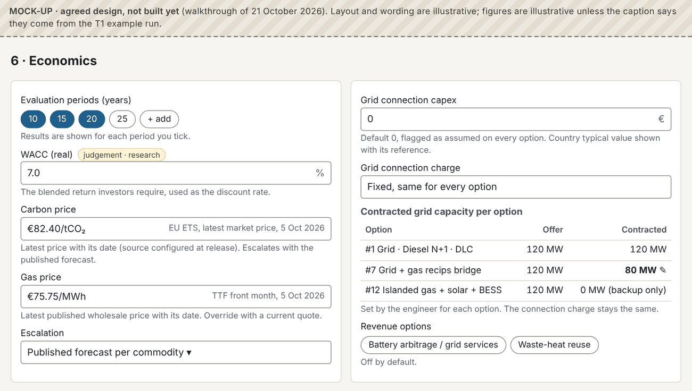

::: {.callout .built}
**Answered 23 October 2026** (OPEN-QUESTIONS 19 and 20, Claude's recommendations accepted in advance by the owner): contracted capacity is a rule per grid strategy set before the run (blank = the full offer); islanded options contract 0 MW and do not pay the connection charge.
:::

# 20. Inputs: the design choices C1–C20 {#ch20}

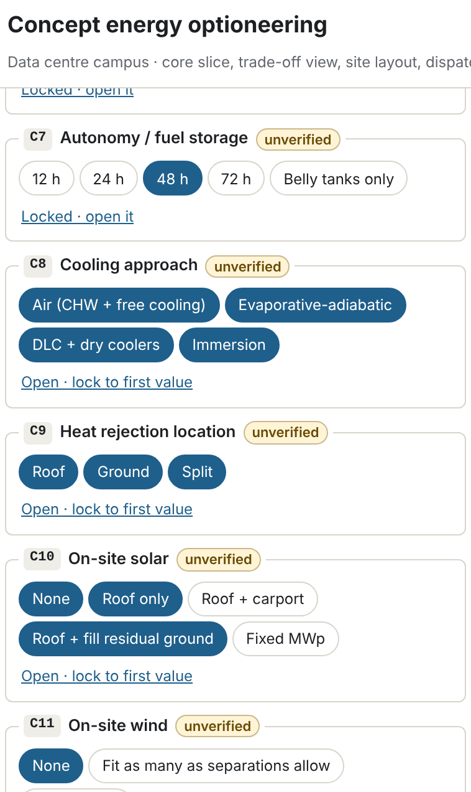

Each choice has a list of values. A choice is **open** (every included value is combined with the other choices) or **locked** (only its first included value is used). Click a value to include or exclude it; use "Open · lock to first value" or "Locked · open it" to switch. The badge on the section shows the projected number of combinations after the compatibility rules, the cap and whether sampling is on.

The table lists every choice, its values, and the values included by default (marked **bold**). "Locked" means only that value is used unless you open the choice.

| Choice | Values (default in bold) |
|---|---|
| C1 Grid strategy | **Wait for grid**, **Bridge until grid**, **Islanded**, Grid + export |
| C2 Bridging supply | **Gas recips**, Gas turbines, **Fuel cells**, HVO-diesel prime, BESS + solar only, **Rented temporary generation** |
| C3 Bridging plant after grid arrives | **Remove**, **Retain as backup**, **Retain as prime**, **Retain for grid services**, **Keep shortfall share as prime, rest as backup** (built 23 October 2026; only with generating plant and a permanent shortfall) |
| C4 Primary firm on-site generation | **None**, **Gas CHP-trigen**, Gas recips, **Fuel cells**, SMR, Hydrogen |
| C4s Firm generation sizing | **Average load (baseload)**, **Permanent shortfall (top-up)**; the top-up only for cooling types with a permanent shortfall, or islanded (built 23 October 2026) |
| C5 Backup power technology | **Diesel gensets**, **HVO gensets**, Gas gensets, BESS-augmented UPS + reduced gensets, **Retained bridging plant**, None |
| C5a Backup arrangement | **Per building**, **Pooled across the campus** (built 23 October 2026; not applicable with no backup or retained-plant backup) |
| C6 Backup topology | locked to the required topology (**N+1**); N, 2N, catcher available |
| C7 Autonomy / fuel storage | locked to the required autonomy (**48 h**); 12, 24, 72 h |
| C8 Cooling approach | **all four** open, unless the cooling approach input fixes one |
| C9 Heat rejection location | **Roof**, **Ground**, **Split** |
| C10 On-site solar | **None**, **Roof only**; **Roof + ground** when the ground area for PV is above 0 |
| C11 On-site wind | **None** on sites ≤ 20 ha; otherwise **None**, **Fit as many as separations allow**, **Off-site land** |
| C12 BESS size | **None**, 1 h at 25 %, 1 h at 50 %, **2 h at 25 %**, 2 h at 50 %, 4 h at 25 %, **4 h at 50 %**, **Sized to the permanent shortfall** (built 23 October 2026; only with a grid, a permanent shortfall and the peak-shave role) |
| C12r BESS role | locked to **Peak-shave**; Shifting, Bridging support, Grid services available |
| C13 Offsite PPA | **None**, Annual-matched solar, Annual-matched wind, **Hybrid**, Baseload-shaped, 24/7-matched |
| C14 PPA coverage | **50 %**, **80 %**, **100 %** |
| C15 Heat reuse | locked to **None** unless district heating is nearby |
| C16 Demand flexibility | locked to **Off** |
| C17 Substation type | **AIS**; GIS available |
| C18 Genset arrangement | **Single-deck**; double-deck and in-building available |
| C19 Phasing of energy plant | locked to **Build per phase**; build all at phase 1 available |
| C20 Fuel decarbonisation pathway | locked to **None**; biomethane, HVO switch available |

**Which choices do something in the current engine.** Most choices change sizing, dispatch, costs or the layout. A few are recorded but have little or no effect yet:

- **C15 Heat reuse**: values are generated only with district heating nearby, and heat reuse is not costed.
- **C20 Fuel decarbonisation pathway**: has no effect on any calculation.
- **C3 "Retain for grid services"** behaves like "Retain as backup", and **C12r "Grid services"** like "Shifting": no grid-services income is modelled.
- **C17** (substation type) and **C18** (genset arrangement) change footprints and, for C17, the substation cost; C18 changes only the footprint.

**Not applicable values.** Some choices only matter when others take certain values: C2 and C3 only with bridging; C4s only with a firm plant; C5a only with gensets; C14 only with a PPA; the BESS role only with a BESS; C6, C7 and C18 only with gensets. Otherwise they are set to "n/a" rather than multiplying the options (chapter 34).

::: {.callout .agreed}
**Agreed, not built yet.** The cooling approach is always chosen by the engineer (chapter 6). The flexibility and battery choices are replaced by the parameters described in chapters 16 and 18.
:::

# 21. Running: progress, run summary and run flags {#ch21}

## Run progress

The **Run progress** panel lists the 13 stages of the run (chapter 31), each with a bar, its cache counts and any warnings. Below it, the **event log** shows the last 200 events; **Download run log** saves the full log as JSON or CSV (in the Windows program, through a save dialog). The log is the audit trail of the run: every stage's start and end, progress every 250 items, every warning, the input hash and the leader.

## Run summary

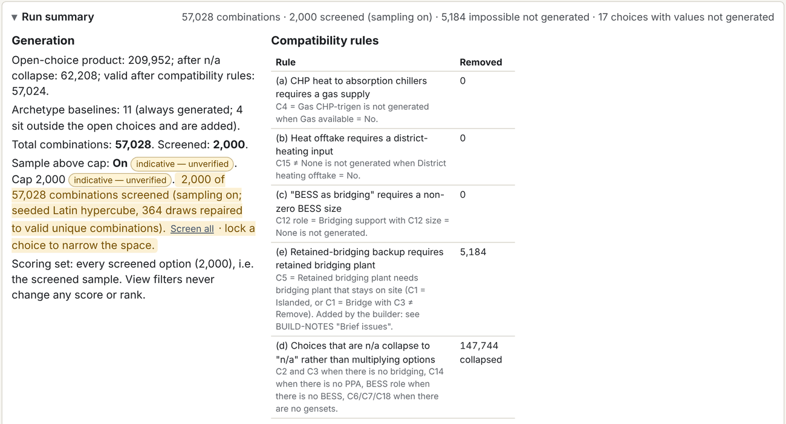

- **Generation**: the open-choice product, the count after the n/a collapse, the valid count after the compatibility rules, the archetypes, the total, and how many were screened. When sampling applies, the summary says so, with a **Screen all** link (switches sampling off) and a reminder that locking a choice narrows the space.
- **Compatibility rules**: each rule, what it removes, and how many combinations it removed.
- **Scoring set**: every screened option. View filters never change any score or rank.
- **Grid shortfall against the design load** (built 23 October 2026; OPEN-QUESTIONS 38): for each cooling type the run generates, the design load (the full contracted IT at the design-day PUE plus ancillary load), the **temporary** shortfall against the offered grid before the full connection date and the **permanent** shortfall from it on (peak MW, its month, and how many months), and the IT load the full grid connection supports on its own. In T1 (120 MW grid from 2029-07) air cooling needs 137 MW, so 16.7 MW stays short from 2031-12 and the full grid supports 87.8 MW of IT; DLC needs 113 MW, has only a temporary shortfall (peak 6.5 MW in 2029-06) and the grid supports 106 MW of IT. On-site generation must close both shortfalls for an option to be adequate.
- **IT load the grid supports, by grid period** and **grid-matched phasing** (built 23 October 2026; OPEN-QUESTIONS 38, step 3): for each period of constant grid capacity, the IT it carries at each cooling type's design-day PUE plus ancillary load; and a reference phasing in which each building is energised no earlier than planned and only once the grid alone carries the cumulative IT. The reference is not an option and is not ranked: it shows what the campus could do with no on-site generation. In T1 the 20 MW grid before July 2029 carries 14.6 MW of IT with air cooling, so building 1 would wait 12 months for the 120 MW connection; with air cooling building 4 never fits the grid, with DLC it does.

## Values not generated

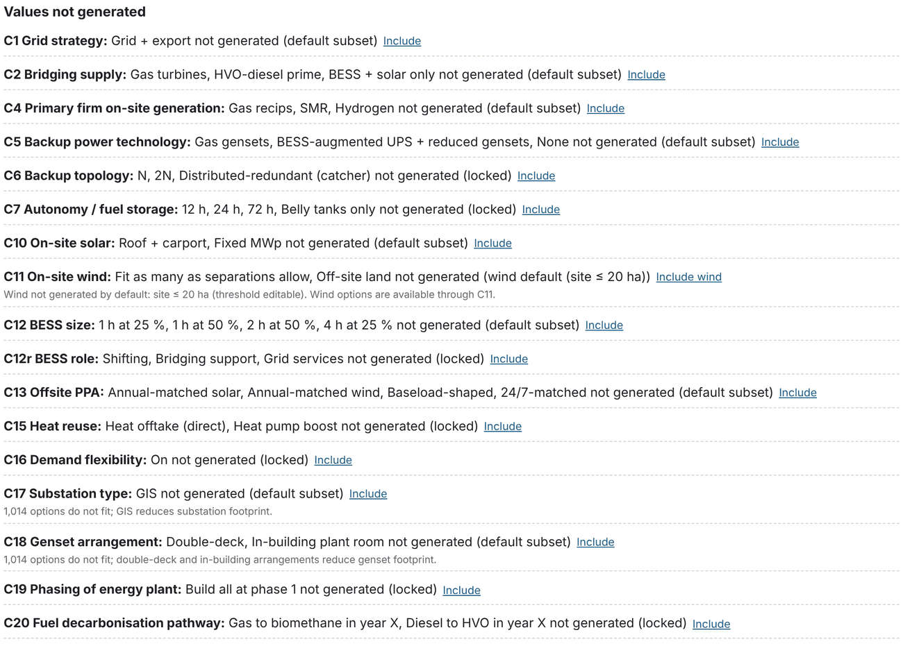

This list matters: it tells you which strategies the run did **not** look at. If a strategy you care about is missing, select **Include** next to it and the run repeats with it. For C17 and C18 the note also says how many options do not fit the site, because GIS substations and double-deck gensets save space.

## Dispatch summary

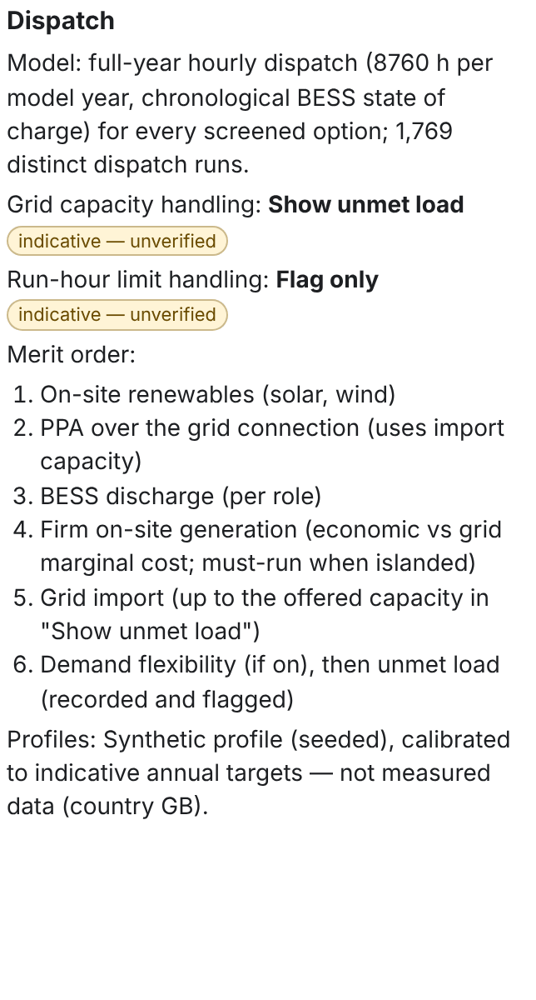

## Run flags

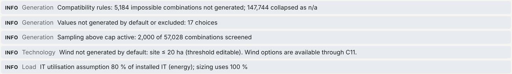

Run flags apply to the whole run rather than to one option: how many combinations the rules removed; how many choices have values not generated; that sampling is active; that wind was not generated on a small site; that the IT utilisation assumption applies to energy but not sizing; and, when the workload is AI training, that transient loads are not modelled.
