# 22. Results: the summary, the top five and the options table {#ch22}

## The summary

::: {.callout .built}
**Built 24 October 2026 (work package 16; OPEN-QUESTIONS 12 and 86–92).** The Options tab opens with a **Summary**: a short text, at most 250 words, that says in plain words what the run shows under your weights and settings. It is written by fixed templates from the run's own figures, with no language model and no network, so the same run always gives the same words, in the browser and in the Windows program. It describes; it never advises, and it never uses the word "recommendation". **Hide** folds it away.
:::

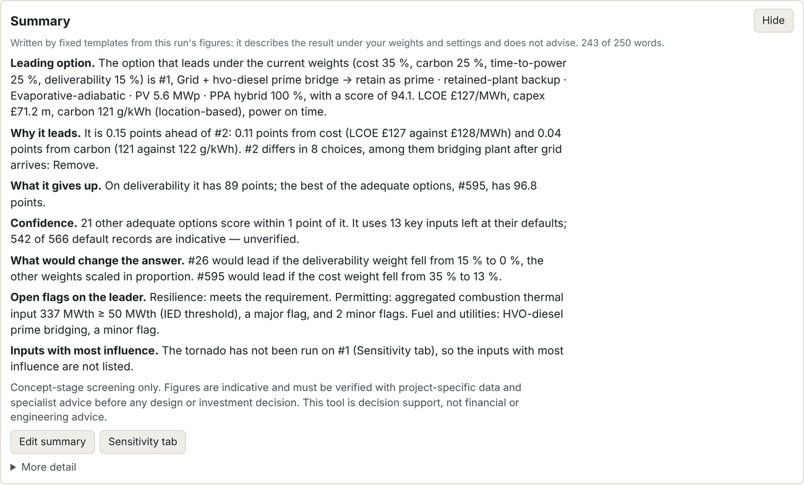

It has seven parts, always in this order:

| Part | What it says |
|---|---|
| Leading option | The option that leads under the current weights, its score, LCOE, capex, carbon and time-to-power. With the Monte Carlo run, its LCOE from P10 to P90; otherwise, with a tornado run on the leader, its LCOE range with each tested input moved one at a time |
| Why it leads | How far it is ahead of #2, split into the axis differences that make up the gap (in score points): those that favour #1 with their figures, those that favour #2 by their points, so the named parts add up to the gap; and one of the choices on which #2 differs |
| What it gives up | The axes where #2 does better, and where the best option of the same group does better by more than 0.5 axis points |
| Confidence | How many other options score within 1 point; with the Monte Carlo run, how often the leader comes first and in the top three, and whether the robust pick differs; how many key inputs the leader uses were left at their defaults; how many default records are unverified |
| What would change the answer | The smallest change of one weight that puts another option first, and which option; once the breakeven table has been run (chapter 27), the two flips nearest today's values |
| Open flags on the leader | Resilience status; permitting and fuel flags; any other major flag. Site-fit flags only while the Site tab (Beta) is on. When many flags would take the text past 250 words, it gives their count and More detail lists them |
| Inputs with most influence | With a tornado run on the leader, the three inputs with the largest swing, with their data confidence |

The summary ends with the guardrail sentence. **More detail** under it lists, part by part, the figures behind each sentence, every weight change that alters the leader, all the leader's flags, and what is not built yet. When a summary would be longer than 250 words, its least important sentences move into More detail. The tornado, the breakevens and the Monte Carlo run on request on the Sensitivity tab (chapter 27); until they have been run for the current result, the summary says so rather than guessing, and More detail lists them as not run. Chapter 44 shows how its numbers are worked out.

**The T1 example** (analysis start January 2027, run of 24 October 2026) reads, before any tornado:

> **Leading option.** The option that leads under the current weights (cost 35 %, carbon 25 %, time-to-power 25 %, deliverability 15 %) is #1, Grid + hvo-diesel prime bridge → retain as prime · retained-plant backup · Evaporative-adiabatic · PV 5.6 MWp · PPA hybrid 100 %, with a score of 94.1. LCOE €152/MWh, capex €84.9 m, carbon 121 g/kWh (location-based), power on time.
> **Why it leads.** It is 0.15 points ahead of #2: 0.11 points from cost (LCOE €152 against €153/MWh) and 0.04 points from carbon (121 against 122 g/kWh). #2 differs in 8 choices, among them bridging plant after grid arrives: Remove.
> **What it gives up.** On deliverability it has 89 points; the best of the adequate options, #595, has 96.8 points.
> **Confidence.** 21 other adequate options score within 1 point of it. It uses 13 key inputs left at their defaults; 549 of 573 default records are indicative — unverified.
> **What would change the answer.** #26 would lead if the deliverability weight fell from 15 % to 0 %, the other weights scaled in proportion. #595 would lead if the cost weight fell from 35 % to 13 %.
> **Open flags on the leader.** Resilience: meets the requirement. Permitting: aggregated combustion thermal input 337 MWth ≥ 50 MWth (IED threshold), a major flag, and 2 minor flags. Fuel and utilities: HVO-diesel prime bridging, a minor flag.
> **Inputs with most influence.** The tornado has not been run on #1 (Sensitivity tab), so the inputs with most influence are not listed.

After the tornado with its seven default drivers, the first part adds "its LCOE is €140 to €171/MWh" and the last reads "grid import price (confidence C) moves LCOE by up to €30.7/MWh across its range. Next: grid full-connection date (C), €11.7/MWh; capex (C), €10.7/MWh." After the breakevens, part 5 adds "Breakevens: #7 would lead if the grid full-connection date slipped by 14 months or more; #2 would lead if capex rose to × 1.41." With both, the summary keeps to 250 words by moving the LCOE range and the second weight change into More detail. (Figures in euro; the screen shows the display currency, pounds for T1.)

**Editing.** **Edit summary** opens the text in a box. **Save note** keeps your text as a note marked **edited**, shown in place of the generated text, with the generated summary one click below. If the result changes afterwards (another leader, other weights or scoring settings, other inputs), the note says it was written for an earlier result and the summary for the current result opens under it. **Discard edit** removes the note. The note is saved in the study file and printed in the PDF after the generated summary (chapter 29), except a note written with the Site tab (Beta) on, which may hold site-fit wording: the PDF says one exists and leaves it out. The note also counts as written for an earlier result when the Site tab is switched, or when a tornado or the breakevens are run on the leader, since each changes the generated text. Editing it never starts a run.

## The top five cards

::: {.callout .built}
**Built 23 October 2026 (OPEN-QUESTIONS 24).** The Options tab opens on the **top five cards**: the best-ranked option of each of **five distinct strategies** (a strategy is the grid strategy, bridging plant, firm generation and backup together), in rank order, so near-identical variants do not fill the top five. Each card shows:

- the weighted score and the four axis scores;
- LCOE, location-based carbon, capex, resilience status and power adequacy;
- the main (major) flags;
- up to **three pros and three cons**, judged **against every option in the run** (the card says so): a pro is a figure in the best 10 % of the run that sets the option apart (no more than 10 % of the run as good or better, so a value most options share, such as no delay, is not a pro; 24 October 2026), a con one in the worse half, among LCOE, capex, carbon, hourly carbon-free energy, time-to-power and deliverability;
- a **Compare** tick box (chapter 25).

The list of assumed defaults on each card arrives with work package 2. Options whose every figure equals a better-ranked option's are marked **"Same results as #k"** in the options table and never take a card (KNOWN-ISSUES item 5).
:::

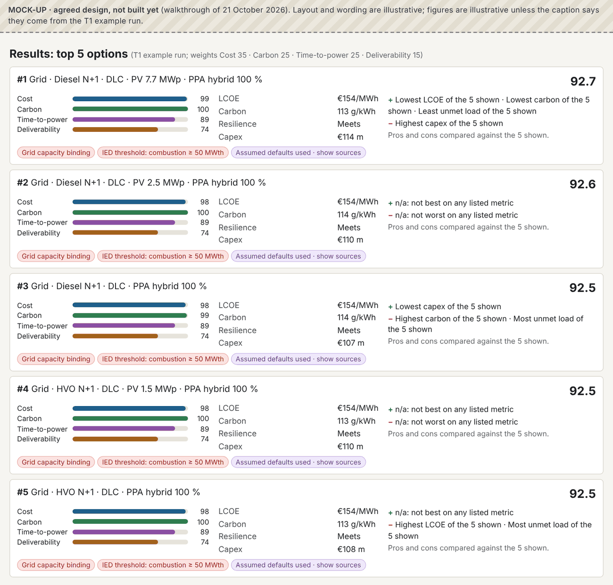

**What the T1 top five shows.** All five are variations of one strategy: wait for the grid, diesel or HVO gensets N+1, direct liquid cooling, and a 100 % hybrid PPA, differing only in the solar size and the backup fuel. Their scores span 92.5 to 92.7. This is typical: the best options are often near neighbours.

::: {.callout .open}
**Open.** The decision says pros and cons are judged against the other options in the run, while its example reads "lowest of the 5 shown"; which comparison set to use needs confirming. The agreed design also does not yet say whether the top five should be the five highest scores (as in the mock-up) or five *different* strategies (for example the best of each grid strategy or backup type). Five near-identical cards say less than five distinct ones. Options that differ only in a choice that changes no number (for example the heat rejection location of an option with no rooftop solar) appear as separate, identical rows today (ranks 10 and 11 in T1).
:::

## The options table (current version)

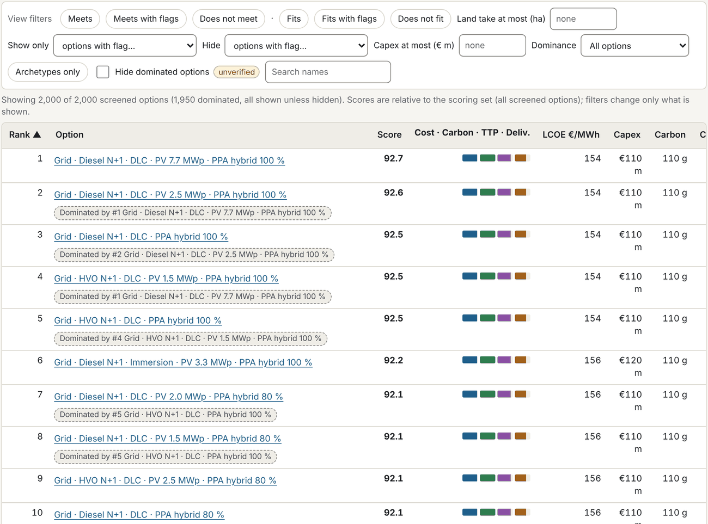

The **Options** tab lists every screened option in rank order. Columns:

| Column | Meaning |
|---|---|
| Rank | Position: adequate options first, then by weighted score (1 = best; chapter 44) |
| Option | Name built from the main choices and sizes; select to open the detail |
| Score | Weighted score, 0–100 |
| Cost · Carbon · TTP · Deliv. | The four axis scores as small bars |
| LCOE €/MWh | Levelised cost |
| Capex | Capital cost including contingency |
| Carbon | g/kWh by the scoring carbon metric |
| CFE | Hourly carbon-free energy share |
| First power, Full load | Months when the supply can first energise phase 1, and carry the full design load |
| Adequacy | Adequate, or Not adequate with the reasons (unmet load, above grid capacity, power gap). Built 23 October 2026 |
| Unmet MWh | Unmet load over all simulated years |
| Land take ha | Land used on site |
| Site fit, Resilience | Status of the two requirement checks |
| Flags | Count of flags by severity |

The table rounds to **two significant figures** (the detail view uses three), which is why the leader's €113.7 m capex shows as €110 m.

**Option names** are built from the choices: grid strategy (and the bridging plant and what happens to it), firm generation, backup and topology, cooling (first word), solar size, wind size, battery hours, and PPA type and coverage. For example "Grid + fuel cells bridge → remove · HVO N+1 · DLC · PV 7.2 MWp · PPA hybrid 100 %".

**Filters** (above the table) change only what is shown, never a score or a rank:

- resilience status (Meets, Meets with flags, Does not meet) and site-fit status (Fits, Fits with flags, Does not fit);
- land take at most (ha) and capex at most (€ m);
- show only, or hide, options with a given flag;
- dominance: all options, non-dominated only, or dominated only;
- archetypes only; and a name search;
- **Hide dominated options** (off by default; custom and pinned options are never hidden).

Active filters appear as chips that can be cleared one by one. Click a column heading to sort by it (click again to reverse). The table shows 50 rows a page.

A dominated option carries a dashed label "Dominated by #k …" naming the option that beats it on every axis.

**Power adequacy first** (built 23 October 2026). A note above the table says how many options are adequate. In rank order, a red divider row marks where the options that are not adequate begin: they do not serve their load in every hour, or their firm supply falls short of the design load in some months, and they rank below every adequate option (chapter 44). They are never hidden; to hide them, choose "Hide options with flag: Not adequate (power)". The header strip also counts adequate and not-adequate options.

# 23. Option detail {#ch23}

Selecting an option's name opens its detail. It is the most useful single view in the tool: everything the engine worked out about that option.

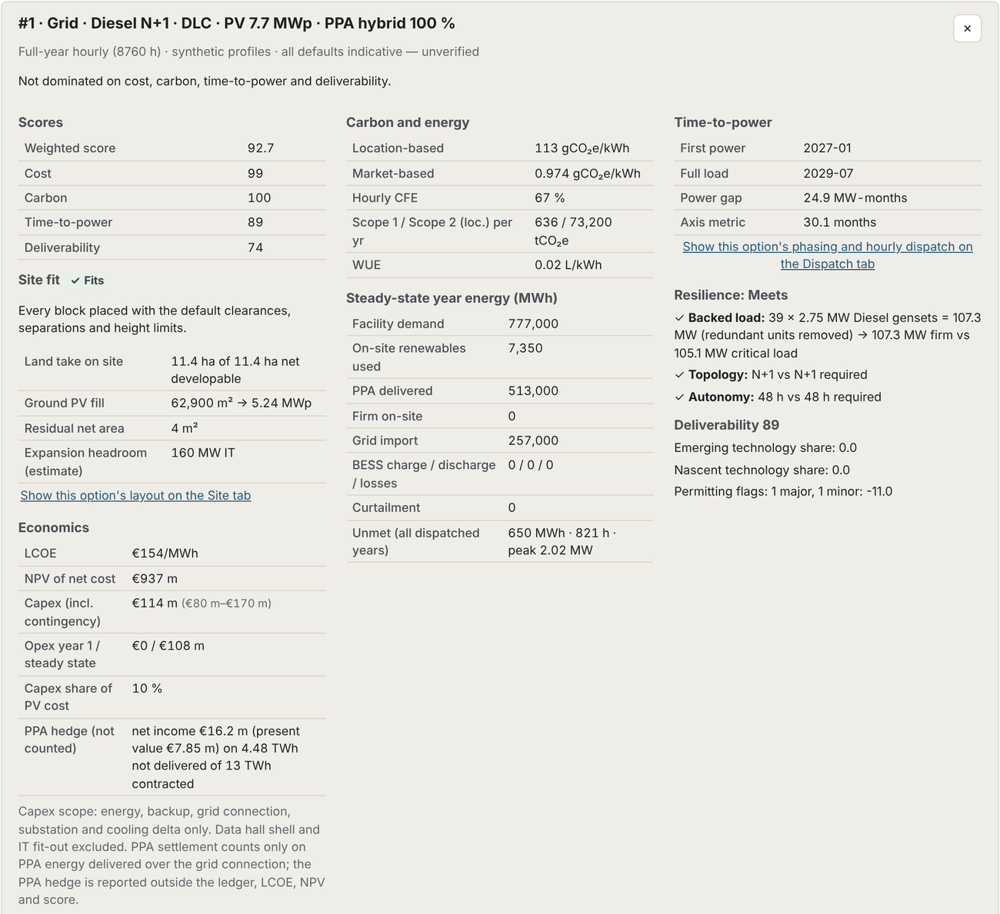

**Power adequacy** (built 23 October 2026). Above the scores: Adequate or Not adequate, in words, then the unmet load over all simulated years (MWh, hours, peak MW and the longest unbroken run of unmet hours), import above the grid capacity (MWh and hours), and the power gap against the design load (MW-months and months).

**Scores.** The weighted score and the four axis scores (rounded).

**Site fit.** The status, the land take against the net developable area, the ground solar fill, the residual area, and an estimate of the extra IT the leftover land could take. A link opens the layout on the Site tab.

**Economics.**

- LCOE and NPV of net cost (chapter 39).
- Capex including contingency, with the Class 5 range (−30 % to +50 %).
- Opex in the first year with load and in the steady-state year (since 24 October 2026; before, the first year of the analysis, which showed €0 for T1 because 2027 has no load).
- Capex share of the present-value cost: how much of the NPV is capital (10 % for the T1 leader: its cost is mostly energy).
- **PPA hedge (not counted)**: the settlement of contracted PPA volume that was not delivered (chapter 39), reported but outside the ledger.

The note under the table restates the capex scope: energy, backup, grid connection, substation and cooling delta only.

**Carbon and energy.** Location-based and market-based carbon, the hourly CFE share, the yearly Scope 1 and Scope 2 averages and the WUE.

**Steady-state year energy.** Where the energy comes from in the last simulated year: facility demand; on-site renewables used; PPA delivered; firm on-site generation; grid import; battery charge, discharge and losses; curtailment; and unmet load over all simulated years.

**Time-to-power.** First power, full load, the power gap in MW-months, and the axis metric in months late (chapter 38). A link opens the option on the Dispatch tab.

**Permitting outlook** (built 23 October 2026). For plant held by the IED or Seveso: the outlook (likely, uncertain, unlikely) with its reason, and the month it is ready against the month it is first needed, with the float or the months late (chapter 8).

**Resilience.** The status and each check (backed load, topology, autonomy, islanding) with its numbers.

**Deliverability.** The score and each penalty (chapter 43).

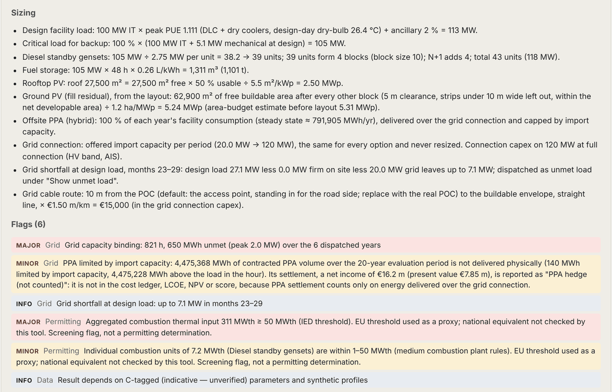

**Sizing.** Plain-English sentences, one per sizing step, each with the arithmetic. These are the quickest way to see why an option is the size it is (chapter 35 explains every rule).

**Flags.** Every flag, with its severity (major, minor or info), category and message (chapter 42).

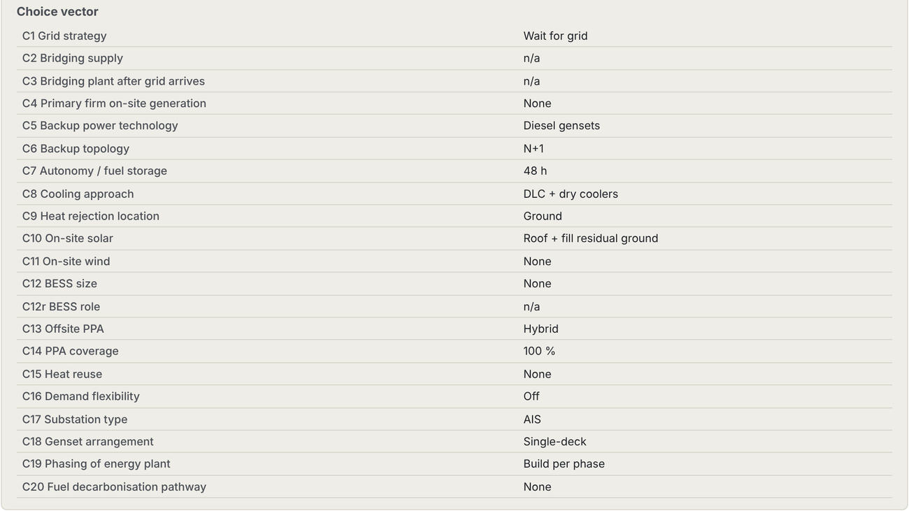

**Choice vector.** The value of every choice C1–C20 for this option ("n/a" where the choice does not apply).

# 24. Trade-offs {#ch24}

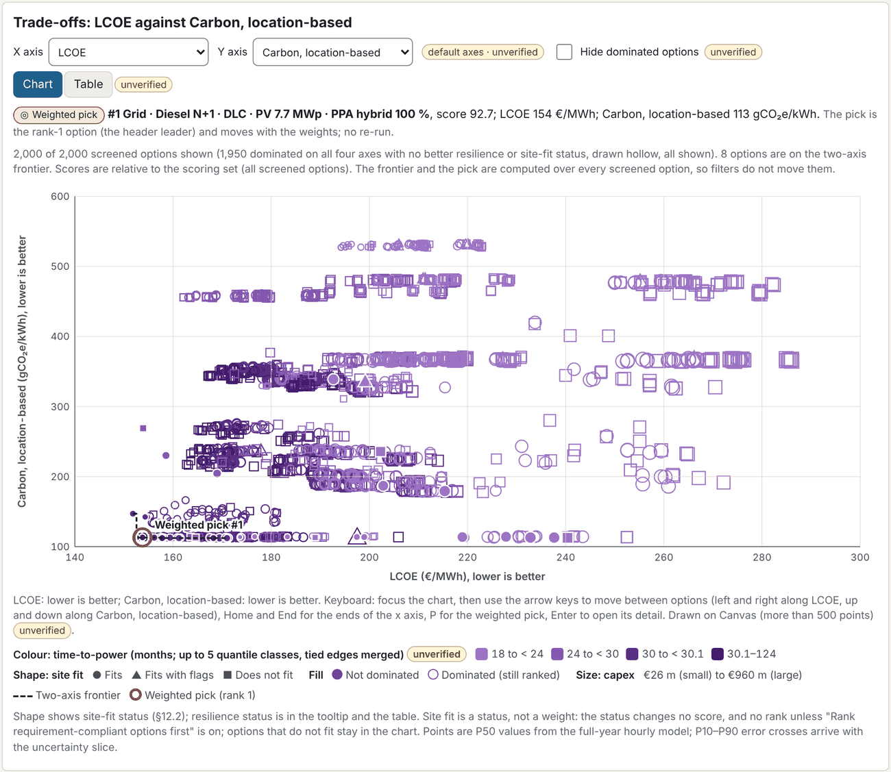

The **Trade-offs** tab plots every screened option on two axes. Each axis can be any of: LCOE, NPV of net cost, location-based carbon, market-based carbon, 1 − hourly CFE, time-to-power, or deliverability.

With "Size and colour: time-to-power colour, capex size" (the encoding before 23 October 2026):

- **Colour** shows time-to-power in up to five classes (quantiles of all options, merged where many options tie).
- **Shape** shows site fit: circle for Fits, triangle for Fits with flags, square for Does not fit.
- **Fill**: solid for options not dominated, hollow for dominated options.
- **Size** shows capex.
- The **dashed step line** joins the options on the two-axis frontier.
- The **weighted pick** (the rank-1 option, the same as the header's leader) is ringed and named above the chart, with its score and its two plotted values.

Points are drawn on a canvas when there are more than 500 (faster), and as individual shapes below that. A **Table** button shows the same rows as a table. With the keyboard: focus the chart, then use the arrow keys to move between options, Home and End for the ends of the axis, P for the weighted pick and Enter to open its detail.

**Reading the T1 chart.** The options form bands of carbon:

- **about 113 g/kWh**: every option supplied by the grid with no on-site plant running in normal hours, **with or without a PPA**. Location-based carbon counts PPA energy at the grid's intensity, so a PPA does not lower it (it lowers the market-based figure instead);
- **about 120 to 350 g/kWh**: options that run gas engines, fuel cells or CHP on site, lower when a larger PPA displaces some of the gas burn;
- **about 360 to 530 g/kWh**: islanded options, which burn gas for everything.

Within a band, cost varies with the cooling approach and the plant. The leader sits at the bottom-left of the lowest band.

::: {.callout .built}
**Built 23 October 2026.** The default chart is **cost on the vertical axis against carbon on the horizontal axis** (each following the scoring metrics), with **resilience status as the bubble size and colour** (Meets large and green, Meets with flags medium and amber, Does not meet small and red). Either axis can be switched, and "Size and colour" switches back to time-to-power colour and capex size.
:::

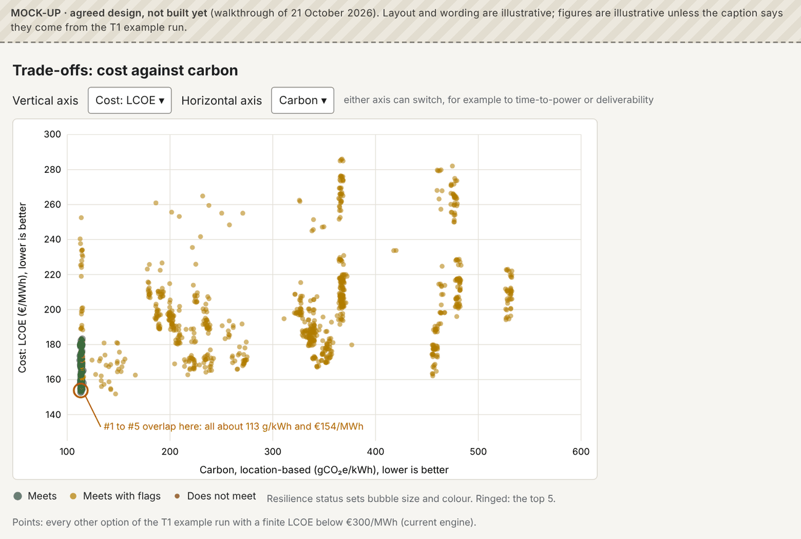

# 25. Compare {#ch25}

::: {.callout .built}
**Built 23 October 2026.** A **Compare** tab shows up to **three options side by side**: tick "Compare" on a top-five card, or use "Add to compare" in any option's detail (options table or trade-off chart); a fourth replaces the oldest. It lists the headline figures (rank, score and axis scores, power adequacy, LCOE, NPV, capex, both carbon figures, hourly CFE, first power and full load, deliverability, resilience, unmet load, flags), then the choices on which the options differ. Selecting an option's name opens its deep-dive card.
:::

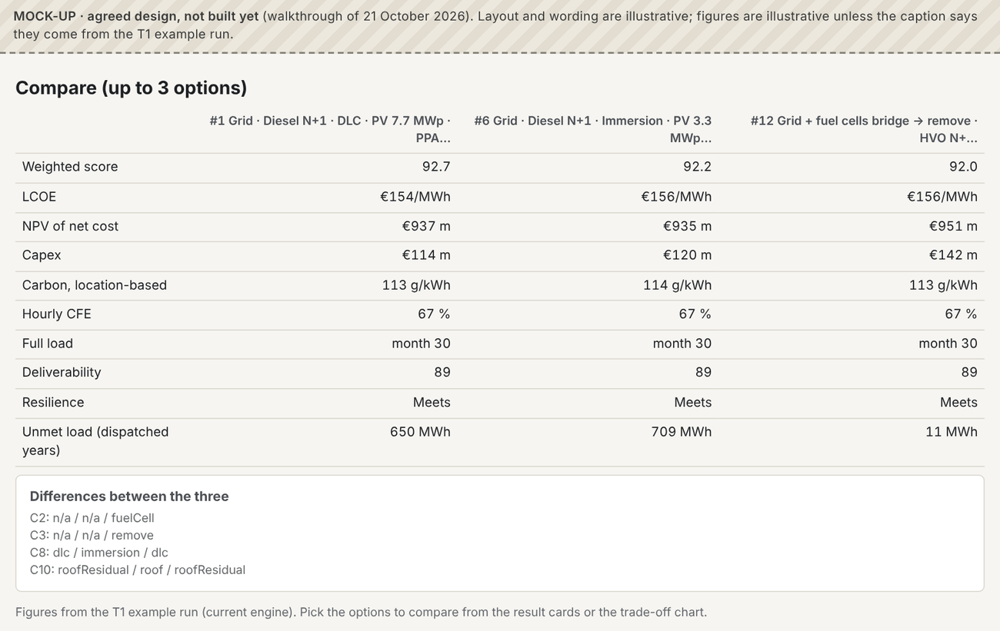

The example shows why compare matters: option #12 bridges with fuel cells until the grid arrives, so its unmet load falls from 650 MWh to 11 MWh and full load arrives at the same time, for €28 m more capex and a slightly higher LCOE.

# 26. Dispatch {#ch26}

The **Dispatch** tab shows how one option is supplied. Choose the option at the top (the leader by default). The option is re-run with the same engine the ranking used, and checked against the ranking's figures.

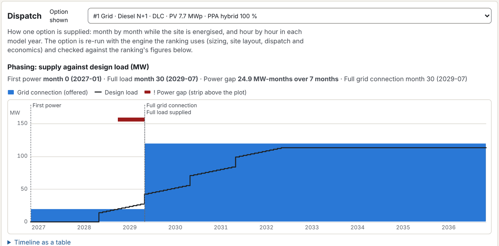

**Phasing.** Month by month: the offered grid capacity, firm on-site plant, and the design load as phases open and ramp. First power, full load, the power gap (MW-months and months) and the full grid connection month are marked. "Timeline as a table" gives the same numbers.

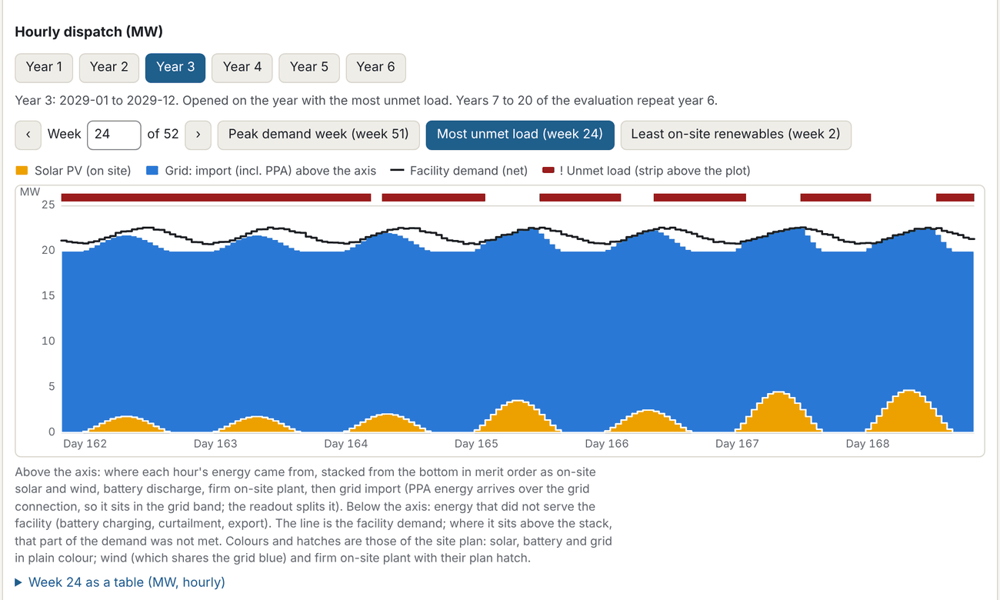

**Hourly dispatch.** Choose a simulated year (Year 1 to Year 6 for T1; later years repeat the last), then a week, or jump to the **peak demand week**, the week with **most unmet load**, or the week with **least on-site renewables**. Above the axis, each hour's supply is stacked in merit order (solar and wind, battery discharge, firm plant, then grid import, which includes PPA energy because it arrives over the grid). Below the axis: battery charging, curtailment and export. The line is the facility demand; where it sits above the stack, demand was not met, and a red strip marks those hours. Hover (or use the table) for each hour's numbers.

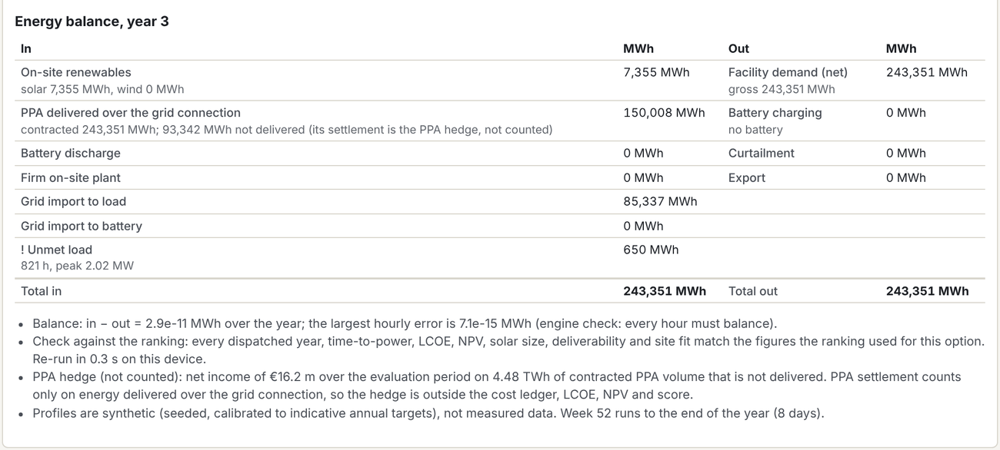

**Energy balance.** For the chosen year: every source in, every use out, and the totals, which must match. The notes below state the balance error (the largest hourly error was 7 × 10⁻¹⁵ MWh: rounding only), confirm that every year, time-to-power, LCOE, NPV, solar size, deliverability and site fit match the ranking, and report the PPA hedge.

::: {.callout .built}
**Built (23 October 2026, work package 8).** Beside the weeks: **Any period**, a start day (1–365) and a length of 1, 2, 3, 7, 14 or 31 days; the chart, readout and table follow it, and "Back to weeks" returns. In a screening run (chapter 10) only the options verified with the full year are offered here.
:::

# 27. Sensitivity (tornado) {#ch27}

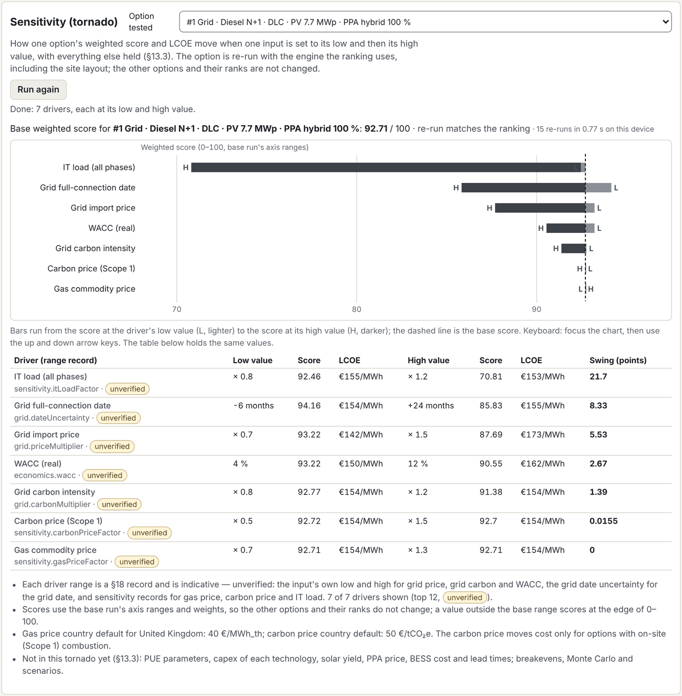

::: {.callout .built}
**Built (23 October 2026, work package 9).** Tick the drivers to test; the decision log's seven are ticked by default (gas price, grid price, WACC, carbon price, capex, capacity factors, grid connection date). "Tick all" adds the other nine. The **result measured defaults to LCOE**; NPV of net cost, location-based carbon and the weighted score can be chosen. Changing the measure re-sorts the drivers at once, without a re-run.
:::

Choose the option to test (the leader by default). The tool re-runs that one option once for the base case and twice for each ticked driver (its low and its high value, everything else unchanged): 15 re-runs for the default seven, 33 for all sixteen. The other options and their ranks are not changed: the re-run scores are measured against the base run's axis ranges.

| Driver | Low | High | Ticked by default |
|---|---|---|---|
| Gas commodity price | × 0.7 | × 1.3 | yes |
| Grid import price | × 0.7 | × 1.5 | yes |
| WACC (real) | 4 % | 12 % | yes |
| Carbon price (Scope 1) | × 0.5 | × 1.5 | yes |
| Capex (every capex line) | × 0.7 | × 1.5 | yes |
| Capacity factors (on-site solar and wind output) | × 0.85 | × 1.15 | yes |
| Grid full-connection date | −6 months | +24 months | yes |
| IT load (all phases) | × 0.8 | × 1.2 | |
| Grid carbon intensity | × 0.8 | × 1.2 | |
| PUE (cooling energy and design-day cooling load) | × 0.8 | × 1.2 | |
| Battery capex | × 0.7 | × 1.3 | |
| Grid connection capex | × 0.5 | × 2 | |
| Evaluation period | 15 years | 25 years | |
| Electricity price escalation (real) | −2 %/yr | +2 %/yr | |
| Flexibility trigger level | × 0.8 | × 1.2 | |
| Generator test hours | 3 h/yr | 24 h/yr | |

Drivers are sorted by the swing in the chosen measure, largest first. A check confirms that the base re-run reproduces the ranking's score exactly. Every range is a registry record labelled indicative — unverified.

**Reading the T1 tornado.** IT load swings the score most (from 92.5 to 70.8): at 120 MW of IT the design load (136 MW) exceeds the 120 MW grid, the option never reaches full load, and its time-to-power score collapses. The grid date comes next (+24 months costs 7 points). The grid price moves LCOE most (€142 to €173/MWh), but the score less, because every option would pay it. Gas price has no effect: the leader burns no gas.

The screenshot above shows the tornado before work package 9 (score measured, the first seven drivers). The mock-up below shows the agreed LCOE view, which is now the default.

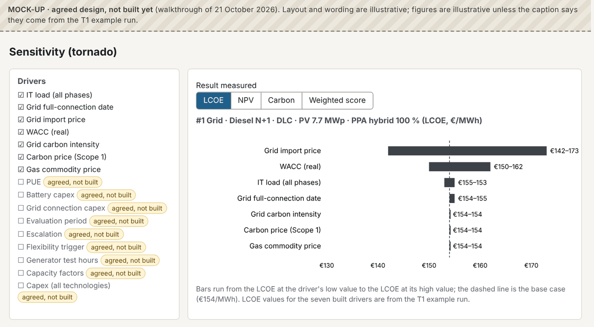

## Breakevens

::: {.callout .built}
**Built 24 October 2026 (work package 17; OPEN-QUESTIONS 93–97).** Under the tornado, **Run breakevens** asks, for the leader and each of five competitors: how far would each of eight drivers have to move before the competitor takes the leader's place? It runs on request (T1: 224 re-runs, a few seconds) and changes nothing in the run.
:::

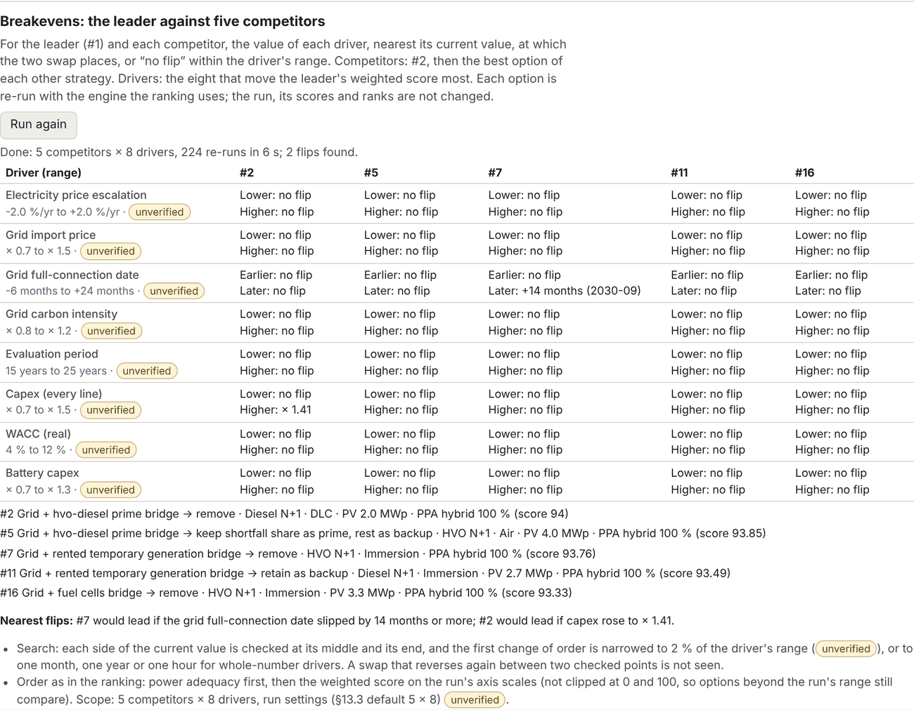

- **Competitors:** #2, then the best option of each other strategy (the strategies of the top-five cards), in rank order.
- **Drivers:** the eight, of all sixteen, that move the leader's weighted score most between their low and high values. They are chosen afresh by the breakeven run, whatever is ticked for the tornado.
- **Each cell** gives, for one driver and one competitor, the value below the current one ("Lower", or "Earlier" for the grid date) and above it ("Higher", "Later") at which the two swap places, or "no flip" within the driver's range. For the grid date the cell also gives the date.
- **Nearest flips** under the table: the flips closest to today's values, as a share of each driver's range. The summary (chapter 22) names the two nearest.

The order is the ranking's: an option that serves its load in every hour stays ahead of one that does not, then the weighted score decides, on the run's own axis scales. The search checks the middle and the end of each side of the current value and narrows the first swap to 2 % of the range (to one month, year or hour for the grid date, the evaluation period and test hours). A swap that reverses again between two checked points is not seen.

Two details (check H6, 26 October 2026). If the run used the representative-day screening tier (chapter 37), the leader and each competitor are re-run over the full year at today's values too, so that every point of the table uses one model; otherwise an option next to the leader could show a flip that is only the difference between the two models (on T1 the screening figures of options outside the best ten were up to 0.04 points off). And if you enter a value outside a driver's record range (a WACC of 13 % against 4–12 %), the range used grows to include it: nothing beyond the record's range is tested on that side, and the table says the range was widened.

**The T1 example** (24 October 2026). The competitors are #2, #5, #7, #11 and #16; the drivers, largest swing first, are electricity price escalation, grid import price, grid date, grid carbon, evaluation period, capex, WACC and battery capex. Only two cells flip: #7 (rented bridge, removed) takes the lead if the grid date slips by 14 months or more, and #2 if every capex line rises to × 1.41. Every other competitor stays behind on every driver across its range: the T1 leader is robust to these inputs, while the margins are small (0.15 points to #2).

## Uncertainty (Monte Carlo)

::: {.callout .built}
**Built 25 October 2026 (work package 18; OPEN-QUESTIONS 98–104).** At the bottom of the Sensitivity tab, **Run uncertainty** draws the uncertain inputs together, many times over, and re-runs the 20 leading options each time. It answers: how wide is each option's likely range, and how often does the leader stay first? It runs on request and changes nothing in the run.
:::

- **Inputs drawn:** the thirteen tornado drivers that describe the world rather than the design: grid date, grid price, grid carbon, gas price, carbon price, WACC, capex, capacity factors, PUE, battery capex, grid connection capex, price escalation and test hours. The IT load, the evaluation period and the flexibility trigger are your choices and are not drawn. Each input is most likely at its current value and can go as low or high as its range (a triangle). Grid and gas price tend to move together, and so do the capex figures.
- **Samples:** 300 by default (100, 300 or 1,000 in the panel), drawn with a fixed seed, so the same run gives the same answer. Each sample re-runs the options with representative days instead of the full year, which is about 2.5 to 3 times faster (T1, 100 samples in Node: 4.0–5.3 s against 11–12 s, measured by check H6 and again by the lead). That costs exactness: adequacy is approximate, and so is the order of the options. In the H6 check on T1 the first place of a sample differed from a full-year run in 1 of 21 test cases, and the order of the top 20 in 13. The panel and the PDF say so.
- **The table**, one row per option: how often it comes first and in the top three (with a small bar), how often it is within 1 % of the best score in its sample (to one decimal place), and its P10, P50 and P90 score, LCOE, carbon and full-load date. P10 means one sample in ten is lower.
- **The robust pick** is the option most often within 1 % of the best score. If it is not the leader, the panel gives the counts behind it (for example 300 of 300 samples against 299): a gap of a few samples is within the noise of sampling, so read it as "about level", not as a finding. It does not by itself make the other option the safer bet.
- The header strip then gives the leader's chance of coming first, and the summary and the PDF use the results.

The table fills in as it runs, every ten samples, and the page stays usable. 300 samples take about 30 s in a browser, above the brief's 8 s target.

**The T1 example** (100 samples, 25 October 2026). The leader comes first in 82 % of samples and is in the top three in 98 %; #7 (rented bridge) comes first in 17 %. The leader's LCOE runs from €145 to €171/MWh (P10 to P90), higher than its €152/MWh in the run because the input ranges lean upwards (the grid price can rise to × 1.5 but fall only to × 0.7, and the grid date can slip 24 months but come only 6 months early). The robust pick is the leader itself. With 300 samples the picture is the same (the leader first in 83 %), but the robust pick moves to #7 by one sample: #7 is within 1 % of the best in 300 of 300 samples, the leader and #4 in 299. That is a tie in practice, which is why the panel now shows the counts.

# 28. Site (Beta) {#ch28}

::: {.callout .built}
**Built (22 October 2026).** The Site tab is a **Beta** feature: hidden by default, turned on in the general settings (chapter 30), and labelled Beta. Site fit never changes a score or a rank: "Rank requirement-compliant options first" uses the resilience status only, and dominance marks ignore site fit. With the tab off, the main views show no site fit at all: no header item, table columns, filters, chart shapes, option-detail section or site-fit flags. Turning the tab off also switches off the optional site-fit penalty, which is a Beta setting. The site inputs other than the area are still used while the tab is off: the POC and gas main set the route costs, and the layout still runs. Ground solar no longer depends on the layout: it comes from the ground area for PV (chapter 15, built 22 October 2026). Keeping the Site tab out of the PDF follows when the PDF is built.
:::

**Large campuses** (built 24 October 2026, work package 13). When laying out every option would take long (layout work above 20 million block², for example nine 100 MW buildings with hundreds of genset blocks) and site fit cannot change the ranking, the run leaves the options "Not laid out" and says so in a run flag. The Site tab then lays out each option it shows, the plan and the six thumbnails, in a fraction of a second each; the ranked list shows "Not laid out" for the others. Set "Site layout in the run" to "Every option, always" to lay them all out.

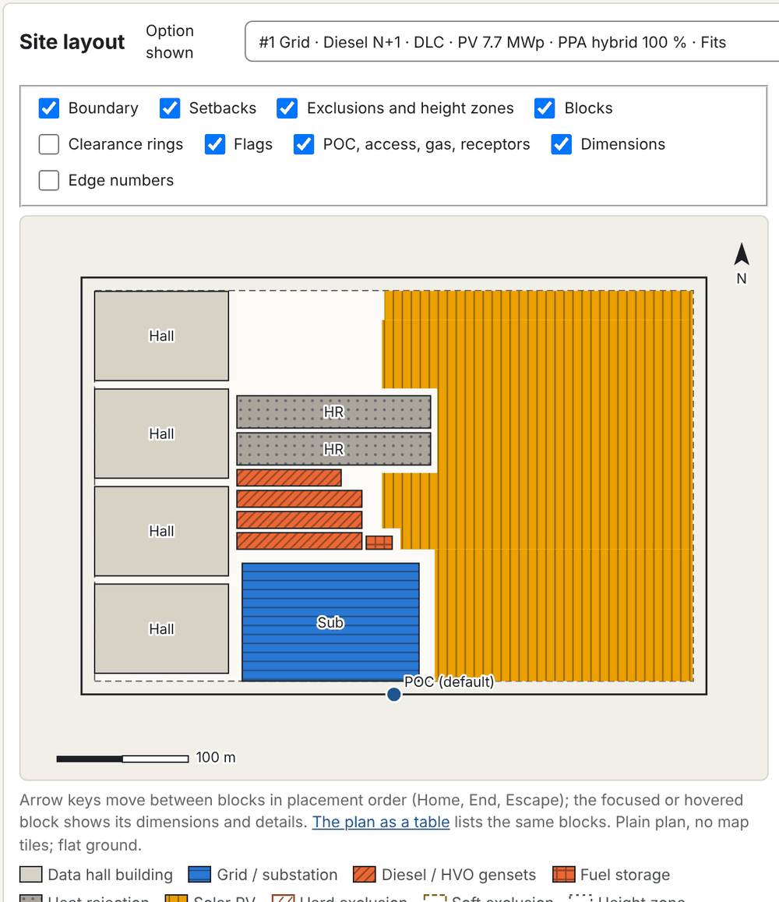

**The plan.** A north-up plan of the site with layers you can switch: boundary, setbacks, exclusions and height zones, blocks, clearance rings, flags, the POC, access, gas main and receptors, dimensions and edge numbers. The plan has no map tiles and assumes flat ground. Use the arrow keys to move between blocks; "The plan as a table" lists them.

**Editing the site.** Draw the boundary on the plan, type coordinates, or import a GeoJSON or KML file. Add exclusion zones (hard or soft, by type), height zones, the POC, the gas main, access points and noise receptors. Per-edge setbacks override the uniform setback.

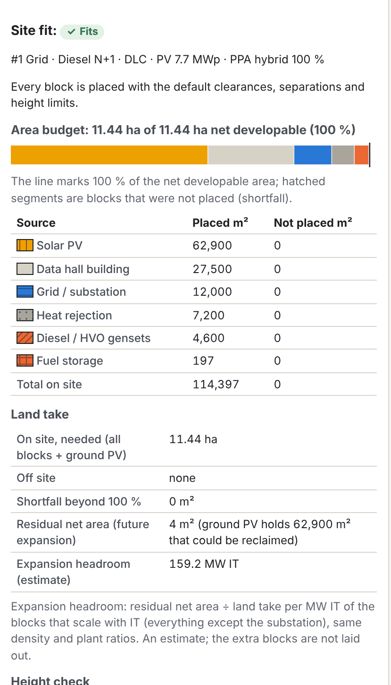

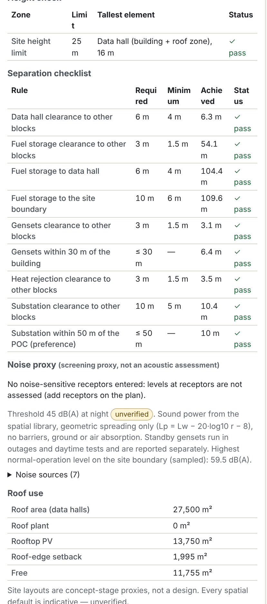

**Site fit panel.**

- **Area budget**: each kind of block's placed and unplaced area against the net developable area.
- **Land take**: on site, off site, shortfall, residual area, and an estimate of expansion headroom in MW of IT.
- **Height check**: the tallest element in each height zone against its limit.
- **Separation checklist**: each spacing rule with the required distance, the minimum allowed when relaxed, the distance achieved and the status (pass, relaxed or fail).
- **Noise proxy**: sound levels at receptors and the boundary from geometric spreading only (a screening proxy, not an acoustic assessment).
- **Roof use**: roof area, roof plant, rooftop solar, edge setback and free roof.

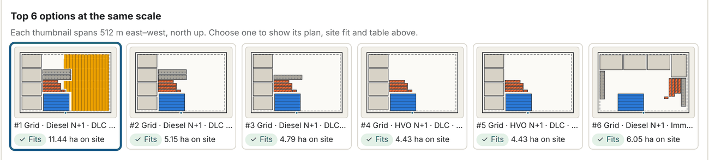

**Small multiples.** The six top-ranked options drawn at the same scale, with their site-fit status and land take. Choose one to show its plan above.

How the layout works is in chapter 36.

# 29. Export: PDF report and run log {#ch29}

## Study files (built 24 October 2026)

**Save study** writes one file, named after the project and the date (for example `Pego-data-centre-campus-study-2026-10-24.json`; the Windows program asks where to save it). It holds:

- your inputs as entered: a value you did not enter is stored as "at default", so a reopened study takes the tool's defaults of the day;
- your edited summary note, if there is one (chapter 22; 24 October 2026);
- the inputs as they were run, with every default resolved, for the record;
- a record of the result of the last run of those inputs: its fingerprint (input hash), the number of options and adequate options, and the leader with its score, LCOE, carbon and capex.

**Open study…** reads a study file, replaces the inputs and runs the study. When the run finishes, the line under the header says either "Re-run matches the saved study" or that the tool's defaults or engine have changed since it was saved, naming the saved leader and today's. A study saved by an earlier version opens with today's defaults for any input it lacks (for example the existing-plant inputs), and the line lists them. A file that is not a study of this tool, or one saved by a newer version, is refused with a reason. Nothing is sent anywhere: the file stays on your computer.

## Run log (current version)

From the Run progress panel, **Download run log** saves the log of the last run as JSON or CSV. The Windows program asks where to save it. The log has the schema name `dc-energy-run-log/1` and one row per event: sequence number, stage, event type (start, progress, end or warning), milliseconds since the start, count, total, and details (the source, and stage-specific data such as cache hits or the leader). Two runs with the same inputs give identical logs apart from the timings.

## PDF report

::: {.callout .built}
**Built (23 October 2026, work package 10).** **Save PDF report** at the top of the window makes one PDF of the run on screen, **inputs first, results after**. The Windows program asks where to save it; a browser saves it to its downloads folder. Nothing is sent anywhere: the app writes the PDF itself, with the standard PDF fonts, and uses no outside library. **No Excel export.** The Site tab (Beta) is not included. The hosted page does not offer the PDF (a host's frame ignores downloads).
:::

The sections (OPEN-QUESTIONS 32, answered 23 October 2026):

| Section | What it holds |
|---|---|
| Cover | Project, date, location, analysis start, IT load, options screened, engine version, inputs fingerprint, and the guardrail |
| Summary | The plain-English summary of chapter 22 (built 24 October 2026), its detail, and your edited note marked "edited" when there is one (with a line when it was written for an earlier result). Site-fit flags are left out, and so is a note written with the Site tab (Beta) on |
| 1. Inputs | Every input with its value and "Entered", "Entered (required)" or "Default" with its label and basis. Site geometry (Site tab) is left out |
| 2. Assumptions | The defaults the run used, with basis and note; how many registry records are unverified |
| 3. Results | Run summary and weights, the leader, the top five cards (figures, pros, cons, main flags), the top 20 |
| 4. Trade-offs | LCOE against location-based carbon for every option; the top five numbered |
| 5. Compare | The options ticked for comparison, their headline figures and the choices on which they differ |
| 6. Dispatch | Energy balance of the top five in the last modelled year and in the first year with load (GWh) |
| 7. Sensitivity | The last tornado run in the Sensitivity tab, with its chart and table, in the measure chosen there; the breakeven table (24 October 2026) and the Monte Carlo table (25 October 2026) when they were run for this run |
| 8. Flags | Every flag on the top five (not the site-fit flags), and the run notes |
| 9. Method | How the options are generated, dispatched, costed and ranked; run settings; the guardrail |

Run the sensitivity test and tick options to compare **before** saving the PDF if you want those sections filled; otherwise they say they are empty. Each page carries the project name, the date and "Page n of N"; the reader's side panel lists the sections.

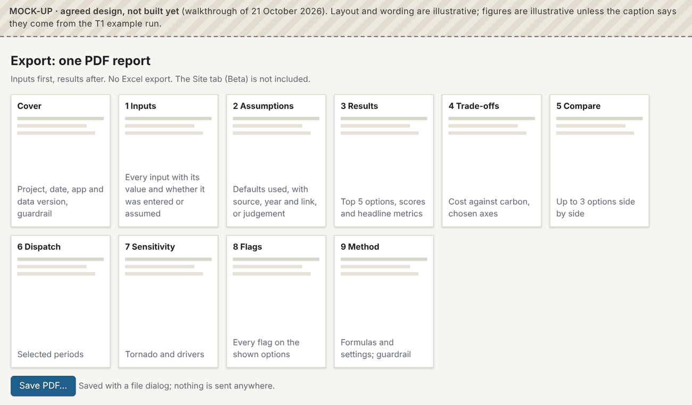

# 30. General settings {#ch30}

::: {.callout .built}
**Built (22 October 2026): the Site tab (Beta) switch.** The **General settings** button at the top of the window opens the settings, which hold features outside the main flow. The one built item is the **Site tab (Beta)** switch, off by default. It is a view setting: turning it on or off changes what is shown, never a score, a rank or a run.
:::

::: {.callout .agreed}
**Proposals, not agreed yet.** The mock-up below also shows the theme (follow Windows, light or dark), a run-log option, and an "About this copy" panel with the app version, the data version (with the dates of prices, carbon and profiles) and a reminder that the program never connects to the internet. The walkthrough did not decide these; they wait for the owner.
:::

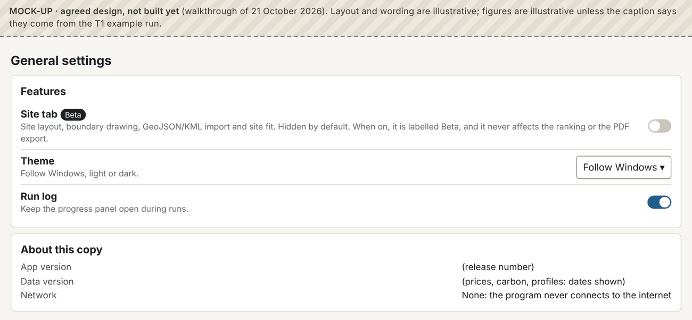
