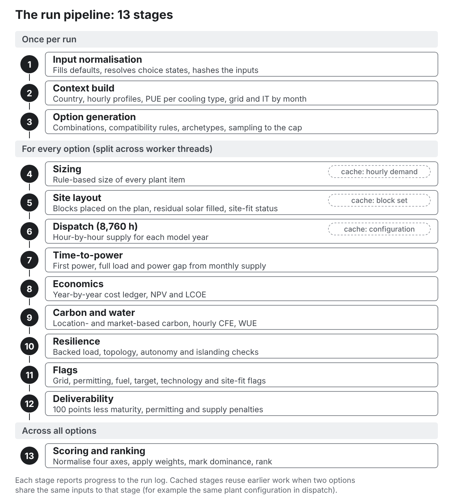
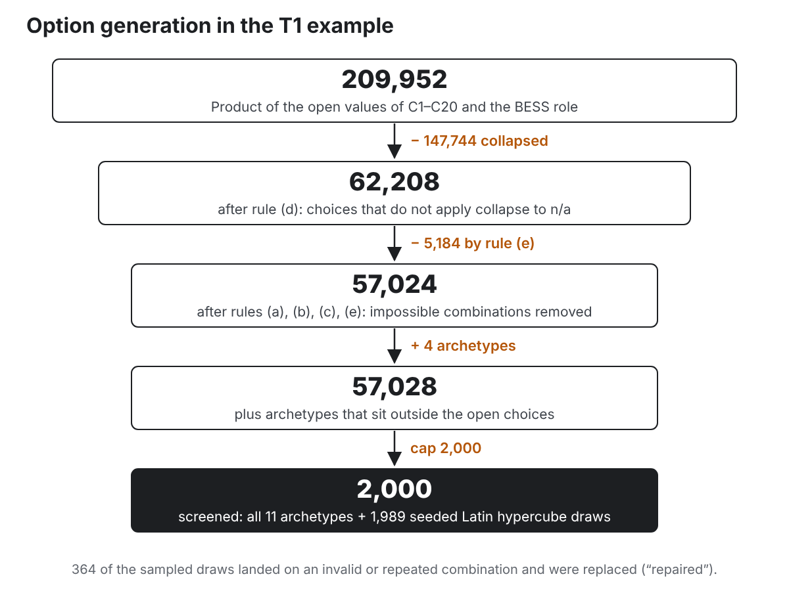
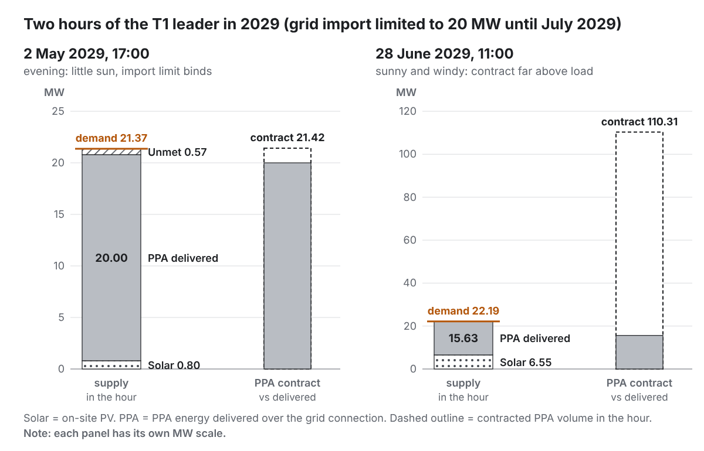

# Part IV. How the engine works {#part4 .part}

This part takes the calculation apart, stage by stage. Each chapter gives the rules as the code applies them, the default values, and the numbers for the T1 leader. Where the walkthrough agreed a change, the chapter says so; chapter 48 collects them.

The engine is the part of the program that does the calculation. It is written so that it has no screen code in it: the same engine runs in the Windows program, the single file, the tests and the Dispatch and Sensitivity tabs, which is how those tabs can check their numbers against the ranking.

# 31. The run pipeline {#ch31}

## Order of work

A run is a fixed sequence of stages. Each per-option stage is a pass over the whole list of options before the next stage starts, so the run log has exactly one start and one end per stage (per worker). The stages are:

1. **Input normalisation**: fill derived defaults (the phasing, choice states, the site area from a boundary), check the required inputs, and compute an **input hash**, a short fingerprint of all the inputs, used to name the log.
2. **Context build**: everything shared by all options (chapter 33).
3. **Option generation** (chapter 34).
4. **Sizing** (chapter 35).
5. **Site layout** and site fit (chapter 36).
6. **Dispatch** (chapter 37).
7. **Time-to-power** (chapter 38).
8. **Economics** (chapter 39).
9. **Carbon and water** (chapter 40).
10. **Resilience** (chapter 41).
11. **Flags** (chapter 42).
12. **Deliverability** (chapter 43).
13. **Scoring and ranking** (chapter 44).

## Background threads

To keep the screen responsive and use every processor core, the options are split between **worker threads**: one per core minus one, at least one, at most eight. Worker k evaluates every k-th option of the same generated list (options 0, k, 2k …), running stages 1 to 12 on its share. The main thread then merges the shares back into the generated order and runs stage 13 over all of them, because scores are relative to the whole set.

If background threads are not available (some browsers block them for files opened from disk), the same pipeline runs on the main thread in slices of 30 milliseconds, yielding to the screen in between. A watchdog checks every 2 seconds and, if a worker has been silent for 30 seconds, stops the pool and falls back to the main thread. The status line says which mode ran.

A run starts **350 milliseconds after an input is committed**. A newer request stops the workers of the older one, so results always match the current inputs.

## Determinism

With the same inputs and seed, every run gives the same options, sizes, results and ranks, whatever the machine or the number of workers. Three things make this so:

- every random number comes from one seeded generator (mulberry32), with separate streams for the profiles, the load shape and the sampling (each stream's seed is the run seed mixed with a fixed label);
- the option list is built in a fixed order and each option is identified by a hash of its choices: the letter O followed by the base-36 form of the 32-bit FNV-1a hash of the choice key (for example **O1YAUJ8J** for the T1 leader);
- ties in score are broken by the option identifier.

## Caches

Three stages reuse work:

| Stage | Cached by | T1 run |
|---|---|---|
| Sizing | hourly demand per cooling approach and model year | 1,996 reuses, 4 computations |
| Site layout | the set of blocks (options with identical blocks share a layout) | 676 reuses, 1,324 layouts |
| Dispatch | the dispatch configuration (everything the hourly loop reads) | 231 reuses, 1,769 simulations |

Two options with the same dispatch configuration (for example differing only in the substation type) are simulated once.

## Re-scoring without re-running

Weights, the cost and carbon metrics and "rank requirement-compliant options first" only affect stage 13. Changing them re-scores the existing options without running stages 1 to 12 again.

## Timing

The T1 run (2,000 options; 1,769 distinct dispatch configurations; 10,616 simulated years of 8,760 hours in all) took 13.6 seconds on one worker in the environment used for this guide. The owner's measured figure on the target laptop is 15 to 20 seconds (the repository's status file still says 9 to 10 seconds and needs correcting).

# 32. Inputs, defaults and the registry {#ch32}

## The registry

Every default the engine uses is a **record** in one registry: **496 records** in the current version. Each record holds:

| Field | Meaning |
|---|---|
| path | Its name, for example `economics.wacc` or `tech.bess.p.capexPerKWh` |
| value, unit | The default and its unit |
| low, high | A range, where one is given (used by the tornado for some drivers, and reserved for the planned Monte Carlo) |
| basis | **source** (should come from a published source), **judgement** (an engineering judgement) or **run setting** (chosen for speed or resolution) |
| source, year, url, accessed | Where the value was verified: **all empty** in the current version |
| confidence, verified | C and false for every record |
| sourceToVerify | The source the brief names for checking it |
| note, briefRef | Explanation and the brief section |
| label | "indicative — unverified" |

By basis, 307 records are "source", 177 "judgement" and 12 "run setting". By group: 195 technology parameters, 90 spatial (layout) parameters, 45 cooling parameters, 22 site, 21 choice defaults, 20 requirements, 18 settings, 13 load, 11 economics, 11 deliverability, 8 fuels, 7 view settings, 7 grid, 6 project, 6 PPA, 6 utilities, 5 weights, 4 sensitivity and 1 for the country profile set. Appendix A lists every record.

A field shows the **unverified** tag while it is at its default. "At its default" means: equal to the record's value; or, for defaults that follow other inputs ("by country", the phasing, the choice states), not overridden by a value you entered.

## Required inputs

Seven inputs have no default in the brief: latitude, longitude, site area, IT load, grid import now, grid import at full connection, and the full-connection date. The program fills them with the T1 values so that it can run, marked "required · example value". If one is missing, the run log records a warning.

## Defaults that are not used yet

A few records are held but not read by any calculation in the current version:

- `requirements.upsMin` (5 minutes of UPS): no UPS is sized;
- `requirements.bessUpsGensetFraction`: the BESS-augmented UPS rule uses N gensets regardless;
- `economics.revenueExport`: export income is counted whenever C1 is "Grid + export";
- `settings.autonomyBasis` and `settings.absoluteScaling`: placeholders;
- `fuel.efHydrogen`: the engine uses zero for hydrogen directly.

## Derived inputs

Before every run, the inputs are **normalised**: a missing phasing becomes one phase at the full-connection date; a valid boundary polygon replaces the site area; and each choice without a user setting takes its default state, some of which follow other inputs (C6 follows the required topology, C7 the autonomy, C8 the cooling approach input, C11 the site area and off-site land, C15 the district heating input).

::: {.callout .agreed}
**Agreed, not built yet.** Each default gets its source, year, link and access date as it is researched (chapter 50); values that stay judgements are labelled "judgement". Each option lists the defaults it relies on, with their sources.
:::

# 33. The run context: country, profiles and timelines {#ch33}

The context holds everything that depends on the inputs but not on any option's choices, built once per run.

## Country

If the country is not set, the engine picks the built-in country whose outline contains the pin. If the pin is at sea or on the coast just outside every outline, it takes the built-in country whose outline is nearest, up to 25 km away ("nearest coast"). If the pin is inside a country with no built-in profile (for example Serbia or Ukraine) but within 3 km of a built-in country, it takes that country. Otherwise it takes the nearest reference point. The outlines are simplified (Natural Earth 1:50m, rounded to about 1 km), so a pin within 3 km of a border carries a flag on every option naming the neighbour and asking you to check the country. Reference-point distances measure east–west distances scaled by the cosine of the latitude (`context.js` `pinCountryInfo`, `geocountry.js`). Each country row holds: name, currency, reference latitude and longitude, mean temperature and seasonal swing, solar yield (kWh/kWp a year), wind capacity factor, mean wholesale price, non-commodity adder, mean grid carbon, gas price, carbon price, EU membership and the grid carbon multiplier reached in 2050. Appendix B lists them.

## Synthetic hourly profiles

::: {.callout .built}
**Built.** Every profile is synthetic: generated from the seed, shaped by simple physics and statistics, then scaled to the country's annual targets. They are labelled "Synthetic profile (seeded), calibrated to indicative annual targets — not measured data".
:::

For each country, seed and site latitude the engine makes one year of 8,760 hours:

- **Weather spells.** Three daily random series with memory (each day's value is a fraction of yesterday's plus a random step): a temperature anomaly (memory 0.8, scaled to about ±2.6 °C typical), cloudiness (memory 0.6) and dryness (memory 0.7).
- **Temperature** = mean + seasonal swing × a cosine with its low in mid-January + a daily cycle peaking at 15:00 (amplitude 3.5 °C in winter rising to 5.5 °C in summer) + the daily anomaly.
- **Wet-bulb temperature** = temperature − a depression of (1.5 + 0.22 × temperature above 0 °C) K, varied by the dryness series and the time of day, never less than 0.5 K.
- **Solar output per MWp** = clear-sky output from the sun's elevation (worked out from the site latitude, the day and the hour) reduced by up to 75 % on cloudy days (cloudier in winter); then scaled so the annual total equals the country's solar yield, and capped at 1 MW per MWp.
- **Wind capacity factor**: an hourly wind speed with strong memory (0.985 from hour to hour), windier in winter, passed through a generic turbine power curve (starts at 3 m/s, full output from 12.5 m/s, stops above 25 m/s). The speeds are scaled up or down until the average capacity factor equals the country target.
- **Wholesale price** = country mean × (1 + morning and evening peaks − a night trough − a winter premium − 0.9 × how much windier than average − 0.5 × how much sunnier than average) plus random noise, floored at −€30/MWh and re-centred so the annual mean equals the country mean.
- **Grid carbon** = country mean × (1 − seasonal term − 0.9 × wind anomaly − 0.45 × solar anomaly + noise), floored at 10 % of the mean and rescaled to the mean.
- **Cheapest and dearest hours.** For each day the engine marks the 1, 2, 4 and 12 cheapest and dearest hours, which the battery rules use.
- **Design temperatures**: the hottest hour's dry-bulb and wet-bulb temperatures.

For T1 (United Kingdom, seed 20261015): mean temperature 9.8 °C, hottest hour 26.4 °C dry-bulb and 19.9 °C wet-bulb, solar yield 950 kWh/kWp, wind capacity factor 0.34, mean price €95/MWh, mean carbon 200 g/kWh.

## Cooling profiles

For each cooling approach and each hour, using the temperature that drives it (chapter 6):

::: formula
| COP = max(1.5, COP_ref − slope × (T − T_ref))
| part = 0 if T ≤ T_fc; 1 if T ≥ T_fc + band; otherwise (T − T_fc) ÷ band
| mechanical fraction = part ÷ COP
| cooling fraction = fan fraction + mechanical fraction
| PUE in that hour = 1 + cooling fraction + loss fraction
:::

The **annual** cooling fraction is the average over the year; the **peak** is the value at the design temperature. The number of hours with part > 0 is kept for the water calculation.

| Parameter | Air | Evaporative | DLC | Immersion |
|---|---|---|---|---|
| T_fc (°C) | 10 | 14 (wet-bulb) | 26 | 30 |
| band (K) | 10 | 6 | 10 | 10 |
| COP_ref | 5.0 at 25 °C | 6.5 at 20 °C | 5.5 at 35 °C | 5.5 at 38 °C |
| COP slope (per K) | 0.12 | 0.15 | 0.10 | 0.10 |
| fan fraction | 0.07 | 0.05 | 0.045 | 0.03 |
| loss fraction | 0.07 | 0.07 | 0.06 | 0.06 |

**T1, DLC on the design day** (26.36 °C): part = (26.36 − 26) ÷ 10 = 0.036; COP = 5.5 − 0.1 × (26.36 − 35) = 6.36; mechanical = 0.0057; cooling = 0.045 + 0.0057 = 0.0507; peak PUE = 1 + 0.0507 + 0.06 = **1.111**.

## Timelines by month

The context holds month-by-month arrays from the analysis start, long enough for the evaluation period and the time-to-power horizon. The horizon is 120 months, extended when the programme is longer so that it always reaches full load (the last phase plus its ramp) and the full grid date with a year to spare, in whole years (built 24 October 2026):

- **Grid capacity**: grid import now, then each step from its date, then the full capacity from the full-connection date.
- **Installed IT**: the sum over phases of phase IT × ramp factor, where the ramp factor is 0 before the phase, then rises from 0.5 to 1 over 12 months.
- **Gas price** = gas commodity price (your value or the country's) + transport adder (€4/MWh).
- **Carbon price**, **price multiplier**, **price adder** (your value, or the country's) and **carbon multiplier**.

## Hourly demand

For a cooling approach and a model year y, hour h falls in month 12y + floor(h ÷ 730) (the engine uses 730-hour months, with the last month running from hour 8,030 to the year end). Then:

::: formula
| IT(h) = installed IT in that month × load shape(h)
| facility demand(h) = IT(h) × (1 + cooling fraction(h) + loss fraction) + ancillary × installed IT
| mechanical cooling(h) = IT(h) × mechanical fraction(h)
:::

The load shape has an average of exactly the utilisation (0.8 by default), so facility energy uses utilised IT, while sizing uses installed IT. The result is cached for each cooling approach and year.

## Grid decarbonisation

::: formula
| factor(year) = 1 + (factor_2050 − 1) × (year − base year) ÷ (2050 − base year)
:::

equal to 1 in the base year and fixed at the 2050 value afterwards. It multiplies grid carbon (location-based Scope 2) in the economics stage.

# 34. Generating options {#ch34}

## Step 1. The product of open values

Each choice contributes its included values (one if locked). The raw count is the product of the counts. For T1 it is **209,952**.

## Step 2. Not-applicable values collapse (rule d)

Going through the choices in order, a choice that does not apply is set to "n/a" instead of multiplying the options:

| Choice | Not applicable when |
|---|---|
| C2 bridging supply | C1 is neither "Bridge until grid" nor "Islanded" |
| C3 plant after grid arrives | C1 is not "Bridge until grid" |
| C5a backup arrangement, C6 topology, C7 autonomy, C18 genset arrangement | C5 is "None" or "Retained bridging plant" |
| C4s firm generation sizing | C4 is "None" |
| C12r BESS role | C12 is "None" |
| C14 PPA coverage | C13 is "None" |

T1: 147,744 combinations collapse, leaving **62,208**.

## Step 3. Compatibility rules

Only logically impossible combinations are removed, each by a named rule:

- **(a)** Gas CHP-trigeneration needs a gas supply: not generated when gas available is "No".
- **(b)** Heat offtake needs district heating: C15 other than "None" not generated when district heating is "No".
- **(c)** A battery in the "bridging support" role needs a battery: not generated with C12 "None".
- **(e)** "Retained bridging plant" as backup needs bridging plant that stays on site (C1 "Islanded", or "Bridge until grid" with C3 not "Remove"). This rule was added by the builder.
- **(f)** "Roof + ground" solar needs a ground area for PV above 0; otherwise it would repeat "Roof only" (built 22 October 2026).
- **(g)** A top-up firm plant (C4 sizing "Permanent shortfall") needs a permanent shortfall for the option's cooling type: the design load above the full grid capacity after the full grid date. Islanded options always have one. Otherwise it would repeat C4 "None" (built 23 October 2026).
- **(h)** Splitting bridging plant (C3 "Keep shortfall share as prime, rest as backup") needs generating plant and a permanent shortfall for the option's cooling type (built 23 October 2026).
- **(i)** A battery sized to the permanent shortfall (C12) needs a grid to recharge from (not islanded), a permanent shortfall for the cooling type and the peak-shave role (built 23 October 2026).
T1: rule (e) removes 5,184; the others none. **57,024** valid combinations remain.

## Step 4. Archetypes

Eleven reference strategies are always generated, whatever the choice settings, so every run includes recognisable baselines:

| Archetype | Main choices |
|---|---|
| A1 Grid-only | wait for grid, diesel backup, no solar, battery or PPA |
| A2 Grid + offsite PPA | HVO backup, hybrid PPA 100 % |
| A3 Grid + on-site solar + BESS | roof + residual solar, 4 h battery at 50 % |
| A4 Grid + gas CHP/trigeneration + BESS | CHP prime, 2 h battery at 25 % |
| A5 Gas bridging to grid | gas recips bridge, retained as backup |
| A6 Islanded gas + solar + BESS | islanded on gas recips, solar, 4 h battery |
| A7 Renewables-led | solar, wind fitted on site, 4 h battery, hybrid PPA 100 % |
| A8 Fuel cells + grid | fuel cell prime |
| A9 Low-carbon backup + grid + PPA | BESS-augmented UPS, hybrid PPA 100 % |
| A10a Nascent firm (SMR) | SMR prime |
| A10b Nascent firm (hydrogen) | hydrogen prime |

Choices an archetype does not specify take the **first open value** of that choice. With the T1 defaults that makes every archetype air-cooled with roof heat rejection, which matters for the results (chapter 47). Archetypes that fall outside the open choices (T1: four of them) are added to the count: **57,028** combinations.

## Step 5. The cap and sampling

If the total exceeds the cap (2,000) and sampling is on, the engine keeps every archetype and samples the rest with a seeded **Latin hypercube**: a way of drawing a sample so that every value of every choice appears about equally often.

- For each choice, a column of n values is made by cycling through its open values, then shuffled (n = cap − archetypes = 1,989 for T1).
- Draw i takes the i-th value from every column, then applies the n/a collapse.
- A draw that is invalid, repeats an earlier draw, or equals an archetype is a miss. Misses are replaced by valid combinations not yet chosen, picked at random ("repaired"). T1: 364 repairs.

Combinations not drawn are not sized, simulated, scored or shown. The run summary and header say so, and "Screen all" switches sampling off.

## Values not generated

For each choice the engine lists the values left out and why: excluded by you, the wind default on small sites, locked, or simply not in the default subset. This is the "values not generated" list of the run summary.

# 35. Sizing rules {#ch35}

Every option is sized by the same rules, from its choices and the inputs, before any check. Each rule writes a plain-English sentence with its arithmetic; the T1 leader's are quoted in *italics*.

## Design and average load

::: formula
| design load = IT × (peak PUE + ancillary fraction)
:::

*Design facility load: 100 MW IT × peak PUE 1.111 (DLC + dry coolers, design-day dry-bulb 26.4 °C) + ancillary 2 % = 113 MW.*

The **steady-state average facility load** (for prime plant and the PPA sentence) is the average hourly demand in the first full year after the last phase has ramped up: 791,905 MWh ÷ 8,760 h = 90.4 MW for T1.

## Building

::: formula
| whitespace = IT (kW) ÷ density;  GFA = whitespace × gross-up
| footprint = GFA ÷ storeys;  height = storeys × 6 m + 4 m
:::

## Critical load and backup

::: formula
| critical load = backed % × IT × (1 + design cooling fraction)
| N = ceiling(critical load ÷ unit size)
| blocks B = ceiling(N ÷ 10)
| installed = N (N); N + B (N+1); 2N (2N); N + ceiling(B ÷ 4) (catcher)
:::

*Critical load for backup: 100 % × (100 MW IT + 5.1 MW mechanical at design) = 105 MW.*
*Diesel standby gensets: 105 MW ÷ 2.75 MW per unit = 38.2 → 39 units; 39 units form 4 blocks (block size 10); N+1 adds 4; total 43 units (118 MW).*

The "design cooling fraction" is the fans plus mechanical cooling at the design temperature (0.0507 for DLC).

**BESS-augmented UPS:** N HVO gensets only; the redundant units' capacity (B units for N+1) is provided by a battery of that many MW for 2 hours.

**Retained bridging plant as backup:** the bridging plant is enlarged if needed to meet the same backup rule on the critical load and required topology; with HVO-diesel bridging, fuel storage is sized for the required autonomy.

**Per building or pooled** (built 23 October 2026, choice C5a, OPEN-QUESTIONS 47 and 48). The rule above sizes the gensets for the whole campus as one pool. Since 23 October 2026 two arrangements are generated:

- **Per building** (the rule): one backup technology per building, each building sized on its own critical load with its own redundancy. Bridging plant retired into backup when the grid arrives (C3 "Retain as backup", "Retain for grid services", or the share not kept as prime) backs up whole buildings, in phase order, if it can meet a building's critical load at the required topology; gensets back up the rest. In T1 with DLC each 25 MW building needs 10 + 1 diesel units, 44 in all against 43 pooled; with air cooling 12 + 2, 56 against 52. The T1 bridging plant is too small to back up a whole building.
- **Pooled across the campus:** the gensets are sized as above, on the campus critical load less the retired bridging plant (its redundant units removed). Pooling saves units, so the option carries a **client-perceived risk** item in deliverability: by default the penalty of a minor permitting flag (3 points), raisable to that of a major one (8 points) with the input "Client-perceived risk of pooled backup".

Fuel storage is sized for the critical load the gensets back up, and genset capex is booked by building.

## Fuel storage

::: formula
| bulk fuel (m³) = critical load the gensets back up (kW) × autonomy hours × 0.26 L/kWh ÷ 1,000
| fuel mass (t) = volume × 0.84 t/m³
:::

*Fuel storage: 105 MW × 48 h × 0.26 L/kWh = 1,311 m³ (1,101 t).*

Gas gensets: no storage, unlimited autonomy while the gas network stays up (flagged).

For the Seveso test the store also counts the liquid fuel held for **running** HVO-diesel prime or bridging plant, by the same rule at that plant's full output (built 24 October 2026; before, only the standby store counted). Bridging plant kept as the backup is already in the standby store.

::: formula
| Seveso store (t) = (standby store m³ + running plant MW × 1,000 × autonomy hours × 0.26 L/kWh ÷ 1,000) × 0.84 t/m³
:::

## Grid

The grid connection is the offered capacity per month, the same for every option and never resized. The band (MV below 20 MW, HV up to 150 MW, EHV above) follows the full capacity.

*Grid connection: offered import capacity per period (20.0 MW → 120 MW), the same for every option and never resized. Connection capex on 120 MW at full connection (HV band, AIS).* (Sentence as before work package 3. Since 23 October 2026 the connection is the strategy's contracted capacity, blank = the offer, and the connection charge is the lump sum entered, default 0.)

For each period where the design load exceeds the firm on-site plant plus the grid, a shortfall sentence and an information flag are written:

*Grid shortfall at design load, months 23–29: design load 27.1 MW less 0.0 MW firm on site less 20.0 MW grid leaves up to 7.1 MW; dispatched as unmet load under "Show unmet load".*

The cable route is the straight line from the POC to the buildable envelope (on the default plan, the POC is the access point at the middle of the longest edge, so the route is about 10 m) at €1.5 m per km.

*Grid cable route: 10 m from the POC (default …) to the buildable envelope, straight line, × €1.50 m/km = €15,000 (in the grid connection capex).* (Since 23 October 2026 the cable route is its own capex line, "Grid cable route".)

## Firm prime plant (C4)

Since 23 October 2026 each C4 technology is generated sized two ways (choice C4s, OPEN-QUESTIONS 58), so the ranking compares a baseload plant with a top-up plant.

**Average load (baseload)**, as before:

::: formula
| target = size fraction × steady-state average facility load (size fraction 1.0)
| units = max(1, round(target ÷ unit size));  installed MW = units × unit size
:::

**Permanent shortfall (top-up)**: just enough to keep the option adequate once the full grid is connected, with the same redundancy as bridging plant:

::: formula
| S = largest (design load − full grid capacity) in any month from the full grid date on (islanded: the design load)
| n = ⌈S ÷ unit size⌉;  units = n + ⌈n ÷ block size⌉ (N+1 per block of 10);  installed MW = units × unit size
:::

In T1 with evaporative cooling, for example, S is 9.0 MW, so a top-up CHP has 3 units plus 1 for N+1: 4 × 4.5 MW = 18 MW. A baseload CHP for the same cooling is sized to the average facility load of 91.8 MW: 20 × 4.5 MW = 90 MW.

Available from its programme month (or its earliest year, or the gas date, whichever is later). The programme month (built 23 October 2026) is counted from day one:

::: formula
| programme month = permitting allowance + procurement + construction
| permitting allowance = 6 months if the plant is held by the IED or Seveso (chapter 8), otherwise 0
| (wind, ground solar and SMR: planning and consent + procurement + construction)
:::

The same month applies to bridging plant, the battery and the solar and wind, and the capex of each item is booked in the year it becomes available.

## Bridging plant (C1, C2)

The engine finds the **largest shortfall** S between the design load and the offered grid capacity in the months before the full connection (for an islanded site: at least the design load).

::: formula
| units = ceiling(S ÷ unit size) + ceiling(units ÷ 10)    (N+1 per block, always)
:::

With "BESS + solar only" bridging, the battery is S MW for 24 hours. After the full connection, bridging plant follows C3: removed (sold), retained as backup, retained as prime (keeps running economically), retained for grid services (treated as backup), or split (built 23 October 2026, OPEN-QUESTIONS 59):

::: formula
| SP = largest (design load − full grid capacity) from the full grid date on
| kept units = ⌈SP ÷ unit size⌉ + N+1 per block;  bridging units = max(bridging units, kept units)
| before the grid date: all units run;  from it: the kept units run as prime, the rest are backup
:::

**When bridging plant arrives and is paid for** (built 24 October 2026, OPEN-QUESTIONS 69 and 70):

- **Rented plant** is hired one month (`settings.rentalLeadMonths`, judgement, 0–6) before the first month of shortfall (islanded: before the first load), not from the month it could first arrive. Dispatch, time-to-power and the rental all start then; the sizing sentence gives both months. In T1, all 350 rented options are hired later than they could arrive.
- **Plant kept as the backup** (C5 "retained") is bought in step with the buildings: the bridging units at the bridging date, then the units each later building's critical load needs, with its redundancy, at that building's date. Fixed O&M follows the units owned; rented plant kept as the backup is hired in the same steps. Dispatch still counts the whole kept fleet from its first date, because after the grid arrives it serves only as backup or above-grid prime.

In T1, for example, a rented bridge of 7 × 2 MW keeps 6 units (12 MW) for the 9.0 MW permanent shortfall of evaporative cooling and retires 1 into backup. Rule (h) generates the split only with generating plant (not "BESS + solar only") and where there is a permanent shortfall; otherwise it would repeat "Retain as backup".

## Battery (C12)

::: formula
| battery MW = share × design load;  battery MWh = MW × hours
:::

For example "4 h at 50 %" on a 113 MW design load gives 56.5 MW and 226 MWh. The role comes from C12r. A bridging battery is added to the same store.

**Sized to the permanent shortfall** (built 23 October 2026, OPEN-QUESTIONS 60). A battery that counts as firm supply against the design load. It is sized on the **design day**: the year's hottest day, shifted so its hottest hour is at the design temperature, with the PUE worked out hour by hour by the same cooling model (so its peak hour is the design load).

::: formula
| shortfall(h) = installed IT × (design-day PUE(h) + ancillary) − grid capacity, for each month from the full grid date
| battery MW = largest shortfall(h);  usable MWh = largest daily Σ shortfall(h) > 0;  stored MWh = usable ÷ √(round-trip efficiency)
| recharge check, each month: Σ min(battery MW, headroom(h)) × round-trip efficiency ≥ that day's shortfall energy
:::

When the check passes in every month, the battery counts as firm supply from the full grid date (once available), so it can close the power gap and make an option adequate. When it fails, the battery is still built and dispatched but does not count, and the minor flag `bess-recharge` says from which month. In dispatch it is a security battery: it covers only the grid shortfall, takes no arbitrage and recharges from the grid in any hour. Rule (i) generates it only with a grid, a permanent shortfall and the peak-shave role.

In T1 the permanent shortfall lasts most of the design day (air cooling: 16.7 MW at the peak, 291 MWh in the day), so the battery cannot recharge and never counts. On a site short only at the peak hours it does: T1 with a 125 MW grid and evaporative cooling (design-day PUE 1.27 at the peak, 1.12 at night) needs a 4.0 MW / 21.9 MWh battery, which recharges every day and closes the permanent power gap (250 → 31 MW-months; what remains is before the full grid date).

**Sized to the trigger hours** (built 23 October 2026, OPEN-QUESTIONS 33; generated only when flexibility, C16, is on, rule j). The economic battery for battery response:

::: formula
| battery MW = maximum curtailable share × full IT  (10 % × 100 MW = 10 MW in T1)
| battery MWh = battery MW × longest trigger event (at most the event length, 4 h) ÷ √(round-trip efficiency)
:::

With "hold fixed: hours covered", the trigger level is first set so that the events reach the target hours a year; with "battery size", the entered MW and MWh are used and the hours it covers are reported in dispatch.

**Resilience reserve battery** (built 23 October 2026): full IT × the reserve minutes (100 MW × 5 min = 8.3 MWh in T1). It is never dispatched; its battery energy is costed at €500/kWh (indicative) per building, replaced every 10 years.

## Area budget and solar

Before the layout, the engine estimates the land each block needs:

| Block | Area rule |
|---|---|
| Data halls | footprint (above) |
| Substation | MV: 500 m² per 20 MVA (MW ÷ 0.9); HV: 1.2 ha AIS, 0.4 ha GIS; EHV: 4 ha AIS, 1.2 ha GIS |
| Backup gensets | 100 m² per unit (gas 110); × 0.5 double-deck; 0 in-building |
| Fuel storage | 0.15 m² per m³ |
| Battery | 50 m² per MWh |
| Firm plant | per MW: recips 200, turbines 120, CHP 280, fuel cells 120, HVO-diesel 40, rented 150, hydrogen 300 m² |
| Heat rejection on the ground | 60 m² per MW rejected (IT × (1 + design cooling + losses)); half with "Split" |
| Wind | 0.1 ha pad per turbine |

**Rooftop solar:** from the roof area for PV when you enter one (÷ 5.5 m²/kWp). Left empty, the rule: the roof (the building footprint) less the roof plant: with heat rejection on the roof, the larger of 40 % of the roof and 60 m² per MW rejected (half of each for "Split"). Then:

::: formula
| rooftop MWp = free roof × 50 % usable ÷ 5.5 m²/kWp ÷ 1,000
:::

*Rooftop PV: roof 27,500 m² = 27,500 m² free × 50 % usable ÷ 5.5 m²/kWp = 2.50 MWp.* (The leader rejects heat on the ground, so the whole roof is free.)

An entered roof area larger than the free roof raises a minor flag ("solar-roof-area"); the PV is not reduced.

**Ground solar** (C10 "Roof + ground", only when the ground area for PV is above 0): the ground area for PV ÷ 1.2 ha per MWp. The layout places it as one block of that area and never resizes it; if it does not fit, site fit says so (chapter 36). Built 22 October 2026 (OPEN-QUESTIONS 52–54); carport solar, "fill residual" and "Fixed MWp" were removed.

::: formula
| ground MWp = ground area for PV (ha) ÷ 1.2 ha/MWp
| e.g. 3 ha ÷ 1.2 = 2.5 MWp
:::

**Wind:** on site, the net developable area ÷ 33.75 ha per turbine, rounded down, × 5 MW; off site, the off-site land the same way.

## PPA

*Offsite PPA (hybrid): 100 % of each year's facility consumption (steady state ≈ 791,905 MWh/yr), delivered over the grid connection and capped by import capacity.*

## Gas connection

For options that burn gas on site, a pipe from the gas main to the site at €0.8 m per km, only if a gas main location is given (by default it is not, and the sentence says so).

## Plant handed to dispatch

Firm prime and bridging plant become **dispatchable plants**, each with a mode for every month: 0 (off: before it is available or before its fuel), 1 (runs when cheaper than the grid, or to cover a grid shortfall) or 2 (must run: an islanded site). Backup gensets are not dispatched.

# 36. Site layout and site fit (Beta) {#ch36}

::: {.callout .built}
**Built (22 October 2026).** This stage belongs to the Site tab, a Beta feature kept out of the ranking (chapter 28). It still runs in every run and gives each option a site-fit status, which changes no score unless you switch on the site-fit penalty with the tab on. It no longer sizes ground solar: that comes from the ground area for PV (chapter 35).
:::

## The site model

The site is either the drawn or imported boundary, or a rectangle from the area and aspect ratio (long side east–west, centred on the location). The engine works in local metres, rotated so the site's smallest enclosing rectangle is aligned with the axes, and lays a grid of square cells over it: **2 m** cells, or **5 m** above 50 ha. A cell is buildable only if it lies wholly inside the boundary, at least the setback from every edge, and clear of hard exclusions. Soft exclusions, height zones and the distance to the boundary are kept per cell.

## Blocks

Each option's plant becomes rectangular blocks: data halls (one per phase, split above 25,000 m²), substation, genset arrays (at most 12 units or 4,000 m² each, two rows), fuel storage, battery arrays, firm plant arrays, heat-rejection modules, wind turbine pads, and ground solar as a fill. Rooftop solar and roof plant sit on the halls. SMR (and off-site wind) go to an off-site tray.

## Placement

Blocks are placed in priority order:

1. data halls;
2. substation, as close to the point of connection as possible;
3. backup gensets and fuel storage, next to the halls (gensets within 30 m), away from noise receptors where possible;
4. firm generation, near the gas main if there is one, away from receptors;
5. battery, near the substation;
6. heat rejection on the ground;
7. wind turbines;
8. ground solar, filling what is left (5 m from other blocks, strips narrower than 10 m left out; soft exclusions allowed by default).

Each block goes to the feasible position with the lowest cost for its rule (ties to the lower row, then column, then unrotated). A position is feasible if every cell is buildable and every separation is met: each block type's clearance to others, specific pairs (for example fuel storage 6 m from halls and 10 m from the boundary; batteries 10 m from occupied buildings), height limits and exclusions.

## Relaxation

If a block cannot be placed with the default rules, the engine tries again at relaxation levels, and names every rule it breaks:

| Level | What is relaxed |
|---|---|
| 0 | nothing (default rules) |
| 1 | separations reduced to their minimum values |
| 2 | height limit exceeded |
| 3 | both 1 and 2 |
| 4 | both, and soft exclusions used |

A block that still cannot be placed, or that would push the land take beyond the net developable area, goes to the **unplaced tray** with its area.

## Site-fit status

- **Fits**: every block placed at level 0, no flags.
- **Fits with flags**: everything placed, but a rule was relaxed, a height exceeded, the roof over-allocated, a wind buffer missed, or a hydrogen, SMR, off-site land or noise flag raised.
- **Does not fit**: at least one block (or part of a fixed solar field) not placed; the flag gives the shortfall in m².

T1: 963 options fit, 23 fit with flags, 1,014 do not fit.

## The checks reported

- **Separations**: for each rule, the closest pair, the required and minimum distance, the distance achieved and the status.
- **Height**: the tallest element in each zone (building plus roof zone, stacks, wind tip) against the limit.
- **Noise proxy**: sound pressure at each receptor and around the boundary from each noisy block, by geometric spreading only:

::: formula
| Lp = Lw − 20 × log10(r) − 8    (r in metres; levels added as energies)
:::

with screening sound powers such as 101 dB(A) per genset container and 88 dB(A) per MW of heat rejected. Continuous sources (heat rejection, engines) are compared with the night threshold (45 dB(A)); standby gensets are reported separately.

- **Roof use**: roof area, roof plant, rooftop solar, edge setback (1.5 m) and free roof.
- **Expansion headroom**: the residual net area divided by the land each MW of IT needs (excluding the substation), as an estimate in MW of IT.

# 37. Dispatch, hour by hour {#ch37}

Dispatch decides, for every hour of every simulated year, where the energy comes from. It is the core of the model.

## The hourly loop

For each hour h, with demand D and the grid capacity of that month:

**1. On-site renewables.** Solar = installed MWp × solar profile; wind = MW × wind profile (each only from its availability month). They serve the demand first; the rest is surplus.

**2. PPA.** The contracted volume for the hour is the annual volume (coverage × the year's facility energy) times the PPA's hourly shape (solar, wind, half-and-half hybrid, flat, or the site's own demand, normalised to sum to 1 over the year). The PPA delivers the smaller of: that volume, the remaining demand, and the grid import capacity. What it cannot deliver is recorded with its wholesale value; the part lost only because of the import capacity is also recorded ("limited by import capacity").

**3. Battery discharge** (if the battery is available and there is remaining demand). The battery can give at most its power rating, and its stored energy × √(round-trip efficiency).

- With the **peak-shave** or **bridging support** role, it covers any shortfall: remaining demand − remaining grid capacity − available firm plant.
- With the **peak-shave**, **shifting** or **grid services** role, in the day's dearest hours it also serves the remaining demand, keeping half its energy in reserve for peak-shave.

The dearest hours are the day's 1, 2, 4 or 12 most expensive hours, matched to the battery's duration (under 1.5 h: 1; under 3 h: 2; under 8 h: 4; otherwise 12).

**1b. Trigger hours** (flexibility on, built 23 October 2026, OPEN-QUESTIONS 34). In an hour of a trigger event (consecutive trigger hours, at most 4 per event, then 12 hours' recovery), the flexible share (10 % of IT) is taken off the grid: first by the economic battery, if battery response is on (up to its power and charge), then by curtailing IT, which uses one of the 100 hours a year and costs €500/MWh. The battery's other duties use only the power and charge left.

**4. Firm on-site plant**, in order (prime, then bridging), each in its monthly mode:

- **must-run** (islanded): serves all the remaining demand up to its capacity;
- **economic**: serves all the remaining demand if its marginal cost is below the grid price this hour;
- otherwise it serves only the part the grid cannot take (remaining demand − remaining grid capacity).
- **backup gensets as primary power** (if hours are set, built 23 October 2026): must-run in the year's most expensive grid-price hours only, after the other plant.

::: formula
| marginal cost = fuel price ÷ efficiency + variable O&M + carbon price × emission factor ÷ efficiency
| (SMR: fuel €9/MWh + variable O&M €3/MWh)
:::

A unit below its **minimum stable load** either does not run (if it was only economic) or runs at that load (if it was needed). When it runs at its minimum, it serves up to the whole remaining demand and the grid import that follows backs off; only output above the remaining demand becomes surplus (battery charging or curtailment). Built 24 October 2026 (OPEN-QUESTIONS 72); before, the plant's extra output was curtailed while the grid still imported, and where the grid was full the remainder showed as unmet load. **CHP-trigeneration** also displaces mechanical cooling: its recovered heat (1 MWth per MWe) drives absorption chillers (COP 0.7), which replace electric chillers with that hour's COP, up to the mechanical cooling load in that hour. That credit reduces the demand. If "Respect limit" is set, plant stops once it has run its maximum hours that year.

**5. Grid import**: the remaining demand up to the remaining capacity ("Show unmet load"), or all of it ("Show exceedance").

**6. Flexibility, then unmet load.** With flexibility on, what the trigger step has not already shed this hour can be shed against the shortfall, up to 10 % of that hour's IT load, for at most 100 hours a year in all (shared with trigger hours). IT shed here counts as unmet for power adequacy (OPEN-QUESTIONS 61). Anything still left is **unmet load**.

**After the hour.** In an hour with no discharge, the battery charges, first from surplus on-site generation, then, in the day's cheapest hours, from the grid within the spare import capacity, never beyond its rating or its free capacity (charging loses √(efficiency) on the way in). Remaining surplus is exported (C1 "Grid + export": up to the export capacity, paid at 90 % of the hourly wholesale price) or curtailed.

## What is recorded

For every hour: demand, each source, battery charge and discharge and state of charge, curtailment, export, unmet load and the grid capacity. For every year: totals, unmet hours and peak, exceedance, grid energy and cost, PPA contracted, delivered and undelivered volumes, grid and PPA carbon, renewable generation used and curtailed, battery losses, firm plant energy, hours run and fuel, the CHP credit, flexibility used and the carbon-free energy.

## Energy balance check

Every hour must balance:

::: formula
| renewables + PPA + battery discharge + firm + grid + unmet
|   = net demand + battery charge + curtailment + export
:::

The largest error is recorded; for T1 it is 7 × 10⁻¹⁵ MWh (rounding). A run with an error above 10⁻⁶ MWh writes a warning.

## Two hours of the T1 leader

**2 May 2029, 17:00.** Demand is 21.37 MW. Solar gives 0.80 MW, leaving 20.57 MW. The PPA's contracted volume this hour is 21.42 MW, but it can deliver only the remaining demand capped by the import capacity: 20.00 MW. No grid capacity is left, there is no battery or firm plant, so **0.57 MW is unmet**. Of the 1.42 MW of PPA volume not delivered, 0.57 MW was lost to the import limit and 0.85 MW was above the demand.

**28 June 2029, 11:00.** Demand is 22.19 MW. Solar gives 6.55 MW. The hybrid PPA's contracted volume this hour is 110.31 MW (sunny and windy), but only 15.63 MW is needed, so **94.68 MW is not delivered** and goes to the PPA hedge. Nothing is unmet.

Over 2029 the leader's energy balance is: demand 243,351 MWh = solar 7,355 + PPA delivered 150,008 + grid 85,337 + unmet 650. The PPA contracted 243,351 MWh (the year's demand), of which 93,342 MWh was not delivered (140 MWh of it because of the import limit, over 224 hours).

## Simulated years

The engine simulates years in order, carrying the battery's charge, from year 0 to the **first year that starts after the last change**: the last phase fully ramped, the full grid connection, any grid step, and the first month of solar, wind, battery and each plant mode. That year then repeats to the end of the evaluation period. At most 15 years are simulated (run setting "Most dispatch years", 1–30); if an option needs more, the run gets the minor flag "Dispatch covers only the first N model years …", which says how many years to set. For T1, the last change is month 66 (phase 4 fully ramped), in the middle of year 5, so years 0 to 6 (2027 to 2033) are simulated and 2033 repeats.

::: {.callout .built}
**Fixed 24 October 2026** (work package 11, OPEN-QUESTIONS 71 and 76). Before, the engine stopped at the year containing the last change, so a change in the middle of a year left that year still ramping when it repeated (for T1, facility energy in 2033–2046 was about 1.8 % low), and the limit was 8 years with no flag, which cut long programmes such as the nine-building Pego case short.
:::

# 38. Time-to-power {#ch38}

## Supply by month

For every month of the 120-month horizon:

::: formula
| supply = offered grid capacity (0 if islanded)
|   + firm prime and bridging plant available and fuelled that month
|   + bridging battery MW (with "BESS + solar" bridging, from its availability)
:::

## The measures

- **First power**: when phase 1 can be energised: the later of phase 1's date and the first month in which the supply is positive and at least phase 1's initial load (phase 1 IT × ramp start × (peak PUE + ancillary); the T1 worked examples use the 50 % ramp start of 21 October 2026, now 25 %). Built 24 October 2026; before, first power was the month the supply was ready, which could be month 0, before any building existed. The month the supply was ready is kept as well.
- **Full load**: the first month in which the supply is at least the full design load of the whole campus.
- **Power gap**: the sum over months of (design load of the installed IT that month − supply), where positive, in MW-months; and the number of months with a gap.

## The axis metric

The axis measures **months late against the phasing plan** (built 24 October 2026, OPEN-QUESTIONS 68):

::: formula
| delay to first power = max(0, first power − phase 1 month)
| delay to full load = max(0, full load month − last phase month)
| time-to-power metric = delay to first power + delay to full load + 0.5 × power gap (MW-months) ÷ design load (MW)
:::

Supply that is ready before a building needs it earns nothing, and an option that powers every building on its date with no gap scores 0. If full load is never reached within the horizon, the full-load month counts as the end of the horizon. The gap term separates options that are late by the same months but leave different gaps on the way.

Before 24 October 2026 the metric was the months to full load + 0.5 × gap ÷ design load. On a phased campus that ranked plant bought years before the buildings above plant that arrives just in time (found in the Pego study, revision 3).

## T1 leader (run of 21 October 2026)

The grid gives 20 MW from month 0, which is more than phase 1's initial 14.1 MW, so the supply is ready from month 0 and first power is phase 1's date, **month 18 (July 2028)**. The full 120 MW arrives in month 30 and exceeds the 113 MW design load, so full load is **month 30 (July 2029)**, 24 months before the last phase (month 54). Between, the installed load outgrows 20 MW in months 23 to 29: gaps of 0.02, 1.20, 2.38, 3.56, 4.74, 5.91 and 7.09 MW, **24.9 MW-months** over 7 months.

::: formula
| metric = 0 + 0 + 0.5 × 24.9 ÷ 113.07 = 0.11 months late   (before 24 October 2026: 30.11 months)
:::

In the run after the fixes, 1,537 of T1's 2,000 options power every building on time with no gap and score 0; the axis separates only the options that are late.

## Targets

The first phase's date and the last phase's date are the targets. If first power comes after the first phase, or full load after the last phase, the option gets the minor flag "Time-to-power target missed by N months".

**What the metric does not say.** Full load means the supply could carry the full design load, not that the IT is installed. An option whose design load exceeds the grid offer and has no firm plant never reaches full load, so its delay to full load runs to the end of the horizon (66 months for T1) and its time-to-power score falls to near zero, however well it does in the meantime.