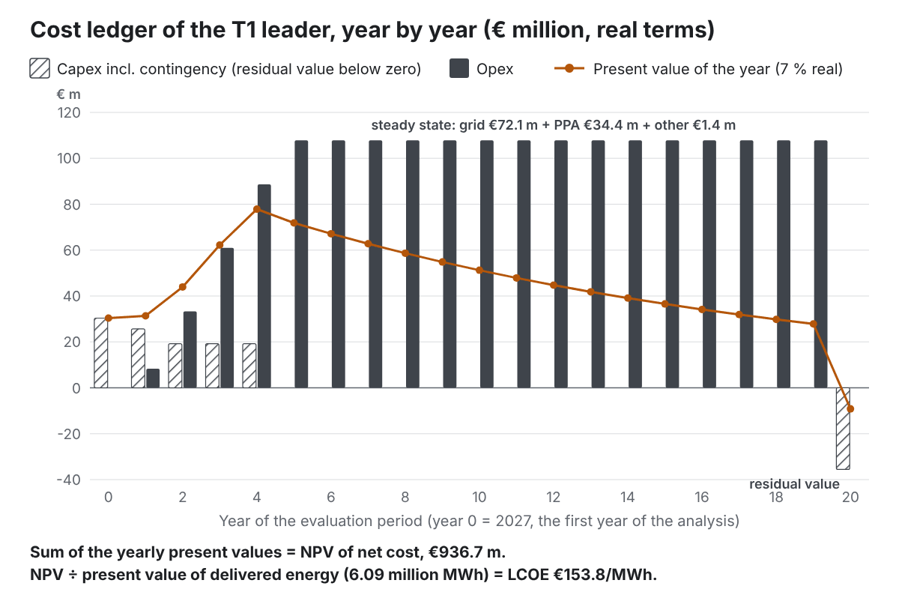

# 39. Economics: the cost ledger {#ch39}

The economics stage builds one **ledger** per option: a row for each year from year 0 (the analysis start year) to year N (the end of the evaluation period, 20 by default). It is the single source of every cost figure: LCOE, NPV, capex, opex and the capex share.

## Capex lines

Each line is booked in the year its plant can first supply power (or, for per-phase plant, in the year of each phase), with **10 % contingency** added.

| Line | Amount | Year booked | Life |
|---|---|---|---|
| Grid connection charge (built 23 October 2026) | the lump sum entered (default 0); not on islanded options | first month with grid capacity | 40 |
| Grid cable route | cable km × €1.5 m; not on islanded options | same | 40 |
| Substation | full capacity × €/MW for the band (× 1.4 for GIS) | same | 40 |
| Solar (roof, ground) | MWp × €/kWp × 1,000 | availability | 25, 30 |
| Wind | MW × €/kW × 1,000 | availability | 25 |
| Battery | MWh × €250/kWh + MW × €150/kW (× 1,000) | availability | 15 |
| Firm prime plant | MW × €/kW × 1,000 | availability | by technology |
| Bridging plant (not rented) | MW × €/kW × 1,000 | availability; plant kept as the backup: the bridging units at availability, then each building's units at its date (lines "(bridging)" and "(retained as backup)", built 24 October 2026) | by technology |
| Existing plant: connection to the campus (built 24 October 2026) | the amount entered; no plant capex (the plant is leased) | when the lease starts | 25; when the plant is handed back at the grid date the capex is still paid but has no life or residual value (judgement) |
| Gas connection pipe | km × €0.8 m; existing plant outside the campus does not need it | first gas plant on the campus | 40 |
| Backup gensets | MW × €/kW × 1,000, split by phase | each phase | 25 |
| Battery for UPS augmentation | as battery, split by phase | each phase | 15 |
| Bulk fuel storage | m³ × €1,200, split by phase | each phase | 30 |
| Cooling capex delta vs air | IT kW × €/kW delta, split by phase | each phase | none |

The connection and substation rates are €100k, €150k and €120k per MW (connection) and €60k, €80k and €70k per MW (substation) for the MV, HV and EHV bands. With C19 "Build all at phase 1", per-phase items are all booked in the first phase's year.

**The grid connection is the same for every option**, including islanded options and options that never use it fully, because the current version gives every option the full offered capacity.

## Replacements and residual value

For each item with a life:

- **Replacement**: at its installation year + life, + 2 × life, and so on, while before the end (the removal year or year N), at its cost plus contingency. Fuel-cell stacks are replaced every 7 years at 25 % of the fuel-cell capex.
- **Residual value**: at the end, the share of life remaining since the last installation, as a credit:

::: formula
| remaining share = max(0, 1 − (end year − last installation year) ÷ life)
| residual credit = cost × (1 + contingency) × remaining share   (in year N)
| salvage credit = the same × 50 %   (in the removal year, for removed bridging plant)
:::

## Fixed operating costs

Each year, from each item's availability: fixed O&M per kW (solar €12–15/kWp, wind €35/kW, firm plant €10–40/kW and the SMR €120/kW, backup gensets €8–9/kW), the battery at 1.5 % of its capex a year, and rented bridging plant at **€12 per kW per month** for every month it is on site, from one month before it is first needed (built 24 October 2026; before, from the month it could first arrive), and, when kept as the backup, for the units on hire that month. Leased existing plant is paid the same way, at its lease rate, for every month from a month before it is first needed (as bridging plant until the grid arrives if handed back). Fixed O&M of owned plant kept as the backup follows the units owned. Backup genset O&M scales with the share of the IT installed in the middle of that year.

## Energy, fuel and carbon costs

Each year uses its simulated year (or the last simulated year once they repeat):

- **Variable O&M**: plant MWh × €/MWh (recips €8, turbines €6, CHP €10, fuel cells €5, HVO-diesel €12, rented €10, SMR €3, hydrogen €5).
- **Fuel**: plant fuel MWh × fuel price (gas: the context gas price, escalated by the gas escalation; diesel €110, HVO €170, hydrogen €150 per MWh of fuel); SMR fuel €9 per MWh of electricity.
- **Generator tests**: installed units × unit MW × test hours (12 a year) × test load (75 %) ÷ efficiency = MWh of fuel, times the fuel price, scaled by the IT share of the year.
- **Grid**: the hourly grid energy times the hourly price (wholesale × multiplier + adder), **plus the adder on every MWh of PPA energy delivered** (the network charge on PPA energy), both escalated by the electricity escalation (0 % by default). The adder is your figure if you entered one, otherwise the country's. Built 24 October 2026: before, an entered adder was ignored and the network charge on PPA energy was not escalated.
- **PPA**: PPA MWh delivered × (strike + €5 shaping).
- **Carbon**: Scope 1 tonnes × carbon price × (1 + carbon escalation)^y (2 % a year real).
- **Revenue**: export MWh × 90 % of the hourly wholesale price × the price multiplier (only with C1 "Grid + export"), escalated like electricity. The multiplier applies since 24 October 2026.

## Totals and discounting

::: formula
| capex(y) = capex + contingency + replacements − residual and salvage credits
| opex(y) = fixed O&M + variable O&M + fuel + grid + PPA + carbon + rental + tests − revenue
| present value = capex(y) ÷ (1 + r)^y + opex(y) ÷ (1 + r)^(y+1)
| NPV of net cost = sum of present values, years 0 to N
| delivered energy(y) = facility demand − unmet load
| LCOE = NPV ÷ sum of delivered energy(y) ÷ (1 + r)^(y+1)
:::

The **capex** reported with each option is the initial capex: the sum of the capex lines plus contingency, excluding replacements and residual value, with a range of −30 % to +50 %.

## The PPA rule and the hedge

**No PPA income without physical delivery** (owner decision, 18 October 2026). The ledger books the PPA price only on PPA energy delivered to the load over the grid connection. For the contracted volume that is not delivered, the settlement (its wholesale value less the PPA price) is reported as the **PPA hedge (not counted)**: shown in the option detail and the PPA flags (`ppa-import-limited`, `ppa-above-load`), discounted like opex, but never added to the ledger, LCOE, NPV, the capex/opex split or the score.

Before the decision, the ledger booked the PPA price on the whole contract and credited the undelivered volume at the hourly grid price including the network adder. On the no-grid T3 example that made grid-dependent options look profitable, which is why the rule changed.

## Worked example: the T1 leader

**Capex lines** (before contingency):

| Line | Year | € m |
|---|---|---|
| Grid connection (120 MW × €150k + 10 m of cable) | 0 | 18.02 |
| Substation, HV AIS (120 MW × €80k) | 0 | 9.60 |
| Rooftop solar (2.50 MWp × €900/kWp) | 1 | 2.25 |
| Ground solar (5.24 MWp × €700/kWp) | 1 | 3.67 |
| Diesel gensets (118.25 MW × €450/kW), four phases | 1–4 | 53.21 |
| Bulk fuel storage (1,311 m³ × €1,200), four phases | 1–4 | 1.57 |
| DLC cooling delta (100 MW × €150/kW), four phases | 1–4 | 15.00 |
| **Total** | | **103.32** |
| Contingency 10 % | | 10.33 |
| **Capex reported** | | **113.65** (range 79.6 to 170.5) |

**Residual value** in year 20 (€35.54 m credit): the grid connection and substation have half their 40-year life left (€15.19 m); the gensets bought in years 1 to 4 have 24 to 36 % of their 25-year life left (€17.56 m); solar and fuel storage the rest. Discounted, it is worth €9.19 m.

**Steady-state opex** (2032 onwards): grid €72.06 m (of which €28.2 m is the €55/MWh adder on 513,000 MWh of PPA energy), PPA €34.37 m (513,000 MWh × €67), fixed O&M €1.04 m, generator tests €0.31 m, carbon €0.04 m: **€107.8 m a year**.

**Totals**: present value of capex €92.28 m; of opex €844.45 m; **NPV €936.73 m**. Present value of delivered energy 6,091,609 MWh. **LCOE = 936.73 ÷ 6.0916 = €153.77/MWh**. Capex is 10 % of the present-value cost: this option's cost is mostly the energy it buys.

**PPA hedge**: of about 13 TWh contracted over 20 years, 4.48 TWh is not delivered; its settlement is a net income of €16.2 m (present value €7.85 m), not counted.

# 40. Carbon and water {#ch40}

## Each year

::: formula
| Scope 1 (t) = sum over plant of fuel MWh × emission factor
|   + test-run fuel MWh × emission factor × IT share
| Scope 2 location (t) = (grid MWh + PPA MWh) × hourly grid carbon ÷ 1,000 × decarbonisation factor
| Scope 2 market (t) = Scope 2 location × max(0, 1 − PPA contract MWh ÷ (grid MWh + PPA MWh))
:::

Grid MWh here includes grid energy used to charge the battery. The hourly grid carbon includes the carbon multiplier.

## Over the evaluation period

::: formula
| location-based (g/kWh) = (sum of Scope 1 + sum of Scope 2 location) ÷ sum of delivered MWh × 1,000
| market-based (g/kWh) = (sum of Scope 1 + sum of Scope 2 market) ÷ sum of delivered MWh × 1,000
| hourly CFE (%) = sum of carbon-free MWh ÷ sum of net demand MWh
:::

where, in each hour:

::: formula
| carbon-free MWh = min(net demand, renewables used + min(PPA contract volume, PPA delivered + grid import for the load)
|   + firm output × share of firm capacity that is SMR or hydrogen)
:::

Since 23 October 2026 (decision O2) the PPA counts only against grid energy actually used for the load in that hour, so contracted volume that could not come over a full connection no longer counts.

## Water

::: formula
| WUE (L/kWh) = base WUE + evaporative WUE × hours with adiabatic or mechanical assist ÷ 8,760
| water (m³ a year) = WUE × IT MWh in the steady-state year
:::

A minor flag is raised if water per day exceeds the water available (when entered).

## Worked example: the T1 leader

- **2029** (the first full year with load): Scope 2 location = (20,515 t on grid energy + 26,672 t on PPA energy) × 0.9217 = 43,494 t; Scope 1 = 280 t (generator tests); delivered 242,700 MWh; that year alone is about **180 g/kWh**.
- **Over 20 years**: the grid decarbonises towards 10 % of today's carbon by 2050, so the average is **113 g/kWh** location-based.
- **Market-based**: the PPA contract (100 % of consumption) covers all imported energy, so market-based Scope 2 is zero and only Scope 1 remains: **0.97 g/kWh**.
- **Hourly CFE**: **67 %** (65 % in 2029).
- Scope 1 averages 636 t a year; Scope 2 (location) 73,200 t a year; WUE 0.02 L/kWh.

# 41. Resilience check {#ch41}

## Firm capacity in an outage

::: formula
| firm MW = backup units needed (N) × unit MW
|   + retained bridging plant: N units × unit MW (if fuelled)
|   + firm prime plant: (units − one per block, with N+1 or better required) × unit MW (if fuelled)
|   + battery MW (main, bridging and UPS augmentation)
:::

Redundant units are removed: the check asks whether the site can still carry the critical load with one unit per block out of service.

## The items

| Item | Passes when |
|---|---|
| Backed load | firm MW ≥ critical load |
| Topology | the backup topology (C6) ranks at least the required one: N < N+1 = catcher < 2N |
| Autonomy | the autonomy ≥ the required hours (see below) |
| Islanding (if required) | prime + retained bridging plant MW ≥ critical load |
| Backup technology | fails if C5 is "None" |

**Autonomy** is: the fuel hours (C7) when liquid-fuel firm capacity alone covers the critical load; unlimited (while the gas network stays up) when gas plant covers it; otherwise the stored battery energy ÷ the critical load.

## Status

- **Does not meet**: any item fails (the failing items are listed, each with a major flag).
- **Meets with flags**: all pass, but the backup depends on the gas network (minor flag: raised only when plant that does not burn gas covers less than the critical load, with both figures in the message; built 24 October 2026, before it was raised whenever gas plant was counted), or uses BESS-augmented UPS (minor flag: an emerging approach whose redundancy lasts only as long as the battery).
- **Meets**: otherwise.

## Worked example: the T1 leader

- Backed load: 39 × 2.75 MW = 107.3 MW ≥ 105.1 MW critical load: pass.
- Topology: N+1 against N+1 required: pass.
- Autonomy: 48 h against 48 h required: pass.
- Status: **Meets**.

In the T1 run, 185 options meet the requirement and 1,815 meet it with flags (most because they burn gas on site); none fails, because C5 "None" is not in the default choices.

# 42. Flags {#ch42}

Flags are how the tool reports problems without enforcing them. Each has an identifier, a **severity** (**major**: a requirement or limit is breached, or a significant risk; **minor**: a concern to check; **info**: context), a category and a message with the numbers. Permitting flags end with "Screening flag, not a permitting determination", and outside the EU with "EU threshold used as a proxy; national equivalent not checked by this tool".

## Grid

| Flag | Severity | Raised when |
|---|---|---|
| adequacy-short | major | the option is not adequate: unmet load, import above the grid capacity, or firm supply below the design load in a month (chapter 44). Shows MWh, hours, peak MW and the longest event |
| grid-binding | major | unmet load in any simulated year ("Show unmet load") |
| grid-exceed | major | import above the offered capacity ("Show exceedance") |
| ppa-import-limited | minor | contracted PPA volume not delivered because the grid connection was full, with its share of the undelivered volume; reports the PPA hedge (built 23 October 2026, O3) |
| ppa-above-load | info | contracted PPA volume above the load still to serve in its hour, with its share; the two shares add to 100 % (built 23 October 2026, O3) |
| grid-bess-peakshave | minor | a peak-shave battery cannot hold the import within capacity on the design day |
| bess-recharge | minor | a battery sized to the permanent shortfall cannot recharge from the grid headroom on the design day, so it does not count as firm supply (built 23 October 2026) |
| grid-shortfall | info | design load exceeds grid plus firm plant in some months |
| grid-export | info | surplus above the export capacity is curtailed |

## Permitting

| Flag | Severity | Raised when |
|---|---|---|
| permit-ied | major | combustion plant thermal input ≥ 50 MWth in total (prime, bridging and backup units ÷ efficiency) |
| permit-mcp | minor | any combustion unit between 1 and 50 MWth |
| permit-seveso-fuel | major | diesel or HVO stored ≥ 2,500 t |
| permit-h2 | major (≥ 5 t) or minor | hydrogen plant on site (always raised) |
| permit-wind | major | wind turbines on site |
| permit-stack | minor | a stack above the height limit |
| permit-runhours | minor | plant runs more hours than the limit |
| site-noise | minor | the noise proxy exceeds the night threshold at a receptor |

::: {.callout .built}
**Built 23 October 2026.** `permit-outlook` (minor when an item is "unlikely" or not ready when first needed, info otherwise) lists every plant held by the IED or Seveso with its outlook, ready month, needed month and float (chapter 8). It is not counted in deliverability, so it changes no score.
:::

## Fuel and utilities

| Flag | Severity | Raised when |
|---|---|---|
| fuel-gas-unknown | minor | gas used and gas availability "Unknown" |
| fuel-gas-assumed | info | gas used: capacity and date assumed |
| fuel-gas-none | major | gas plant with gas availability "No" (it never runs) |
| fuel-h2-unavailable | major | hydrogen plant and no hydrogen supply |
| fuel-h2-assumed | minor | hydrogen supply assumed |
| fuel-water | minor | water use above availability |
| fuel-diesel-prime | minor | HVO-diesel prime bridging |

## Targets and ceilings

| Flag | Severity | Raised when |
|---|---|---|
| target-carbon | minor | location-based carbon above the target |
| target-ttp | minor | first power or full load after its target date |
| target-capex | minor | capex above the ceiling |
| target-capex-p90 | info | only the high estimate above the ceiling |
| target-landtake | minor | land take above the ceiling |

## Technology, resilience, site and data

| Flag | Severity | Raised when |
|---|---|---|
| tech-nascent | info | SMR or hydrogen in the option |
| tech-late | minor | prime plant available after the full-load target |
| res-backed, res-topology, res-autonomy, res-island | major | that resilience item fails |
| res-none | major | no backup technology |
| res-gas | minor | backup depends on the gas network |
| res-bessups | minor | BESS-augmented UPS |
| site-does-not-fit | major | blocks not placed (shortfall in m²) |
| site-relaxed, site-height, site-soft, site-genset-distance | minor | a layout rule relaxed |
| site-wind-buffer, site-hydrogen, site-offsite-land, site-roof | minor | wind buffers, hydrogen separation, off-site land, roof over-allocated |
| site-soft-solar, site-smr | info | ground solar in soft exclusions; SMR off site |
| data-unverified | info | on every option: indicative defaults and synthetic profiles |

## Run flags

Information flags for the whole run: compatibility-rule counts (gen-rules), values not generated (gen-values), sampling active (gen-sampling), wind not generated on a small site (tech-wind-default), AI training transients not modelled (load-ai), the utilisation assumption (load-util), and how many options are adequate (adequacy-count; or adequacy-none, major, when no option is adequate).

::: {.callout .built}
**Built 23 October 2026 (decision O3).** The single `grid-ppa` flag is now **two flags**, `ppa-import-limited` and `ppa-above-load`, each with its share of the undelivered PPA volume.
:::

::: {.callout .agreed}
**Agreed, not built yet:** an "assumed default" flag on every option for each default it uses that the engineer did not enter, with its source.
:::

# 43. Deliverability {#ch43}

Deliverability is a score out of 100 for how hard an option will be to deliver: immature technology, permits, fuel supply and long lead times.

::: formula
| deliverability = 100
|   − 15 × emerging share − 40 × nascent share
|   − 8 × major permitting flags − 3 × minor permitting flags
|   − 10 if gas is used and its availability is "Unknown"
|   − 10 if the option depends on hydrogen
|   − 5 × each technology with procurement over 24 months
|   − site-fit penalty (only if switched on: 10 for "Fits with flags", 25 for "Does not fit")
| limited to 0–100
:::

**Shares.** The emerging (or nascent) share is the average of two shares: its share of the installed capacity (solar, wind, battery, prime, bridging, backup and the grid connection), and its share of the energy supplied in the steady-state year (grid and PPA, renewables used, each plant). Fuel cells and BESS-augmented UPS are emerging; SMR and hydrogen are nascent; everything else is commercial.

**Permitting flags** counted are those marked as permitting (IED, MCP, Seveso fuel, hydrogen, wind, stack, run-hours). The noise proxy and site-fit flags are never counted.

**Pooled backup** (built 23 October 2026, OPEN-QUESTIONS 48). An option whose backup is pooled across the campus loses the penalty of a minor permitting flag (3 points) for client-perceived risk, or of a major one (8 points) if the engineer raises it.

**Long lead times.** In the current defaults only the SMR (36 months of procurement) exceeds 24 months. Published data suggests large diesel gensets now take 18 to 24 months (chapter 50).

**Worked example: the T1 leader.** No emerging or nascent technology; one major permitting flag (IED: 43 × 2.75 MW ÷ 0.38 = 311 MWth of gensets) and one minor (MCP: each 2.75 MW genset is 7.2 MWth): 100 − 8 − 3 = **89**. In T1 the scores range from 65.7 (the hydrogen archetype) to 97.1.

All the penalty values are judgements, labelled indicative, and on the research list.

# 44. Scoring, dominance and ranking {#ch44}

## Axis metrics

| Axis | Metric (default first) |
|---|---|
| Cost | LCOE; or NPV of net cost |
| Carbon | location-based g/kWh; or market-based; or 1 − hourly CFE |
| Time-to-power | the time-to-power metric (months late against the phasing plan, since 24 October 2026; chapter 38) |
| Deliverability | the deliverability score (higher is better) |

## Axis scores

Over **all screened options** (view filters never change this set), the engine finds the lowest and highest finite value of each metric. Then:

::: formula
| lower-is-better axis: score = 100 × (highest − value) ÷ (highest − lowest)
| higher-is-better axis: score = 100 × (value − lowest) ÷ (highest − lowest)
:::

A non-finite value (for example the LCOE of an option that delivers nothing) scores 0. If every option has the same value, all score 100.

## Weights and the weighted score

::: formula
| effective weight = raw weight ÷ sum of raw weights   (25 % each if all are 0)
| weighted score = sum over axes of effective weight × axis score
:::

**T1 leader** (run of 21 October 2026, under the earlier time-to-power metric). Ranges over the 2,000 options: LCOE €151.83–286.04/MWh, carbon 112.18–532.68 g/kWh, time-to-power 18.00–123.85 months, deliverability 65.65–97.10. The leader's axis scores are 98.55, 99.77, 88.56 and 74.25, so:

::: formula
| 0.35 × 98.55 + 0.25 × 99.77 + 0.25 × 88.56 + 0.15 × 74.25
|   = 34.49 + 24.94 + 22.14 + 11.14 = 92.71
:::

Note that the leader is not the cheapest option: a gas-bridging option has the lowest LCOE (€151.83/MWh) but ranks 25th, mainly on carbon (147 g/kWh).

## Dominance

Option j dominates option i when j is no worse on all four metrics, strictly better on at least one, and its power adequacy, resilience and site-fit statuses are at least as good as i's (an option that is not adequate never dominates one that is). A small tolerance (one part in a billion) avoids marking options that differ only by rounding. The mark names the first dominating option found. **Dominance never changes a score or a rank.**

## Ranking

**Power adequacy first** (built 23 October 2026; the owner's decision of 2026-10-22, OPEN-QUESTIONS 38–41). An option is **adequate** only when all three hold: no unmet load in any hour of any simulated year; no import above the offered grid capacity ("Show exceedance" mode); and no power gap, meaning its firm supply reaches the design load (the full contracted IT at the design-day PUE plus ancillary load) in every month. There is no tolerance: one unmet hour makes an option not adequate. Every adequate option ranks above every option that is not. Options that are not adequate stay in the list, with the major flag `adequacy-short`, and keep their scores: adequacy changes the order, never a score. This is the owner's deliberate exception to "flag, don't enforce".

Within each group, options are sorted by weighted score, highest first; equal scores go to the lower identifier. With "rank requirement-compliant options first" on, options whose resilience is "Does not meet" (or, with the Site tab on, whose site fit is "Does not fit") are placed after the others within each adequacy group, each part still in score order. The **leader** (also called the weighted pick) is rank 1.

In the T1 run 953 of the 2,000 screened options are adequate. The options with the highest scores (92.7 and just below) are not: each leaves some 300 to 1,000 MWh of load unmet over 500 to 1,000 hours before the full grid connection, and has a power gap (the highest scorer: 608 MWh over 830 hours, longest event 581 hours, 15 MW-months of power gap). The leader is now the best adequate option, OPIAR4Q (score 89.8).

## How the summary's numbers are worked out

Built 24 October 2026 (work package 16; chapter 22 shows the summary). Every number in it comes from the scoring above.

**Why it leads.** The score gap between #1 and #2 splits exactly into one part per axis:

::: formula
| part for an axis = effective weight × (axis score of #1 − axis score of #2)
| the four parts add up to score of #1 − score of #2
:::

In T1 (24 October 2026), the gap of 0.15 points is 0.11 from cost (axis scores 98.58 and 98.28, × 0.35) and 0.04 from carbon (91.65 and 91.47, × 0.25); time-to-power and deliverability are level. The summary names every part above 0.005 points: those that favour #1 with their figures, those that favour #2 by their points ("less 0.02 points on hourly CFE, where #2 does better"; their figures are under "What it gives up"), so the named parts add up to the gap, to rounding.

**The weight change that changes the leader.** Raise one axis's weight by a share t of the way to 100 %, with the other weights scaled down in proportion. The axis ranges do not depend on the weights, so every option's score moves in a straight line:

::: formula
| score(t) = (1 − t) × score now + t × axis score
| option j overtakes the leader at t = gap ÷ (gap + (axis score of j − axis score of the leader))
| the axis weight there = weight now + t × (1 − weight now)
:::

Lowering a weight towards 0 % works the same way, with "axis score" replaced by the score the option would have with that axis left out. The engine solves this for each axis, both ways, against every option in the leader's group (adequate, and requirement-compliant when that setting is on), keeps the smallest change, and states the first whole per cent past the crossing with the option that leads there (test 43 checks each one by re-scoring). In T1 the engine finds five such changes: deliverability down from 15 % to 0 % (crossing at 0.3 %: #26 leads), cost down from 35 % to 13 % (13.5 %: #595), deliverability up to 38 % (37.5 %: #595), cost up to 97 % (96.1 %: #26) and carbon up to 99 % (98.6 %: #145). Every other single-weight change leaves the leader in place. Two cases are not listed: a weight of exactly 100 %, where many options tie on that one axis and the order between them is by option code (in T1, time-to-power at 100 % puts #86 first that way), and lowering a weight that is already 100 %.

**What it gives up** compares the leader's axis scores with the best of its group on each axis and names up to two gaps larger than 0.5 axis points (judgement). **Confidence** counts the options of the group within 1 point of the leader, the leader's "assumed default" flags (chapter 42) and the unverified registry records. **Inputs with most influence** sorts the tornado rows by their swing in the tornado's measure (LCOE when the measure is the weighted score, which depends on the weights); equal swings put the less certain record (confidence C) first.

# 45. The trade-off view {#ch45}

**Frontier.** On the two chosen axes (each turned so that lower is better), the frontier is the set of options not beaten on both: sort by the first axis, then keep each option whose second value is lower than that of every option with a smaller first value. Options with exactly equal values are all kept. The frontier is computed over all screened options, so filters never move it.

**Time-to-power colours.** The options' time-to-power metrics are split into up to five classes at quantiles (20 %, 40 % …) of all screened options; class edges that coincide (many options reach full load in the same month) are merged. T1 has four classes: 18 to 24, 24 to 30, 30 to 30.1, and 30.1 to 124 months.

**Size** is scaled between the smallest and largest capex of the run (€26 m to €960 m in T1).

**The weighted pick** is always rank 1, the header's leader. When the highest-scoring option is not rank 1, the chart marks it separately and says why: because it is not adequate (power adequacy first), or because "rank requirement-compliant options first" placed it lower.

# 46. The tornado {#ch46}

For the chosen option, the engine:

1. re-runs the option with the base inputs, checking that it reproduces the ranking's score;
2. for each driver, sets it to its low value, re-runs the option through every stage (sizing, layout, dispatch, economics, carbon, resilience, flags, deliverability), then does the same for its high value;
3. scores each re-run against the **base run's** axis ranges and weights, clipping each axis score to 0–100, so no other option is touched;
4. sorts the ticked drivers by the swing in the chosen measure (LCOE by default; NPV of net cost, location-based carbon or weighted score) and shows the top ones (up to 12, record `sensitivity.topDrivers`; sixteen drivers exist, seven ticked by default).

How each driver is applied:

- **Grid full-connection date**: the full-connection date and every grid step move together.
- **Grid import price, grid carbon**: the multipliers are scaled.
- **Gas price, carbon price**: entered as inputs at the factor times the current value (the country default or your value).
- **WACC**: set to 4 % and 12 %.
- **IT load**: the IT load at full build and every phase are scaled.
- **Capex, battery capex, grid connection capex** (built 23 October 2026): a factor multiplies the capex lines before contingency. "Capex" scales every line; "battery capex" the battery lines (shortfall, bridge and resilience batteries); "grid connection capex" the grid connection and reinforcement line. Replacements follow the capex they replace.
- **Capacity factors**: the hourly output of on-site solar and wind is scaled (the PPA's own profile is not).
- **PUE**: the cooling and mechanical share of the facility load, and the cooling term of the design-day PUE, are scaled. A higher PUE raises the energy bought and the plant sized.
- **Evaluation period, escalation**: set to the input's own low and high.
- **Flexibility trigger level**: the price, carbon and temperature trigger levels are scaled together (only the active trigger matters).
- **Generator test hours**: set to the record's low and high; it moves test-run fuel, cost and Scope 1 carbon.

The ranges are records in the registry, all labelled indicative: the inputs' own low and high for price, carbon, WACC, evaluation period, escalation and test hours; the grid-date uncertainty (−6 / +24 months); and factor records for gas price (× 0.7 / × 1.3), carbon price (× 0.5 / × 1.5), IT load (× 0.8 / × 1.2), capex (× 0.7 / × 1.5), battery capex (× 0.7 / × 1.3), grid connection capex (× 0.5 / × 2), capacity factors (× 0.85 / × 1.15), PUE (× 0.8 / × 1.2) and the flexibility trigger (× 0.8 / × 1.2). The factor records are all 1 in the main run, so they change nothing outside the tornado.

The T1 results are in chapter 27.

## Breakevens

Built 24 October 2026 (work package 17; chapter 27 shows the screen). For the leader L and each competitor C, and each driver d with range low … high and current value b:

1. The leader alone is re-run at every driver's low and high value; the eight drivers with the largest weighted-score swing are kept.
2. L and every C are re-run at the middle and the end of each side, (low + b) ÷ 2, low, (b + high) ÷ 2 and high; at b the run's own figures are used (when the run used the representative-day screening tier, they are re-run over the full year, like every other point). If b lies outside low … high, the range used grows to include it.
3. At each value the two are put in the ranking's order: adequacy first, then compliance when "rank requirement-compliant options first" is on, then the weighted score Σ w × axis score, with each axis score taken on the **run's** range and **not clipped** to 0–100 (the tornado clips; here two options beyond the run's range must still compare).
4. Walking out from b on each side, the first value where C is ahead is bracketed with the last value where L is ahead, and the bracket is halved, re-running both options at its middle, until it is narrower than 2 % of the range (whole-number drivers: 1). The flip is reported at the middle of the bracket (whole-number drivers: its outer end).

The search sees the first swap on each side only if the order differs at one of the checked points; a swap that reverses again between them is not seen. "Nearest flips" sorts every flip by |flip − b| ÷ (high − low).

## Monte Carlo

Built 25 October 2026 (work package 18; chapter 27 shows the screen).

1. **Sampling.** For n samples (300 by default) and each of the thirteen drivers, the range 0–1 is cut into n equal strata; each sample takes one stratum, in a shuffled order, and a random point inside it (Latin hypercube; the shuffle and the points come from a seeded generator, so the same seed gives the same samples). Correlated pairs (grid and gas price, ρ 0.6; the capex factors, ρ 0.8) are joined through the normal distribution: z₂′ = ρ · z₁ + √(1 − ρ²) · z₂. After the join the second driver of a pair no longer takes exactly one sample per stratum (check H6 counted 182–195 of the 300 strata filled for gas price, battery capex and grid connection capex), but it keeps its distribution. In the capex group every driver is joined to the all-lines capex factor, so battery capex and grid connection capex are joined to each other at about 0.8 × 0.8 = 0.64, not 0.8 (check H6; the owner chose to keep this on 26 October 2026, and the figures are indicative, unverified).
2. **Values.** Each quantile u becomes a value of a triangular distribution from the driver's low value to its high value, peaking at the current value. If the current value lies outside that range (a WACC of 13 % against 4–12 %), the range grows to include it and the panel, the summary and the PDF say so. Grid date and test hours are rounded to whole months and hours.
3. **Re-runs.** All thirteen values are applied together (as the tornado applies one) and the 20 leading options are re-run with representative days (chapter 37), without a layout, which changes no figure the ranking reads; the layout is made only when "rank requirement-compliant options first" or the site-fit penalty is on.
4. **Order in each sample.** As the ranking orders: adequacy first, then compliance when that setting is on, then the weighted score on the run's own axis scales and weights, not clipped.
5. **Counts.** For each option: how often it is first, in the top three, and within 1 % of the best score among the sample's first group; and P10, P50 and P90 of its figures, by linear interpolation in the sorted samples.

The robust pick is the option with the highest share within 1 %; ties go to the option that is first more often. §13.2 of the brief proposed 5 %, but in T1 every one of the top 20 options was within 5 % of the best in at least 93 % of samples, so 5 % told the options apart only by tie-break (OPEN-QUESTIONS 102).

# 47. Worked example: the T1 run end to end {#ch47}

## Generation

(Run of 21 October 2026; 48,340 combinations on 24 October 2026.) 209,952 raw combinations; 147,744 collapsed as not applicable; 5,184 removed by rule (e); 57,024 valid; 4 archetypes outside the open choices; 57,028 combinations; 2,000 screened (11 archetypes + 1,989 sampled, 364 repaired). 1,769 distinct dispatch configurations; 1,324 distinct layouts.

## The top twelve

| Rank | Option (abridged) | Score | LCOE | Capex € m |
|---|---|---|---|---|
| 1 | Diesel N+1 · DLC · PV 7.7 · PPA 100 % | 92.71 | 153.8 | 113.7 |
| 2 | Diesel N+1 · DLC · PV 2.5 · PPA 100 % | 92.58 | 154.1 | 109.6 |
| 3 | Diesel N+1 · DLC · PPA 100 % | 92.55 | 154.1 | 107.1 |
| 4 | HVO N+1 · DLC · PV 1.5 · PPA 100 % | 92.53 | 154.4 | 109.9 |
| 5 | HVO N+1 · DLC · PPA 100 % | 92.51 | 154.5 | 108.4 |
| 6 | Diesel N+1 · Immersion · PV 3.3 · PPA 100 % | 92.20 | 155.6 | 120.0 |
| 7 | Diesel N+1 · DLC · PV 2.0 · PPA 80 % | 92.08 | 156.0 | 109.1 |
| 8 | Diesel N+1 · DLC · PV 1.5 · PPA 80 % | 92.08 | 156.0 | 108.6 |
| 9 | HVO N+1 · DLC · PV 2.5 · PPA 80 % | 92.06 | 156.3 | 110.9 |
| 10 | Diesel N+1 · DLC · PPA 80 % | 92.05 | 156.0 | 107.1 |
| 11 | Diesel N+1 · DLC · PPA 80 % | 92.05 | 156.0 | 107.1 |
| 12 | Fuel cells bridge → remove · HVO N+1 · DLC · PV 7.2 · PPA 100 % | 92.00 | 156.2 | 142.1 |

Ranks 1 to 11 all wait for the grid. Ranks 10 and 11 have identical figures: they differ only in a choice that changes nothing measurable.

## The eleven archetypes

| Archetype | Rank | Score | LCOE | Full load |
|---|---|---|---|---|
| A5 Gas bridging to grid | 147 | 87.5 | 175.4 | month 24 |
| A4 Grid + CHP + BESS | 677 | 73.6 | 172.4 | month 33 |
| A2 Grid + offsite PPA | 867 | 70.7 | 153.1 | never |
| A9 Low-carbon backup + PPA | 1,014 | 68.6 | 153.6 | never |
| A8 Fuel cells + grid | 1,015 | 68.6 | 179.5 | month 30 |
| A1 Grid-only | 1,110 | 67.6 | 164.8 | never |
| A7 Renewables-led | 1,184 | 66.9 | 168.2 | never |
| A6 Islanded gas + solar + BESS | 1,185 | 66.8 | 179.8 | month 24 |
| A3 Grid + solar + BESS | 1,358 | 63.8 | 180.0 | never |
| A10a SMR | 1,806 | 54.5 | 197.5 | never |
| A10b Hydrogen | 1,892 | 45.8 | 205.9 | never |

## What the T1 run teaches

1. **The cooling choice decides grid fit.** (Run of 21 October 2026; since 24 October 2026 the archetypes take the open cooling type with the lowest design load, chapter 34.) Every archetype took the first open cooling value, air, whose design load (136.7 MW) exceeds the 120 MW grid offer. Without firm plant they never reach full load, their time-to-power metric is about 124 months (run of 21 October 2026; under the metric since 24 October 2026, about 66 months late plus the gap term), and their time-to-power score is near zero. That alone costs them about 22 points. DLC (113 MW) fits under the offer, which is why it dominates the top of the ranking.
2. **Cheapest per MWh is not best.** A2 (grid + PPA, air-cooled) has a lower LCOE than the leader (€153.1/MWh), but it cannot take the full load, and LCOE does not see that.
3. **Bridging buys time, at a price.** Gas bridging (A5) reaches full load 6 months earlier than the grid, but costs more per MWh and does not fit the 15 ha site. Fuel-cell bridging (#12) almost removes the leader's 650 MWh of unmet load in 2029, for €28 m more capex.
4. **Energy, not plant, is the cost.** The leader's capex is 10 % of its present-value cost; grid energy, the network adder and the PPA make up the rest. The grid price is the input that moves its LCOE most.
5. **A PPA does not change location-based carbon.** Grid options score about 113 g/kWh with or without a PPA; the PPA shows in the market-based figure and in hourly CFE.
6. **Most of a 100 % PPA can be "undelivered".** About a third of the leader's contracted volume (4.48 of 13 TWh) arrives in hours when the site does not need it; by the owner's rule its settlement stays outside the ledger.
7. **The top is crowded.** The top five differ by 0.2 points and share one strategy (chapter 22).

# 48. Agreed changes to the engine (not built yet) {#ch48}

This chapter lists every walkthrough decision that changes what the engine calculates, with the stage it touches. Changes that only affect screens are in Part III. None of these is built.

## Inputs and knowledge levels

- **Every input has a default; anything not entered is flagged on each option that uses it, with its source.** Touches the registry (sources filled in) and the flags stage (one "assumed default" flag per default used).
- **Grid capacity and connection time** default to country values when unknown, labelled indicative and flagged. Needs a country table (research).
- **IT load estimated from area** when unknown: area × 35 % coverage × 1 storey × 5.5 kW/m² (research; see the density conflict in chapter 16).
- **Bridging period**: known or unknown, both supported.

## Location, climate and data

- **Map pin** sets the location; **country from the pin**; offline map bundled.
- **Hourly data from published sources** (ENTSO-E prices and generation, with Ember, the World Bank and Eurostat as alternatives; weather from NOAA or an uploaded EPW file), prepared at release time (chapter 52). Replaces the synthetic profiles in the context stage.
- **Design temperatures from the nearest ASHRAE station**, flagged as such.
- **Currency** per site from a fixed list, rates fixed per release.

## Demand

- **Load shapes**: flat, fluctuation, AI training and AI inference, with editable parameters.
- **Flexibility**: off by default; triggers on price, carbon or weather and grid stress, with level, duration, notice, recovery and cost; historical analysis of trigger hours.
- **Battery response** to triggers instead of curtailment, sized by default to cover the historical trigger hours; the engineer chooses which of battery size, trigger threshold or hours covered is held fixed. Battery capex into the ledger.
- **Two battery allocations**: resilience reserve (always kept; 5 minutes of UPS by default) and economic battery.

## Resilience

- Default N+1 with 100 % of IT backed (as today); autonomy from fuel, batteries or both.
- **Test running 6 hours a year per generator** (today 12) and **test load as a separate input** (75 %).
- **Gensets as primary power** for a set number of hours a year, dispatched and costed.

## Grid and economics

- **Contracted grid capacity**, built 23 October 2026 as a rule per grid strategy (chapter 9).
- **Fixed grid connection charge**, default 0 and flagged as assumed, not paid by islanded options: built 23 October 2026.
- **Several evaluation periods** at once.
- **Carbon price** from the latest EU ETS market price with its date; **gas price** from the latest published wholesale price with its date (free monthly source); **escalation** from published forecasts per commodity.
- **Revenue options** (battery arbitrage and grid services, waste-heat reuse) available but off by default.
- **Cooling type chosen by the engineer**, with typical PUE and maximum demand offered and editable.

## PPA and carbon rules

- O1, O2 and O3 were built on 23 October 2026 (chapters 12 and 42).
- No PPA income without physical delivery (already built).

## Model tiers and results

- **Representative-day screening** for all options and full 8,760-hour verification for the top options; dispatch views for any period, for verified options only.
- **Tornado** with a tick-box list of drivers (the brief's seven plus additions), measuring LCOE by default.
- **Site tab as Beta**, kept out of the ranking and the PDF.

## Details still to settle

::: {.callout .open}
**Open.** The walkthrough fixed the decisions above but not every detail of how to build them. Among the details still to decide:

- (answered 23 October 2026) contracted capacity is a rule per grid strategy; islanded options do not pay the charge;
- which evaluation period sets the score when several are shown;
- how the representative days are chosen and how many options are verified at full resolution;
- whether the top five should show five distinct strategies;
- how the land budget for ground solar and wind is set with the Site tab hidden;
- (answered 23 October 2026) the building massing rule is kept, and the IT estimate inverts it.
:::
