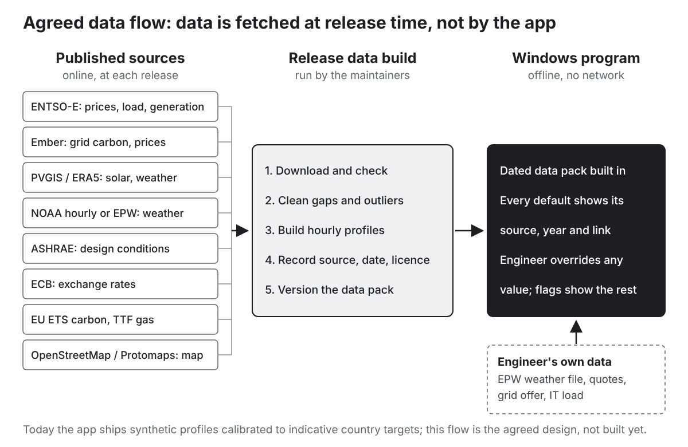

# Part V. Data, defaults and sources {#part5 .part}

This part is for whoever maintains the tool's data. It explains how the defaults are recorded, compares the important ones with published values found on 21 October 2026, and describes the data sources, APIs and licences the agreed design needs.

# 49. How to read the defaults register {#ch49}

Every default is a record in the registry (chapter 32): 496 in all, listed in Appendix A. In the current version **none is verified**: each carries confidence C and the label "indicative — unverified", and its source, year, link and access date are empty. The brief's rule is that this label stays until a person has checked the value against a source and filled those fields in.

For this guide, the most important values were checked against published sources. The comparison tables in chapter 50 use these statuses:

| Status | Meaning |
|---|---|
| Consistent | The app's value is within the published range, or within about 10 % of the published figure |
| Update suggested | The published value differs enough to change results; a new default is suggested |
| Check | Plausible, but depends on a choice not yet made (for example tax treatment) |
| Judgement | No published source applies; the value is an engineering judgement and should say so |
| Research | Not checked yet; on the research list |

A check here is not a verification in the brief's sense. Values should be verified by the people responsible for the data, against the sources named, before they lose the "unverified" label. Published values are quoted as found, with their date; currency conversions use the ECB reference rates of 21 October 2026 (1 euro = 1.1234 US dollars = 0.83825 pounds).

# 50. Defaults checked against published sources {#ch50}

## Market prices and exchange rates

| Default | App | Published | Status |
|---|---|---|---|
| EU ETS carbon price | €85/t | €82.40/t on 5 Oct 2026; 2025 average €74.40; 2026 forecast average €87.90 | Consistent |
| UK ETS carbon price | €50/t | £62/t (about €74) on 29 Sep 2026; 2025 average £50.16 | Update suggested |
| Gas commodity (TTF) | €40–45/MWh in most countries | 2025 about €35–45; €31.51 on 27 Feb 2026; €87.55 on 16 Oct 2026; banks' median for Q4 2026 €71; forecasts for 2027 €32–45 | Consistent with 2025 and 2027; far below the October 2026 market |
| Gas transport adder | €4/MWh | not checked | Research |
| Diesel | €110/MWh (about €1.09/litre) | EU average pump price with taxes €2.15/litre on 5 Oct 2026 (about €216/MWh) | Check: plausible before duty and VAT |
| HVO | €170/MWh | 2025 average $2,136/t (about €156/MWh); 2026 expected $2,500–2,700/t (about €182–197/MWh), before duty | Consistent with 2025; low for 2026 |
| Renewable hydrogen | €150/MWh | €7–10/kg (about €210–300/MWh); HYDRIX index about €8.20/kg in 2025 (about €246/MWh) | Update suggested |
| Exchange rates | GBP 0.85; NOK 11.5; SEK 11.3; DKK 7.46; CHF 0.95; ISK 150 | 0.83825; 10.512; 11.0975; 7.4746; 0.9256; 136.20 | Update at each release |

**2026 energy prices.** Gas and oil prices rose sharply in 2026 after the strikes on Iran at the end of February and the fall in shipments through the Strait of Hormuz: TTF went from €31.51/MWh before the strikes to €87.55 on 16 October, its highest since December 2022, and the EU average diesel price from €1.54 to €2.15 a litre between January and October (with a record €2.24 on 28 September). The tool's gas defaults reflect calmer years. This is exactly why the walkthrough agreed to show the latest published price with its date, and to let the engineer override it. A high-price scenario would also be useful.

**Units.** Gas at €/MWh refers to the energy content of the fuel. One litre of diesel holds about 9.9 kWh; one kilogram of hydrogen 33.3 kWh; one tonne of HVO about 12.2 MWh.

## Electricity

| Default | App | Published | Status |
|---|---|---|---|
| Wholesale price (27 countries with data) | by country | 20 within 10 % of the latest annual figure; France €85 against €61.5 (2025); Austria, Finland, Portugal, Slovenia, Norway and Czechia 12–22 % high (mostly against 2024 data) | 7 updates suggested (Appendix B) |
| Non-commodity adder | €25–55/MWh (Germany and United Kingdom €55) | 50Hertz (German transmission operator), 2026, extra-high voltage, ≥ 2,500 h a year: €53.06 per kW a year + 0.69 ct/kWh, about €13.5/MWh at 8,000 hours, before levies and taxes | Check: likely high for a transmission-connected site; research by country |
| Grid carbon (31 countries) | by country | 12 within 10 % of Ember's 2025 figures; largest gaps Estonia (500 against 319 g/kWh), Bulgaria (400 against 276), Iceland (15 against 28), Finland (80 against 57), France (55 against 41) | 19 updates suggested (Appendix B) |
| Grid connection capex (EHV) | €120k/MW + substation €70k/MW | 50Hertz 2026 construction-cost contribution €96.91/kW at extra-high voltage, €113.15/kW at the EHV/HV transformation level | Consistent (agreed: default 0, with country reference) |

## Technology costs and performance

| Default | App | Published | Status |
|---|---|---|---|
| Ground PV capex | €700/kWp | Fraunhofer ISE 2024 (Germany, > 1 MWp): €700–900/kWp; IRENA, 2025 global average $667/kW | Consistent (low end) |
| Ground PV fixed O&M | €12/kWp a year | Fraunhofer: €13.3 | Consistent |
| Roof PV capex | €900/kWp | Fraunhofer, large roofs: €900–1,600/kWp | Consistent (low end) |
| Roof PV fixed O&M | €14/kWp a year | Fraunhofer: €21.5 | Update suggested |
| Onshore wind capex | €1,350/kW | Fraunhofer: €1,300–1,900; IRENA 2025 global $976; Lazard 2026 (US) $1,900–2,750 | Consistent (European low end) |
| Wind O&M | €35/kW a year | Fraunhofer: €32 + €0.007/kWh (about €50 a year in all) | Slightly low |
| Battery capex | €250/kWh + €150/kW (about €288/kWh for 4 h) | BloombergNEF 2025 turnkey: Europe $177/kWh, global $117; IRENA 2025 $140; Lazard 2026 (US, 4 h) $270–365 | Update suggested (high) |
| Battery round-trip efficiency | 88 % | typical 85–90 % | Consistent |
| Lifetimes | PV 30 (roof 25), wind 25, battery 15 years | Fraunhofer: PV 30, wind 25, battery 15 | Consistent |
| Gas engines | 4.5 MW units, €900/kW | data centre orders now use engines of about 10 MW (Wärtsilä 34SG, 40 × 10.3 MW, April 2026); capex not checked | Unit size: update; capex: research |
| Gas turbines | €750/kW | EIA 2025, aeroderivative: $1,606/kW (2023 $); Lazard 2026, gas peaking: $1,100–1,650/kW | Update suggested (low) |
| Fuel cells (SOFC) | €2,800/kW, 55 % | about $2,500–3,000/kW, about 60 % (secondary source, low confidence) | Consistent (low confidence) |
| Diesel standby gensets | €450/kW, 2.75 MW, 12 months procurement | $450–600/kW installed (2026); 3.0–3.75 MW units now usual on large campuses; 18–24 months lead time above 2.5 MW | Capex consistent; unit size and lead time: update |
| Genset fuel use | 0.26 L/kWh | 0.24–0.25 L/kWh at full load (3 MW unit) | Consistent (slightly cautious) |
| SMR | €7,000/kW, 80 MW units, from 2035 | Darlington BWRX-300 (Canada): 300 MWe units, about CAD 17,400/kW (first unit about CAD 20,300/kW), first unit in service 2030; EIA 2025: $8,936/kW (2023 $) | Update suggested |

## Fuels and emission factors

| Default | App | Published | Status |
|---|---|---|---|
| Natural gas | 0.202 t CO₂/MWh | IPCC 2006: 56,100 kg/TJ = 0.202 | Consistent |
| Diesel | 0.267 t CO₂/MWh | IPCC 2006: 74,100 kg/TJ = 0.267 | Consistent |
| HVO | 0.03 t/MWh | proxy; depends on the feedstock and supplier data | Judgement |
| Hydrogen | 0 at point of use | upstream emissions not counted | Judgement |

## PPA prices

| Default | App | Published | Status |
|---|---|---|---|
| Solar PPA | €55/MWh | LevelTen, Q2 2026, pan-European solar: €56.59 | Consistent |
| Wind PPA | €65/MWh | LevelTen, Q2 2026, wind: $95.86 (about €85) | Update suggested |
| Hybrid, baseload, 24/7 | €62, €80, €95/MWh | Pexapark European composite, September 2026: €48.34; no like-for-like figures found | Research |
| Shaping cost | €5/MWh | not checked | Research |

## Data centre

| Default | App | Published | Status |
|---|---|---|---|
| Annual PUE (new build) | 1.09–1.18 for the UK profile | Uptime Institute 2025 global average 1.54 (all ages); EU 2023–24 weighted average 1.36; Germany: new data centres ≤ 1.2 | Plausible for new builds; research by cooling type |
| IT density | air 1.5, evaporative 1.8, DLC 4.0, immersion 3.0 kW/m² of whitespace | Uptime Institute 2026: most common rack 11 kW; average 7.8 kW (excluding sites above 30 kW a rack). Assuming 2.5–3 m² of whitespace per rack, that is 2.6–4.4 kW/m² | Air and evaporative probably low; research |
| IT estimate from area (agreed) | 35 % coverage, 1 storey, 5.5 kW/m² | STACK Erskine Park: 82,020 m² of floor on 7.7 ha over three storeys (35.5 % coverage); 450 MW ÷ 82,020 m² = 5.5 kW/m²; IT or facility load not stated | Research (one data point) |
| Generator testing | 12 h a year (agreed: 6) | NFPA 110: monthly runs of at least 30 minutes at 30 % load or more (about 6 h a year), plus an annual load-bank test where needed; UK: emergency-only generators exempt below 50 h a year including testing | Agreed value consistent |
| Test load | 75 % | NFPA 110 load-bank test: 30 min at 50 % and 60 min at 75 % | Consistent (judgement) |
| Utilisation | 80 % | not checked | Judgement |

## Regulation and finance

| Default | App | Published | Status |
|---|---|---|---|
| Industrial Emissions Directive | 50 MWth aggregated | Directive 2010/75/EU Annex I 1.1 (50 MW total rated thermal input); revised by Directive (EU) 2024/1785, in force 4 Aug 2024, to be transposed by 1 Jul 2026 | Consistent for the EU; national rules apply in the UK, Norway, Switzerland and Iceland |
| Medium Combustion Plant Directive | 1–50 MWth per unit | Directive (EU) 2015/2193 | Consistent |
| Seveso III lower tier | hydrogen 5 t; petroleum products 2,500 t | Directive 2012/18/EU Annex I (hydrogen confirmed through Scottish Government planning guidance; the petroleum entry not re-read) | Consistent |
| Capex range | −30 % / +50 % | AACE 18R-97, Class 5: −20 to −50 % / +30 to +100 % | Consistent |
| WACC | 7 % real | UK government (DESNZ) Electricity Generation Costs 2025: hurdle rates 7.6 % for solar and onshore wind (6.5–8.9 %), 8.9 % for gas CCGT | Consistent (judgement) |

## Grid timing (for the agreed country defaults)

There is no single published table of connection times by country. Evidence found so far: securing power in Europe can take up to seven years (Amazon Web Services, February 2026); waits in the main data centre hubs approach a decade (IEA); Amsterdam quotes 2028 or later for new connections above 20 MW, with transformers taking about 36 months to procure (September 2026); Ireland's regulator decided in December 2025 that new data centres above 10 MVA must bring dispatchable generation or storage on or near the site and match 80 % of their annual demand with new renewables in Ireland within six years; Great Britain's regulator proposed in July 2026 a commitment fee of 2.5–7.5 % of capex for data centres of 40 MW or more, after the demand queue grew from 41 to 125 GW in seven months. Country defaults for grid capacity and connection time remain a research item.

## Values that are judgements

Many defaults cannot be checked against a source because they are choices about how the tool should behave. They should be labelled "judgement" rather than "unverified", and reviewed by experienced engineers:

- weights (35/25/25/15) and the five presets;
- every deliverability penalty (15, 40, 8, 3, 10, 10, 5 points; 24-month threshold);
- backup block size (10 units) and catcher ratio (1 per 4 blocks);
- load ramp (50 % over 12 months), utilisation (80 %), ancillary load (2 %);
- building gross-up (2.2), storeys (2), storey and roof-zone heights;
- site setback (10 m), height limit (25 m), roads share (15 %), noise threshold (45 dB(A)), aspect ratio (1.5);
- wind threshold (20 ha), fixed solar size (5 MWp), bridging battery (24 h), BESS-augmented UPS (2 h);
- contingency (10 %), salvage (50 %), escalation rates;
- the grid-date uncertainty (−6/+24 months) and the tornado ranges;
- the run settings (cap 2,000, 8 simulated years, 120-month horizon, raster sizes).

# 51. Country data {#ch51}

Each of the 31 built-in countries has a row of calibration targets (Appendix B, table B1): reference location, mean temperature and seasonal swing, solar yield, wind capacity factor, mean wholesale price, non-commodity adder, mean grid carbon, gas price, carbon price, EU membership, display currency and the 2050 grid carbon multiplier.

What the checks found (Appendix B, tables B2 to B4):

- **Prices**: of the 27 countries with a published figure, 20 are within 10 %. France is the outlier (€85 against €61.5/MWh in 2025). No figure was found for Cyprus, Malta, Switzerland or Iceland, whose markets are small or not coupled to the EU day-ahead market.
- **Grid carbon**: only 12 of 31 are within 10 % of Ember's 2025 figures. Most of the app's values look older and higher (grids have decarbonised fast); a few are lower (Iceland, Sweden, Malta, Latvia and Norway). Ember's figures are life-cycle intensities of generation; the basis the tool should use (life-cycle or direct combustion; generation or consumption, which accounts for imports) needs deciding.
- **Exchange rates**: all six non-euro rates have moved since they were set (the Icelandic króna by 10 %).
- **Not checked**: solar yields, wind capacity factors and temperatures (to be replaced by PVGIS and ERA5 or station data, chapter 52), the adders (chapter 50), gas prices by country, and the 2050 multipliers (which should follow national plans or a published scenario).

The **reference location** of each country is a single point. Countries are picked by the nearest reference point, which can be wrong near borders; the agreed map pin fixes this by taking the country from the pin.

# 52. Data sources and APIs {#ch52}

## The agreed data flow

The Windows program makes no network connection, so it cannot call web services while it runs. The agreed design therefore fetches published data **at release time**: the maintainers run a data build that downloads, cleans and checks each dataset, records its source, date and licence, and produces a versioned data pack bundled with the program. The engineer can override any value and upload their own weather file. The "About this copy" panel shows the data version and dates.

A data build typically has to:

- convert every time series to one time base (UTC), handle daylight-saving changes, and turn 15-minute data into hourly averages;
- fill short gaps (interpolation) and flag long ones; remove obvious errors;
- decide how to treat leap years (the engine uses 8,760 hours);
- choose a reference year, or several, and keep weather and prices from the same year so that their correlation (windy hours are cheap) survives;
- record the source, the access date, the licence and any processing.

## The sources

### ENTSO-E Transparency Platform

- **Provides**: hourly (or 15-minute) day-ahead prices by bidding zone, actual load, generation by production type, installed capacity and cross-border flows, for the European grid operators' area.
- **Access**: a REST API. Register on the Transparency Platform, then e-mail transparency@entsoe.eu with "Restful API access" in the subject and your registration e-mail in the body; once access is granted, generate a **security token** in your account settings. Requests go to `https://web-api.tp.entsoe.eu/api` with the token, a document type (for example day-ahead prices), the bidding zone's code and the period. Responses are XML.
- **Limits**: about 400 requests a minute; day-ahead prices for at most one year per request.
- **Agreed use**: the main source for hourly prices, and for generation by type (to build hourly grid carbon).
- **Terms**: check ENTSO-E's terms for reusing and redistributing processed data before bundling.

### Ember

- **Provides**: yearly and monthly electricity data (generation by source, emissions, demand and carbon intensity) for over 200 countries (88 monthly), and monthly wind and solar capacity. Separately, European wholesale electricity price data (hourly, daily and monthly files, based on ENTSO-E, with other market sources for the United Kingdom and Ireland).
- **Access**: an API with a free key (sign up at `https://api.ember-energy.org/signup`; documentation at `https://api.ember-energy.org/v1/docs`); price data as downloadable files.
- **Licence**: Creative Commons Attribution 4.0 (CC-BY-4.0): free to use and redistribute with attribution.
- **Agreed use**: an alternative to ENTSO-E for prices, and the reference for annual grid carbon.

### PVGIS (European Commission Joint Research Centre)

- **Provides**: solar irradiance and PV output, as annual yields, hourly time series or typical meteorological years (with temperature), from satellite (SARAH-3) and reanalysis (ERA5) data.
- **Access**: `https://re.jrc.ec.europa.eu/api/v5_3/` with tools such as PVcalc (yield), seriescalc (hourly series) and tmy. No key. At most 30 calls a second from one address. It cannot be called from a web page in a browser (no cross-origin access), so it suits a release-time script.
- **Licence**: European Commission reuse rules (acknowledge the source); check.
- **Agreed use**: replace the synthetic solar profiles (per country, or for a grid of points to allow location-specific profiles).

### Copernicus Climate Data Store (ERA5)

- **Provides**: ERA5 hourly reanalysis from 1940 to the present on a grid of about 31 km: temperature, dew point, wind at 10 and 100 m, radiation.
- **Access**: free account and personal access token, through the CDS API.
- **Licence**: CC-BY 4.0 since 2 July 2025.
- **Use**: wind and temperature profiles where station data is thin; the basis of several other datasets.

### NOAA hourly station data (GHCNh)

- **Provides**: hourly observations (temperature, dew point, wind and more) from thousands of weather stations worldwide. The Global Historical Climatology Network hourly (GHCNh) replaces the Integrated Surface Database (ISD).
- **Access**: free downloads per station from NOAA's National Centers for Environmental Information; no key.
- **Restriction to check**: the ISD carried this notice: "The non-U.S. data cannot be redistributed for commercial purposes. Re-distribution of these data by others must provide this same notification." (a consequence of WMO Resolution 40). Check whether GHCNh carries the same condition before bundling non-US station data in a tool used commercially.
- **Agreed use**: historical weather, downloaded raw and cleaned by the app. If the engineer downloads the data and the app cleans it on their computer, the data is not redistributed.

### EPW weather files

- **Provides**: typical-year weather files in the EnergyPlus format, widely used by engineers (for example the TMYx files from Climate.OneBuilding.org, built from ISD data).
- **Licence**: Climate.OneBuilding states "All Rights Reserved" with no open licence, so the files should not be bundled.
- **Agreed use**: the engineer downloads a file and uploads it to the tool.

### ASHRAE climatic design conditions

- **Provides**: design temperatures (for example the 0.4 %, 1 % and 2 % dry-bulb temperatures with coincident wet-bulb, and extreme wet-bulb) for thousands of stations, updated every four years. No hourly data.
- **Licence**: including the data in software needs a developer licence from ASHRAE (a one-time fee).
- **Agreed use**: the nearest station's design temperatures for the PUE design day; the licence is on the research list.

### European Central Bank (exchange rates)

- **Provides**: daily euro reference rates.
- **Access**: the ECB Data Portal API, for example `https://data-api.ecb.europa.eu/service/data/EXR/D.GBP.EUR.SP00.A?format=csvdata` for the pound. No key.
- **Use**: fix the exchange rates at each release.

### Carbon price (EU ETS and UK ETS)

- **Provides**: the European Energy Exchange (EEX) publishes the results of the EU allowance (EUA) primary auctions, with clearing prices, as downloadable spreadsheets; futures prices on ICE Endex are licensed market data. UK allowance auctions are run by ICE Futures Europe, which publishes the results.
- **Agreed use**: "the latest EU ETS market price, with its date". An auction clearing price is free, dated and defensible. Check EEX's terms.

### Gas price

- **Provides**: the World Bank's monthly commodity price data (the "Pink Sheet") includes "Natural gas, Europe" as a monthly average in US dollars per million British thermal units (mmBtu), updated early each month (a monthly workbook, CMO-Historical-Data-Monthly.xlsx).
- **Conversion**: 1 mmBtu = 0.2931 MWh, so $10/mmBtu = $34.1/MWh = €30.4/MWh at 1.1234 dollars per euro.
- **Licence**: most World Bank data is published under CC-BY 4.0; confirm for this dataset.
- **Agreed use**: the "free monthly source" for the latest gas price, with its date. Daily TTF prices are licensed market data.

### Eurostat

- **Provides**: electricity and gas prices for non-household consumers by consumption band, every six months, with and without taxes and levies (datasets nrg_pc_205 for electricity and nrg_pc_203 for gas). Useful for the non-commodity adder by country.
- **Access**: `https://ec.europa.eu/eurostat/api/dissemination/statistics/1.0/data/{dataset}?lang=EN` (JSON-stat format).
- **Licence**: Eurostat's reuse policy (acknowledge the source); check.

### OpenStreetMap and Protomaps (offline map)

- **Provides**: map data (roads, land use, places) from OpenStreetMap, packaged by Protomaps as a single "PMTiles" file that a map viewer can read directly from disk.
- **Size**: the whole planet to zoom level 15 is about 120 GB; each extra zoom level roughly doubles the size. An extract for Europe to the zoom level needed for roads can be cut with the `pmtiles extract` command (by bounding box and maximum zoom). The exact size for Europe at roads level is on the research list.
- **Licence**: OpenStreetMap data is under the Open Database Licence (ODbL); map tiles are a "produced work". The attribution "© OpenStreetMap contributors" must be shown on the map.
- **Agreed use**: the offline map for the location pin.

### Grid connection information

There is no common API. Country defaults for connection capacity, time and cost have to be researched from operators' and regulators' publications: for example the 50Hertz price sheet in Germany, the Dutch grid capacity map, Great Britain's connection reform documents, and Ireland's large energy user connection policy.

### Sources not planned

- **Renewables.ninja** (hourly PV and wind simulations): licensed CC BY-NC 4.0, so commercial use needs permission.
- **Electricity Maps** (hourly carbon and prices): a commercial API. Its free annual review was used for this guide's checks.

# 53. Licences and attribution {#ch53}

| Source | Licence or terms | What it means for the tool |
|---|---|---|
| OpenStreetMap (map data) | ODbL | Show "© OpenStreetMap contributors" on the map; share alike applies to the database, not to the program |
| Ember | CC-BY-4.0 | Free to bundle with attribution |
| Copernicus (ERA5) | CC-BY 4.0 (since 2 July 2025) | Free to bundle with attribution |
| PVGIS | European Commission reuse rules | Acknowledge the source; check |
| ENTSO-E | ENTSO-E terms | Check before bundling processed data |
| ECB | ECB reuse rules | Acknowledge the source |
| World Bank Pink Sheet | usually CC-BY 4.0 | Confirm for this dataset |
| Eurostat | Eurostat reuse policy | Acknowledge the source; check |
| EEX auction results | EEX terms | Check |
| NOAA ISD / GHCNh | US public data; non-US data restricted for commercial redistribution (ISD notice) | Check GHCNh; prefer download by the engineer |
| ASHRAE design conditions | developer licence needed | Buy a licence or use another source |
| Climate.OneBuilding EPW | All Rights Reserved | Engineer uploads; do not bundle |
| Renewables.ninja | CC BY-NC 4.0 | Not for commercial use without permission |
| Electricity Maps | commercial | Not planned |

Every bundled dataset should be listed, with its source, date, licence and attribution, in the "About this copy" panel and the PDF report's method section.
